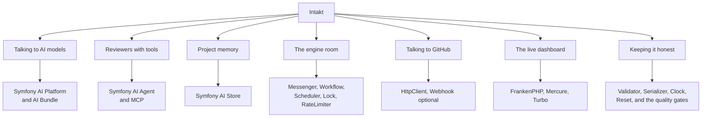
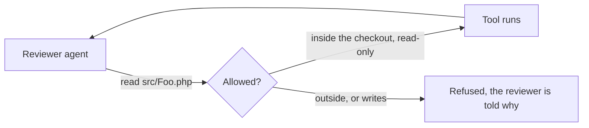
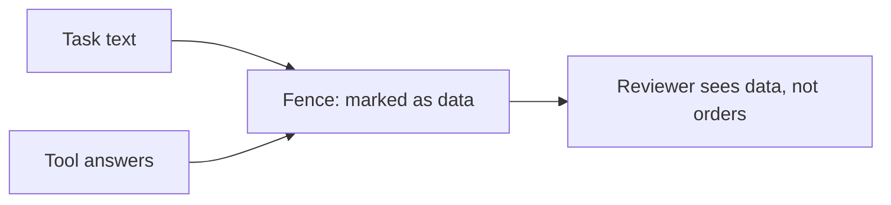
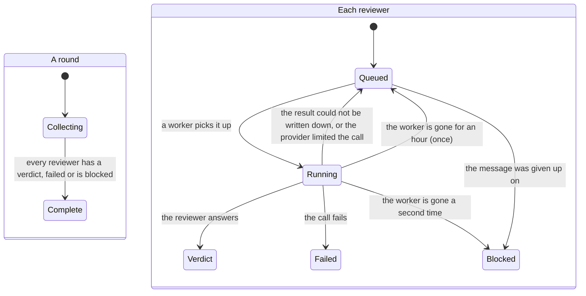
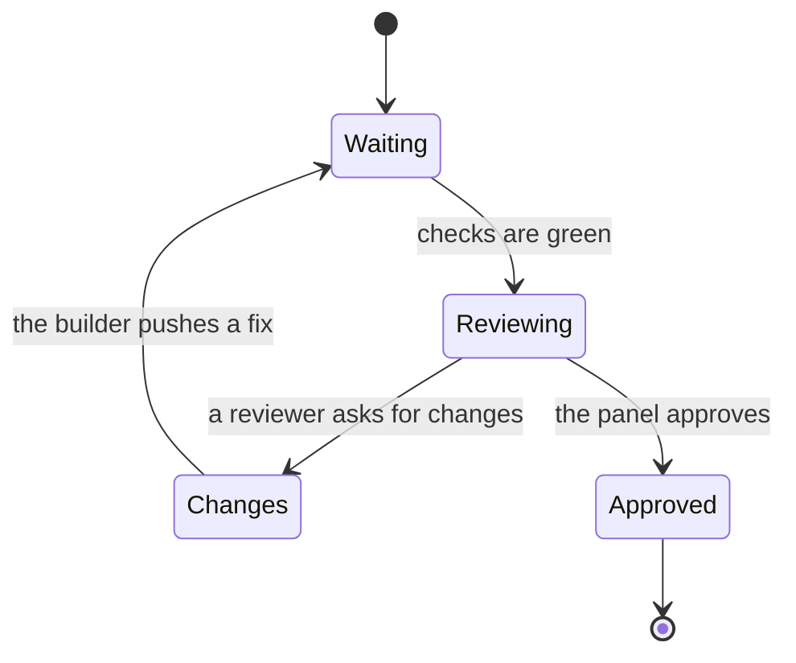

# How Intakt uses Symfony, in plain words

This page explains which parts of Symfony and Symfony AI Intakt is built from, and what each part does for it, without assuming you know Symfony. The exact list, with the status of every feature and where it lives in the code, is in [highlights](../highlights.md). Intakt is still being built: each section says what is **in use** already and what is **planned**.

## First, what are these?

- **Symfony** is a toolbox for building PHP applications. Instead of writing everything from scratch, you pick ready-made, well-tested parts (the "components"): one for running jobs in the background, one for timers, one for checking data, and so on.
- **Symfony AI** is a newer set of parts for working with AI models: talking to models from different companies through one interface, giving them tools, and giving them a memory. It is still in beta, which is why Intakt also uses it to find and report bugs (see the end of this page).
- **FrankenPHP** is the web server Intakt runs on. It keeps the application loaded between requests, which makes it fast, and it has live updates built in.

## Talking to AI models

**Symfony AI Platform** is like a universal power adapter: Intakt plugs into Anthropic, OpenAI or any OpenAI-compatible service through the same socket, so a reviewer can switch companies without its code changing.

What Intakt gets from it:
- **Several companies at once.** The two default reviewers come from different companies; one install talks to all of them. *(in progress)*
- **Answers as forms, not essays.** Instead of reading a model's free text and guessing, Intakt asks for a fixed shape ("verdict: approve or changes; a list of findings, each with a file and a line") and gets it back as a typed object, checked before it is used. *(in progress)*
- **A meter on every call.** Each answer reports the tokens it used, so Intakt knows what each review cost and how much of the week's allowance is left. *(in progress: every call's tokens are recorded already; using them for the week's budget is planned)*
- **Polite waiting.** When a company says "too many requests, try again in 40 seconds", Intakt gets that as a number, not a sentence to parse, and waits exactly that long. *(planned)*
- **A spare tire.** If one company's service is down, a call can fail over to another. *(planned)*
- **Tests without paying for AI.** Intakt's own tests use scripted answers (and real answers recorded once and replayed), so testing never calls a real model. *(in progress)*

**The AI Bundle** is the part that wires this into the application: which companies are configured, where their keys come from (a missing key simply switches that company off), and a table that maps Intakt's own words "strong", "standard" and "light" to each company's model names. *(in progress)*

## Reviewers with tools

**Symfony AI Agent** turns a model into an agent: a model that can use tools. Each reviewer role is an agent with read-only tools for the change it reviews (read a file, search the code, run a small test). *(in progress: reading files, listing folders and searching the code work; running a test is planned)*

- **Guardrails:** before any tool runs, Intakt checks the request. A reviewer that asks for a file outside the code under review is refused. *(in progress)*
- **Fencing:** text that comes from a task or from the code under review is marked as data before the reviewer sees it, so it cannot give the reviewer orders. The mark closes only at a closing marker that repeats its own boundary, so a fake closing marker inside a file stays data. *(in progress)*
- **A failing tool is not a crash:** the reviewer gets an error message and carries on. *(in progress)* Losing the whole toolbox is different: when the reviewer cannot reach its tools at all, or loses them partway through, the review stops and is marked `no-tools` instead of guessing without them. *(built)*
- **Too much text is cut, and then the reviewer cannot say yes:** a task, a change or a file answer longer than about 100 kilobytes is cut, with a note from Intakt saying how much was left out. A reviewer that then still says "approve" is overruled: the review is marked `blocked`, because nobody can show it read the part it was not shown. *(built)*
- **MCP** is a standard way for AI agents to reach tools. You can drive Intakt from your own AI assistant over MCP: list your projects, start a review of a branch, and read a review's status, verdicts and list of things to fix. Each tool is labeled with what it does ("only reads", "changes something"), and Symfony's Security component decides whether a tool may write: starting a review needs your own key and a setting that allows it, whatever the assistant asks. *(built)* The reviewers reach their own tools the same way during a review: each review gets a private MCP door that only shows the code under review, and only that review's reviewers hold its key. *(built)*

## Project memory

**Symfony AI Store** is a searchable notebook. When a review finding is fixed, Intakt files it there; when a later change touches the same files, the reviewers are reminded of what went wrong before. It keeps the notebook in a small SQLite file of its own (one per environment, such as `var/memory_dev.db` or `var/memory_test.db`, so tests never write into the notebook a running Intakt uses), next to Intakt's database, so nothing extra has to run. To make the notes searchable, the text of each fixed finding is sent to OpenAI, which turns it into numbers; without an OpenAI account nothing is filed. Each project's notes stay its own: a reviewer is only reminded of its own project's mistakes.

## The engine room

These Symfony components keep many jobs running in the right order, without anyone watching:

| Component | Everyday comparison | What it does in Intakt | Status |
|---|---|---|---|
| **Messenger** | a to-do tray | builds, reviews and checks are messages handled in the background; a failed one is retried later | partly built: the two trays (commands and questions) exist, and a review round puts one message per reviewer into a queue that workers empty in parallel; a message that finds its reviewer still with another worker comes back when that worker's hour is over, a rate-limited reviewer comes back after the provider's wait, and a message given up on marks its reviewer blocked |
| **Workflow** | a board game's rules | the steps of a review round and of each reviewer in it, and which moves are allowed, drawn as a diagram | partly built: a round (collecting, complete, judged) and each reviewer (queued, running, verdict, failed or blocked, and back to queued when its result could not be written down or the provider limited the call) are built; the steps of the whole review loop below are planned |
| **Scheduler** | an alarm clock | looks at each watched project's open pull requests every minute, checks usage, wakes up waiting tasks at their deadline, cleans up old branches weekly | partly built: every minute Intakt looks at the pull requests of each project that asks to be watched and starts one review for a new version once its checks are green (it looks again a minute later while the checks still run); reading pull requests from GitHub, checking usage, deadlines and the weekly cleanup are planned |
| **Lock** | a "one at a time" sign | stops too many calls to the same AI account at once | built: at most three calls run at once for one AI account, and a reviewer that finds no free place goes back to the queue and tries again shortly |
| **RateLimiter** | a speed limit | spaces calls out so an account stays within its company's limits | partly built: an AI account that hit its limit rests until the company's reset time, and its reviewers move to the next account of the same company meanwhile; spacing calls out before a limit is planned |
| **Console** | a remote control | commands such as running the bug reproductions or summarizing a change | in progress |
| **Uid** | a ticket number | every event gets a unique id that also says when it happened | in progress |
| **Process** | a helper that runs errands | runs git, test commands and the secret scan safely, with a time limit | in use |

The part that is built, a round and its reviewers (the technical drawing is `docs/architecture/review-round.dot`). A round is complete as soon as every reviewer has a verdict, has failed or is blocked, whichever reviewer is last; the state is stored in the database, so a restarted worker carries on:

The whole review loop as the Workflow component would draw it (planned):

## Talking to GitHub

- **HttpClient** makes the calls to GitHub (reading a pull request, posting a review), trying a read again when GitHub hiccups; a review is posted only once, so it never shows up twice.
- **Webhook and RemoteEvent** are an optional extra for installs that GitHub can reach from outside. They receive GitHub's notifications ("a check finished", "someone commented"), check that they really come from GitHub, and turn them into events Intakt reacts to a little sooner. Without them, Intakt simply asks GitHub often enough, and more often while something is waiting. *(planned, optional)*

## The live dashboard

- **FrankenPHP worker mode** keeps Intakt loaded in memory between requests, so pages answer fast. *(decided; planned in the image)*
- **Mercure**, built into FrankenPHP, pushes updates to your browser as they happen, and **Turbo** (part of Symfony UX) updates just the part of the page that changed: a review finishing shows up without a reload. *(in progress: Intakt already sends the updates to the hub as a review runs; the page does not listen to them yet, and the page that shows them without a reload is planned)*

Keeping the application loaded has one catch: anything a part remembers would leak into the next request. Symfony's **reset** mechanism clears that memory between requests, and Intakt has a check that refuses any part that remembers things without a way to be cleared. *(in progress)*

## Keeping it honest

- **Clock:** all time comes from one clock, so tests can freeze or fast-forward it; a check refuses code that reads the system time directly. *(in use)*
- **Validator and Serializer:** a reviewer's verdict is checked field by field; an unknown field or a missing one is refused rather than guessed. *(in progress)*
- **Quality gates:** `bin/check` runs every check (static analysis, code style, tests and Intakt's own rules) the same way on your machine and in CI. *(in use)*

## Finding bugs in the beta

Symfony AI is new, and Intakt uses it hard on purpose. When something looks like a bug in Symfony AI itself (or in Symfony or Doctrine), Intakt writes the smallest possible test that shows it, keeps it under `upstream/`, and, with the owner's OK, reports it to that project. The report text waits in the same folder until the owner approves it. `intakt:upstream:run` re-runs all of them against the pinned versions, so it is obvious when a bug has been fixed upstream. Each report also notes whether the bug is still there in the next version being built upstream, whether someone already reported it there, and what to do next (file it, point to the existing report, or drop it). The current list is in the "Found in the beta" section of [highlights](../highlights.md).
