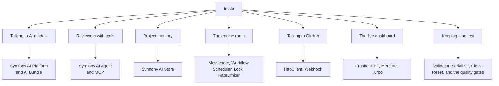
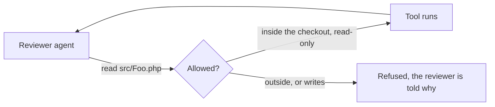
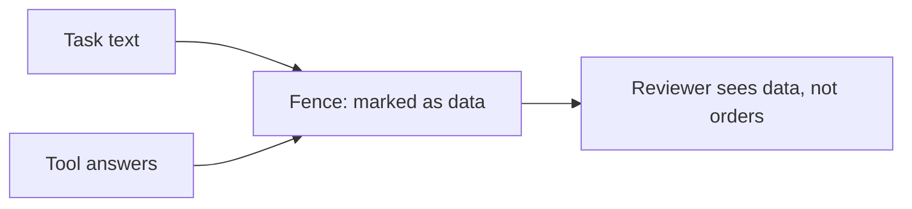
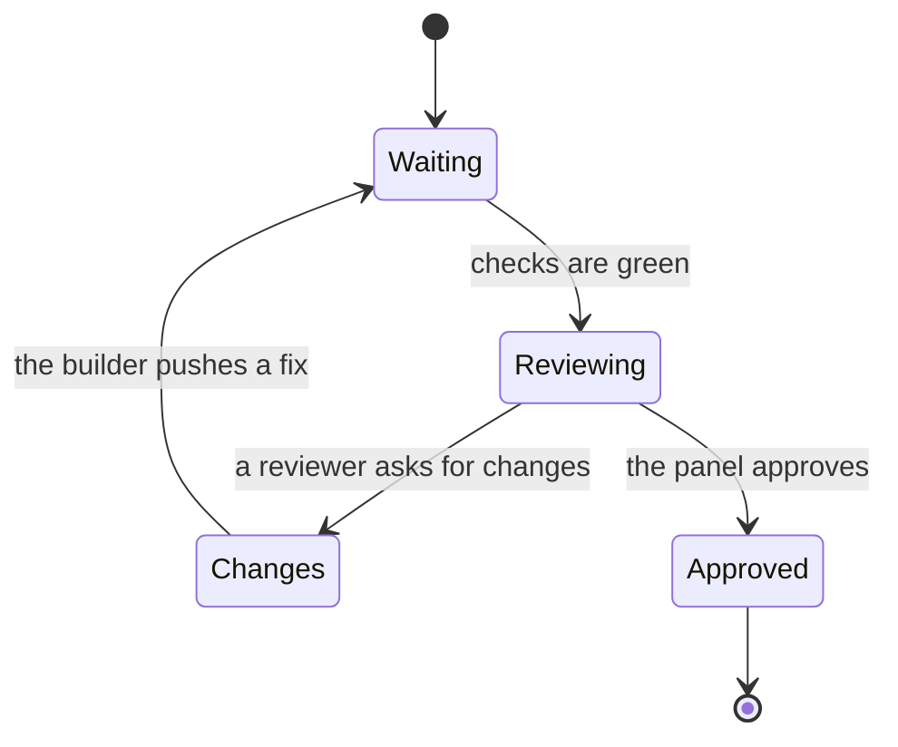

# How Intakt uses Symfony, in plain words

This page explains which parts of Symfony and Symfony AI Intakt is built from, and what each part does for it, without assuming you know Symfony. The exact list, with the status of every feature and where it lives in the code, is in [highlights](../highlights.md). Intakt is still being built: each section says what is **in use** already and what is **planned**.

## First, what are these?

- **Symfony** is a toolbox for building PHP applications. Instead of writing everything from scratch, you pick ready-made, well-tested parts (the "components"): one for running jobs in the background, one for timers, one for checking data, and so on.
- **Symfony AI** is a newer set of parts for working with AI models: talking to models from different companies through one interface, giving them tools, and giving them a memory. It is still in beta, which is why Intakt also uses it to find and report bugs (see the end of this page).
- **FrankenPHP** is the web server Intakt runs on. It keeps the application loaded between requests, which makes it fast, and it has live updates built in.

## Talking to AI models

**Symfony AI Platform** is like a universal power adapter: Intakt plugs into Anthropic, OpenAI or any OpenAI-compatible service through the same socket, so a reviewer can switch companies without its code changing.

What Intakt gets from it:
- **Several companies at once.** The two default reviewers come from different companies; one install talks to all of them. *(in progress)*
- **Answers as forms, not essays.** Instead of reading a model's free text and guessing, Intakt asks for a fixed shape ("verdict: approve or changes; a list of findings, each with a file and a line") and gets it back as a typed object, checked before it is used. *(in progress)*
- **A meter on every call.** Each answer reports the tokens it used, so Intakt knows what each review cost and how much of the week's allowance is left. *(in progress: every call's tokens are recorded already; using them for the week's budget is planned)*
- **Polite waiting.** When a company says "too many requests, try again in 40 seconds", Intakt gets that as a number, not a sentence to parse, and waits exactly that long. *(planned)*
- **A spare tire.** If one company's service is down, a call can fail over to another. *(planned)*
- **Tests without paying for AI.** Intakt's own tests use scripted answers (and real answers recorded once and replayed), so testing never calls a real model. *(in progress)*

**The AI Bundle** is the part that wires this into the application: which companies are configured, where their keys come from (a missing key simply switches that company off), and a table that maps Intakt's own words "strong", "standard" and "light" to each company's model names. *(in progress)*

## Reviewers with tools

**Symfony AI Agent** turns a model into an agent: a model that can use tools. Each reviewer role is an agent with read-only tools for the change it reviews (read a file, search the code, run a small test). *(in progress: reading files, listing folders and searching the code work; running a test is planned)*

- **Guardrails:** before any tool runs, Intakt checks the request. A reviewer that asks for a file outside the code under review is refused. *(in progress)*
- **Fencing:** text that comes from a task or from the code under review is marked as data before the reviewer sees it, so it cannot give the reviewer orders. The mark closes only at a closing marker that repeats its own boundary, so a fake closing marker inside a file stays data. *(in progress)*
- **A failing tool is not a crash:** the reviewer gets an error message and carries on. *(in progress)*
- **MCP** is a standard way for AI agents to reach tools. Intakt serves the review tools over MCP, each tool labeled with what it does ("only reads", "changes something"), and Symfony's Security component decides which tools may write. You can also drive Intakt itself from your own AI assistant over MCP: start a review, read a verdict. *(planned)*

## Project memory

**Symfony AI Store** is a searchable notebook. When a review finding is fixed, Intakt files it there; when a later change touches the same files, the reviewers are reminded of what went wrong before. It stores everything in the same small SQLite database as the rest of Intakt, so nothing extra has to run. *(planned)*

## The engine room

These Symfony components keep many jobs running in the right order, without anyone watching:

| Component | Everyday comparison | What it does in Intakt | Status |
|---|---|---|---|
| **Messenger** | a to-do tray | builds, reviews and checks are messages handled in the background; a failed one is retried later | planned |
| **Workflow** | a board game's rules | the steps of a review round (waiting, reviewing, changes, approved) and which moves are allowed, drawn as a diagram | planned |
| **Scheduler** | an alarm clock | checks usage, wakes up waiting tasks at their deadline, cleans up old branches weekly | planned |
| **Lock** | a "one at a time" sign | stops too many calls to the same AI account at once | planned |
| **RateLimiter** | a speed limit | spaces calls out so an account stays within its company's limits | planned |
| **Console** | a remote control | commands such as running the bug reproductions or summarizing a change | in progress |
| **Uid** | a ticket number | every event gets a unique id that also says when it happened | in progress |
| **Process** | a helper that runs errands | runs git and test commands safely, with a time limit | in use |

A review round as the Workflow component would draw it:

## Talking to GitHub

- **HttpClient** makes the calls to GitHub, retrying when GitHub hiccups. *(planned)*
- **Webhook and RemoteEvent** receive GitHub's notifications ("a check finished", "someone commented"), check that they really come from GitHub, and turn them into events Intakt reacts to at once, instead of asking GitHub every few minutes. *(planned)*

## The live dashboard

- **FrankenPHP worker mode** keeps Intakt loaded in memory between requests, so pages answer fast. *(decided; planned in the image)*
- **Mercure**, built into FrankenPHP, pushes updates to your browser as they happen, and **Turbo** (part of Symfony UX) updates just the part of the page that changed: a review finishing shows up without a reload. *(planned)*

Keeping the application loaded has one catch: anything a part remembers would leak into the next request. Symfony's **reset** mechanism clears that memory between requests, and Intakt has a check that refuses any part that remembers things without a way to be cleared. *(in progress)*

## Keeping it honest

- **Clock:** all time comes from one clock, so tests can freeze or fast-forward it; a check refuses code that reads the system time directly. *(in use)*
- **Validator and Serializer:** a reviewer's verdict is checked field by field; an unknown field or a missing one is refused rather than guessed. *(in progress)*
- **Quality gates:** `bin/check` runs every check (static analysis, code style, tests and Intakt's own rules) the same way on your machine and in CI. *(in use)*

## Finding bugs in the beta

Symfony AI is new, and Intakt uses it hard on purpose. When something looks like a bug in Symfony AI itself, Intakt writes the smallest possible test that shows it, keeps it under `upstream/`, and, with the owner's OK, reports it to the Symfony AI project. `intakt:upstream:run` re-runs all of them against the pinned versions, so it is obvious when a bug has been fixed upstream. The current list is in the "Found in the beta" section of [highlights](../highlights.md).
