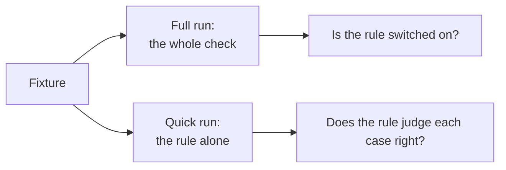

# Testing a new check, in plain words

Intakt's own checks (`bin/check`) include rules of its own for the static analysis (PHPStan): for example "no flag parameters" or "time only through the clock". This page explains how such a rule is tested, for anyone who adds one. The technical details are in the [architecture](../architecture/README.md#quality-gates).

## Two kinds of test for one rule

A rule is tested with small sample projects, called **fixtures**: a few files that break the rule, or that look close to breaking it but are fine. Each test copies one fixture into a scratch folder and asks what the rule says about it.

- **The full run.** Starting the whole check on a fixture takes a few seconds, because the analysis starts from scratch each time. So each rule has exactly two such tests: one fixture the check must reject and one it must accept. They prove that the rule is really switched on in the check, with its real settings.
- **The quick run.** All the other cases ask the rule alone, inside the test itself, without starting the check. That takes a fraction of a second, so a rule can have many cases (every trick someone might try) without making the tests slow.

Both kinds read the findings in the form the check prints them: the file, the line, the rule's name and its message. So a test that expects a message fails in both kinds when the rule says something else.

## Adding a rule

1. Write the rule and switch it on in the check's settings.
2. Add a test class for it next to the others, and say how the check builds the rule.
3. Add a fixture the rule must reject and one it must accept, and test them with the full run.
4. Add every other case as a fixture with the quick run.

The checks of the analysis itself (how strict it is, which extra rule sets it uses) have no single rule to ask, so their cases share one full run: each fixture sits in its own folder, and each test looks for its finding in its folder.
