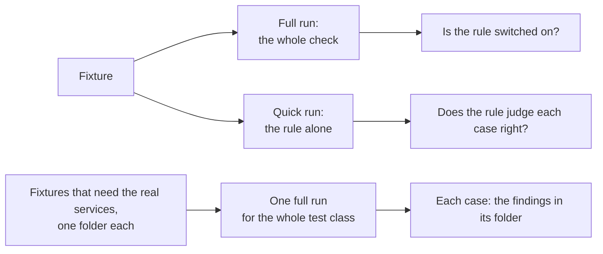

# Testing a new check, in plain words

Intakt's own checks (`bin/check`) include rules of its own for the static analysis (PHPStan): for example "no flag parameters" or "time only through the clock". This page explains how such a rule is tested, for anyone who adds one. The technical details are in the [architecture](../architecture/quality-gates.md).

## Two kinds of test for one rule

A rule is tested with small sample projects, called **fixtures**: a few files that break the rule, or that look close to breaking it but are fine. Each test copies one fixture into a scratch folder and asks what the rule says about it.

- **The full run.** Starting the whole check on a fixture takes a few seconds, because the analysis starts from scratch each time. Only the application's list of services, which takes seconds of its own to build, is built once and shared by the full runs of one test class. So each rule has two such tests: one fixture the check must reject and one it must accept (a rule that only rejects has just the first). They prove that the rule is really switched on in the check, with its real settings. A rule whose answer depends on the services the application really defines (the checks that a service name or parameter exists in the application) needs the full run for each such case, because the quick run does not know those services. Those rules put all such cases into one full run per test class: each fixture sits in its own folder of the same scratch project, the check runs once over all of them, and each case then looks only at the findings in its own folder. A case the rule must reject expects exactly its findings there; a case it must accept expects none there.
- **The quick run.** All the other cases ask the rule alone, inside the test itself, without starting the check. That takes a fraction of a second, so a rule can have many cases (every trick someone might try) without making the tests slow.

Both kinds read the findings in the form the check prints them: the file, the line, the rule's name and its message. So a test that expects a message fails in both kinds when the rule says something else.

## Adding a rule

1. Write the rule and switch it on in the check's settings.
2. Add a test class for it next to the others, and say how the check builds the rule.
3. Add a fixture the rule must reject and one it must accept, and test them with the full run. Cases that need the application's real services share one full run of the class, each fixture in its own folder.
4. Add every other case as a fixture with the quick run.

The checks of the analysis itself (how strict it is, which extra rule sets it uses) have no single rule to ask, so their cases share one full run: each fixture sits in its own folder, and each test looks for its finding in its folder.

## Switching a rule on before the code is clean

The `ratchet` check of `bin/check` enforces this part; the [design](../design/04-constraints.md#ratchet-lists-for-a-new-rule-decided-2026-11-06) has the details.

A new rule often finds places in the existing code that break it. When fixing them all takes more than one build, the rule does not wait for the cleanup: it is switched on at once, and today's violations go into a **ratchet list**, one file per rule, kept in the repository. The list is added once, in the same change that switches the rule on, and never later. A ratchet only turns one way, and so does the list: it can only get shorter.

- The check fails on any violation that is not on the list, so new code cannot add one.
- A change may delete entries or lower an entry's count. Adding an entry, raising a count or widening what an entry matches fails the check. A change that only shortens the list does not need the owner.
- An entry that no longer matches anything fails too, so whoever fixes a violation also deletes its entry.
- Moving or renaming a file that has a listed violation means fixing it: the old entry stops matching, and the moved violation counts as new.
- Every list names its cleanup task at the top, in a line such as `# Cleanup issue: #436`. That task has the rule's milestone and priority, so the cleanup is never put off. When a big rule task is split, the first part switches the rule on with its list, and the cleanup parts can be built at once. The rule's task closes when its list is empty and deleted.

A worked example is the rule that keeps provider hosts and model names out of code. When it was switched on, the places that still named a host went into `ratchet/provider-literals.neon`: one in `src/Core/Ai/Infrastructure/CodexTokenRefresh.php` (the token refresh of the Codex login), one in `src/Core/Build/UseCase/RunBuildJob/RunBuildJob.php` (the build job) and two in `src/Core/Review/Infrastructure/ReviewJob.php` (the review job). The first line of that file, `# Cleanup issue: #2328`, names the task that moves them. Each entry says which message, which file and how many times. Whoever moves one host deletes its entry in the same change; nobody can add an entry or raise a count, so the list only shrinks until it is empty and the file is deleted.

A rule whose cleanup fits in one build gets no list: the rule and all the fixes land together.

## The documentation check

The `docs` check measures the documentation: a paragraph may hold at most 80 words, a page for users or a guide page at most 1,500 words, and a long technical page must open with a short "In short" section that a reader can see. Its list, `ratchet/docs.json`, holds the paragraphs and pages that were already too long when the check arrived.

The list only shrinks, like the lists above. A listed paragraph is known by a short fingerprint of its text, so an edited or copied paragraph must meet the limit. When a paragraph or page gets short enough, its entry must go. Deleting or emptying the list fails the check. The [architecture](../architecture/quality-gates.md#the-docs-gate) has the details.
