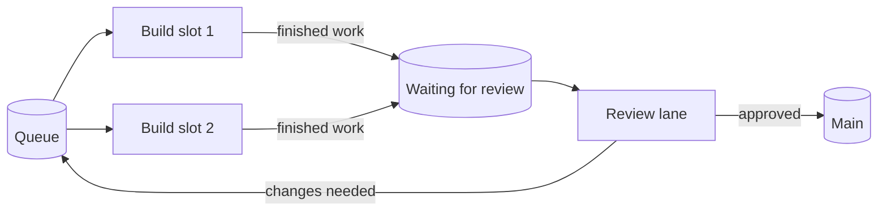
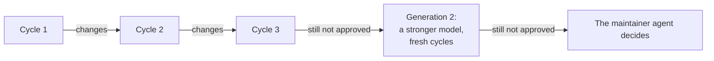
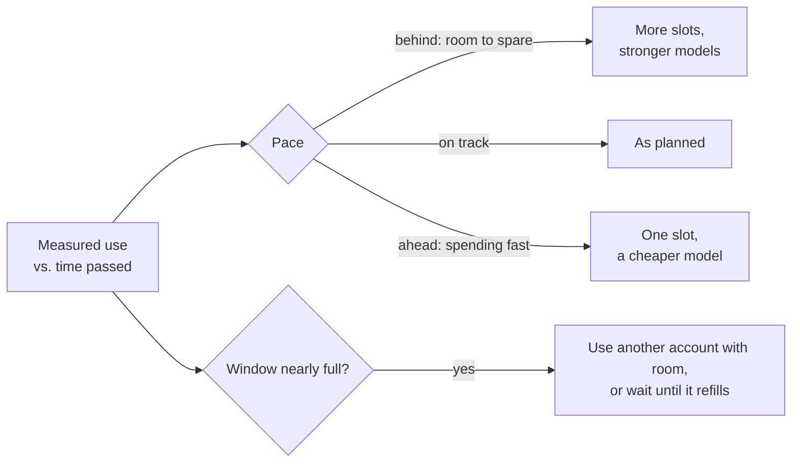
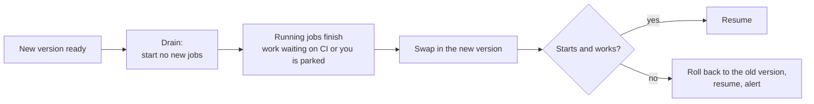

# The engine room: the words behind the loop

The dashboard and the logs use a handful of words for the loop's machinery: lanes, slots, ticks, queues, locks, cycles, generations, budgets, draining. This page explains each one in plain words, with a picture where it helps. For the step-by-step story see [the journey of a task](the-journey-of-a-task.md); for the full rules, the [design](../design/README.md). Intakt is still being built, so this describes the decided design.

## Lanes and slots: the workbenches

Think of a workshop with workbenches. Each bench does one job at a time.

- A **build slot** is a bench where a builder works on one task. A project can have one or more.
- The **review lane** is the bench where finished work is reviewed and merged.

The benches work **independently**: while one task is being reviewed, the next one is already being built. They hand work to each other, like an assembly line.

How many build slots run at the same time depends on the budget (below): when the week's allowance is tight, only one does.

## Queues: who is next

There are two queues: tasks **waiting to be built** and finished work **waiting to be reviewed**. Both are sorted the same way: priority first (`urgent`, `high`, `normal`, `low`), then milestone, then age. One exception in the build queue: a task whose pull request is already open (it needs a fix or an update) goes before any task not started yet, unless that task is `urgent`, so open work lands before new work begins. One exception in the review queue: a change that is approved, has green checks and needs nothing else is merged before any new review starts, whatever its priority, because waiting only creates more work.

**The review cap** stops the builders from running too far ahead: when a few pieces of finished work are already waiting for a reviewer, the builders pause. Work that waits too long goes stale (main moves on and it needs updating), so building more of it would only create waste. An `urgent` task may still start, one at a time. Work that is waiting for *you*, or on hold, doesn't count towards the cap, because no reviewer can move it.

## Ticks, events and deadlines: what makes things move

Some loops run on a **tick**: a clock that wakes every lane every few minutes ("anything to do?"). Intakt mostly doesn't need one. It reacts to **events** the moment they happen:

| Event | What follows |
|---|---|
| a builder finishes | its work is checked and pushed |
| GitHub reports CI is green | the review starts |
| a reviewer finishes | the verdicts are judged; merge or back to the builder |
| you approve something | it moves on |

Everything that waits has a **deadline** that wakes it, for example "check again in 2 minutes whether CI started". A slow **heartbeat** runs as a safety net, in case GitHub forgets to send an event. When nothing needs doing, nothing runs.

## CI: the second opinion

**CI** (continuous integration) is GitHub running the project's checks on its own machines after every push. Intakt has already run the same checks before pushing, so CI is a second, independent opinion, and the reviewers only start once it is green.

Intakt's own checks run on GitHub's machines by default. Whoever maintains a copy of the Intakt repository can move them to a machine of their own by setting the repository variable `CI_RUNS_ON`, but only to a machine that is wiped back to a clean state before every job and cannot reach their home or office network: a change under review runs its own code there, and a machine that keeps anything between jobs would let it leave something behind for the next one. The machine also needs Docker and a few system settings; the [setup page](../user/self-hosted-ci.md) lists them. A paid runner service that hands out a fresh machine for every job works too; the same page says which two settings it needs. One job always stays on GitHub's machines: the one that files the urgent task when the nightly journeys fail, because it needs GitHub's own command-line tool.

If CI never starts (GitHub occasionally misses an update), Intakt notices after a few minutes, nudges GitHub once, and alerts the maintainer agent if that didn't help. A wait for CI never blocks a bench: the work is parked and the bench takes the next job.

## Locks: one at a time

A **lock** is a "one at a time" sign on something that must not be used by two jobs at once:
- the review lane, so two reviews don't merge into main at the same moment;
- an AI account, so too many calls don't hit the same company at once (a *semaphore*: a lock that lets a set number through);
- the moment of an update, so no job starts while Intakt is being replaced.

Locks are short-lived: a job that waits for something outside (CI, you) gives its lock back and comes back later.

## Reviewers, substitutes and catch-ups

- The **review panel** is the set of reviewers for a change: a fixed core panel plus specialists the change calls for ([which reviewers](how-intakt-works.md#which-reviewers-look-at-a-change)).
- When a reviewer's account is over its limit, the same company's next account takes over, if you added one. That is just a move to another account: the same reviewer, no catch-up owed.
- A **substitute** steps in only when every account of that company is out: another company's reviewer, one you named as a substitute in your settings, reviews in its place, so work doesn't stall. Without a named substitute the reviewer waits instead. A review never changes company halfway: if a limit or a temporary error cuts it off before the reviewer starts answering, it starts again from the beginning, on its own company if that has room again, else on the substitute. If the cut comes while the answer is being written, the review ends blocked with the reason on it, because a half-written answer cannot be picked up again.
- A **stand-in** is something else: a cheaper reviewer on an in-between version while a company's allowance is tight. The usual reviewer still reviews the final version, so a stand-in never has the last word.
- A **catch-up review** is the missing reviewer's review, done later once its company is available again. Today Intakt only notes that a catch-up is owed, each time a substitute reviews. Planned: Intakt runs it by itself and checks the change as it was merged. It will never block a merge; if it finds a real problem, that becomes a new task, which waits for you to label it before the builders pick it up; smaller suggestions go to the [follow-up inbox](the-journey-of-a-task.md#7-afterwards) like any review's.

## Cycles and generations: second chances

A **cycle** is one round of *build, check, review*. When reviewers ask for changes, the task goes around again.

- A task gets a **limited number of cycles**, so a change that keeps failing doesn't burn the budget forever.
- A **generation** is a set of cycles with one kind of builder. Generation 1 uses the normal model; if it runs out of cycles, **generation 2** starts with a stronger model.
- If that doesn't work either, the **maintainer agent** decides: split the task, rewrite it, or ask you.

A cycle that changes nothing (the builder couldn't fix the problem because it needs something outside the task) doesn't loop: the task goes **on hold** instead ([holds](how-intakt-works.md#when-something-gets-stuck)).

## Budgets, windows and pace

AI subscriptions come with allowances that refill over time, usually a **five-hour window** and a **weekly window**. Intakt reads how much of each is used, as the AI company measures it, and compares that with how much of the week has passed. Today Intakt can keep the latest reading of each window per account and decide from it whether one more job may start on that account: not at a window's ceiling (90% unless you set another), with the five-hour ceiling lowered while the week is used faster than its pace, and a second job at once only on a reading of the last few minutes with room to spare. The same decision also knows an account's **cooldown** (after the AI company said its limit is reached, that account waits until the reset the company named; other accounts carry on) and holds that stop every account: a budget back-off and a pause still let approved work merge, while a failure back-off and a drain stop merges too. Intakt starts a failure back-off by itself, for 15 minutes, only when something no single pull request causes goes wrong: GitHub refuses Intakt's credentials, the disk is full, the lock store fails while a pull request is being locked or unlocked, two different pull requests fail with the same error within an hour, or a hand-over cannot be recorded; one pull request that keeps failing only waits itself. When an account sends no reading for three hours, Intakt warns you once in its log. `intakt:budget:replay` shows these decisions over a made-up day without changing anything ([user guide](../user/README.md#cooldowns-pauses-and-outage-notices)). Reading the windows from the AI companies, asking that decision before each job, the controls that set a pause or a back-off, and the slots and models of the pace below are planned.

- **Shares:** with several projects, each gets a share of the week, for example 70% and 30%. A project with nothing to do lends its share to the others. A share of 0 pauses the project: a running job finishes, then no builds and no reviews, open pull requests included. Its work resumes when the share is above 0.
- **Ceilings:** near the top of a window, no new job starts on that account. Another account with room takes the work first (a build may move to any company's account; a review stays with its own company), and jobs wait for a refill only when no account has room. A job already running is never stopped just because the window is nearly full or its estimate was too low. It is stopped when it makes no progress for a set number of steps, when it reaches its own ceiling (a few times its allowance), or when the task reaches its total across attempts, and it keeps its commits. On an account that bills overage, a missing usage reading or a call running past the ceiling stops work instead of being let through, and your spending cap applies ([costs](accounts-and-costs.md)).
- **Back-off:** after a failure (an AI company error, a broken environment), a bench waits a little before trying again (a minute for a quick internal hiccup, longer for real failures) instead of hammering. Four failures in a row stop it and call the maintainer agent. When one pull request fails (its checks cannot be read, or its review cannot start), only that pull request waits, a minute and then twice as long each time but never more than half an hour, while the others go on; four failures in a row send it to the maintainer agent (planned), and it is still tried at those waits, so it moves on by itself once the problem is gone. The Reviews page shows a card with the reason. A failing reviewer is set aside alone in the same way, so one broken item never stops the rest.

## Draining and updates

**Draining** is how Intakt updates itself without breaking work in progress:

While a drain is on, the dashboard says "draining" and nothing new starts; it usually takes minutes. Work that is only waiting (for CI, for you, on hold) doesn't hold the drain up.

## Holds, hand-overs and caps

| Word | Meaning |
|---|---|
| **Hold** | a pause with a reason, which lifts by itself when the reason is gone |
| **Hand-over** | the task goes to the maintainer agent, which decides what happens next |
| **Owner cap** | at most a few things wait for you at once, so you're never flooded; more work of that kind waits its turn |
| **Review cap** | at most a few pieces of finished work wait for a reviewer before the builders pause |
| **Parked** | a job that is waiting for something outside (CI, you) and has given its bench back |
