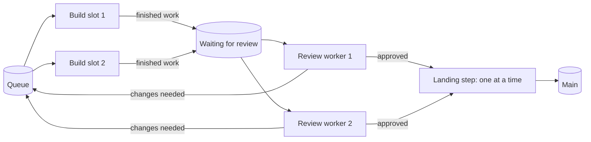
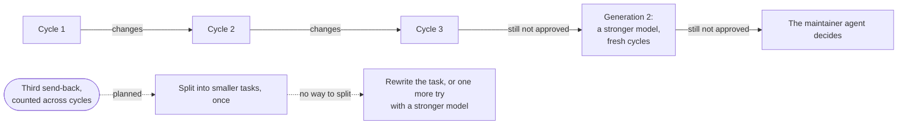
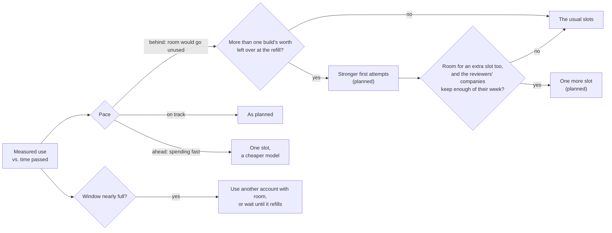
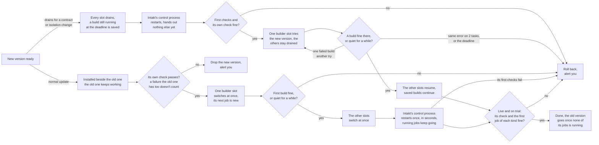

# The engine room: the words behind the loop

The dashboard and the logs use a handful of words for the loop's machinery: lanes, slots, time limits, ticks, queues, locks, cycles, generations, budgets, draining. This page explains each one in plain words, with a picture where it helps. For the step-by-step story see [the journey of a task](the-journey-of-a-task.md); for the full rules, the [design](../design/README.md). Intakt is still being built, so this describes the decided design.

## Lanes and slots: the workbenches

Think of a workshop with workbenches. Each bench does one job at a time.

- A **build slot** is a bench where a builder works on one task. A project can have one or more.
- The **review lane** is where finished work is reviewed, then handed to the landing step. It has as many **review workers** as your settings allow, so reviews keep up with the builders: each worker reviews a different piece of work, and two workers never review the same one.
- The **landing step** merges approved work into main, one piece at a time for the whole install, whichever worker approved it.

The benches work **independently**: while one task is being reviewed, the next one is already being built. They hand work to each other, like an assembly line.

How many build slots run at the same time depends on the budget (below): when the week's allowance is tight, only one does.

Builders on one machine share its processors. What keeps them apart today is each build job's own limit: 2 processors and 4 GiB of memory, from which the builder's check sizes itself (one gate at a time, the tests gate included). Intakt also works out a ceiling for the checks a builder runs at a time when more slots share the machine: the machine's processors divided by the number of slots, rounded down to a whole number (11 processors and 3 slots give 3), at least 2 and at most 8. A build job passes this number on to its builder's check only when there is more than one slot and the number is lower than what the check would pick by itself from the job's limits; it never raises that pick, because the job's memory would not hold more. With today's job limits the ceiling (2 or more) is never lower than the check's own pick (1), so the number of slots does not change a build job's check yet. For now you set the number of slots yourself (`intakt.build.slots`, 1 by default; see the [user guide](../reference/user-manual.md#running-a-build)). Each builder also has a time limit for one command, next to the time limit of its whole session ([below](#time-limits-one-command-and-the-whole-session)).

## Time limits: one command and the whole session

A builder works under two clocks:

- **One command** (a check, for example) gets up to 25 minutes (`intakt.build.tool_time_limit_seconds`, 1500 seconds by default), set by Intakt when it starts the builder. That way a check as slow as the slowest measured on a busy machine (7 to 9 minutes) still finishes inside the command that started it, instead of going to the background while the builder waits. A command that runs longer than the limit may keep running in the background after the call returns, but the session goes on. Every command gets its own 25 minutes.
- **The whole session** gets 50 minutes. Then a watchdog stops the builder, whatever command is running; what it committed until then is kept. The limit for one command is always shorter than this, because a command can never outlive its session.

```mermaid
gantt
  title One build session
  dateFormat HH:mm
  axisFormat %M min
  section The session
  The whole session, 50 minutes, then the watchdog stops it : 00:00, 50m
  section Its commands
  One command, at most 25 minutes : 00:05, 25m
  The next command, its own 25 minutes, cut at the session's end : 00:32, 18m
```

## Queues: who is next

There are two queues: tasks **waiting to be built** and finished work **waiting to be reviewed**. They are sorted differently. *(Planned:)* Intakt does not yet take tasks from the queue on its own: that arrives with the work-intake task, and the intake rules written so far, which nothing runs yet, still put priority before the milestone. The designed build queue goes milestone by milestone: `urgent` tasks come first, then the tasks of the milestone due soonest (tasks with no milestone, or a milestone without a due date, come last, unless an earlier milestone waits on them: then they are built with the earliest milestone that needs them), and only within one milestone does priority decide (`high`, then `normal`, then `low`; a task with no priority counts as `normal`), then the oldest task. Milestones due on the same day, or with no due date, count as one stage: priority decides between their tasks. So a later milestone only gets build time when every ready task of the earlier one is taken or blocked. One exception in the build queue: a task whose pull request is already open (it needs a fix or an update) goes before any task not started yet, even an `urgent` one, so open work lands before new work begins; an approved one goes first of all. *(Planned:)* A task or open pull request that has waited counts one priority step higher every few days (5 by default, per project), never up to `urgent` and never into another milestone; [the journey of a task](the-journey-of-a-task.md) explains it. A task held back because its files are in use never lets a later milestone go ahead (see [the journey of a task](the-journey-of-a-task.md)). Today the review queue goes priority first (`urgent`, `high`, `normal`, `low`), then age. *(Planned:)* Pull requests waiting for review move up the same way, one priority step every few days, never up to `urgent`. One exception in the review queue: a change that is approved, has green checks and needs nothing else is merged before any new review starts, whatever its priority, because waiting only creates more work.

Planned: within one priority and milestone, a task that more other tasks wait on, counted down the whole chain, goes before an older one; among finished changes waiting for review, the same holds within one priority (the review queue does not look at milestones). For builds it never moves a task ahead of a higher priority or an earlier milestone; for reviews it never moves one ahead of a higher priority. A follow-up made from a reviewer's nice-to-have note joins the next milestone instead of its original's, unless it fixes something that blocked the original or no later milestone is open. That is the default: you can put it on the list of settings the maintainer agent may try out within limits you set ([a weekly look at speed and quality](how-intakt-works.md#a-weekly-look-at-speed-and-quality-planned)).

**The review cap** (planned: the rule is written, but the build lane does not use it yet) stops the builders from running too far ahead: when a few pieces of finished work are already waiting for a reviewer, the builders pause. Work that waits too long goes stale (main moves on and it needs updating), so building more of it would only create waste. An `urgent` task may still start, one at a time. Only work that is waiting for a reviewer, or being read by one, counts. Work that is waiting for its checks (CI), for a machine to run them, or to be merged doesn't count towards the cap, and neither does work waiting for *you* or on hold, because no reviewer can move it: otherwise the builders would pause while the reviewers have nothing to read.

**The in-flight limit** (planned: the rule is written, but the build lane does not use it yet) is a second, higher bound beside the review cap. It counts every piece of finished work that is pushed but not merged yet, whatever it waits for: a reviewer, a review in progress, its checks, a machine to run them, or the merge. When that count reaches the limit, the builders pause too, even if the review cap is not full. Two exceptions are planned: one urgent build may start when the review cap is full (but not when this limit is full), and a rework of work already pushed is never held by this limit, because it replaces work that is already counted. By default the limit is twice the review cap. The two limits do different jobs: the review cap keeps builders from outrunning the reviewers, and the in-flight limit keeps the pile of unmerged work small, because every piece of it may clash with the others when they are merged, and each one needs its checks run.

## Ticks, events and deadlines: what makes things move

Some loops run on a **tick**: a clock that wakes every lane every few minutes ("anything to do?"). Intakt mostly doesn't need one. It reacts to **events** the moment they happen:

| Event | What follows |
|---|---|
| a builder finishes | its work is checked and pushed |
| GitHub reports CI is green | the review starts |
| a reviewer finishes | the verdicts are judged; merge or back to the builder |
| you approve something | it moves on |

Everything that waits has a **deadline** that wakes it, for example "check again in 2 minutes whether CI started". A slow **heartbeat** runs as a safety net, in case GitHub forgets to send an event. When nothing needs doing, nothing runs.

*(Planned:)* GitHub does not tell Intakt when CI finishes or you approve something unless webhooks are set up, so Intakt has to look. While a bench waits for GitHub (CI, an approval, a new version of a bot's pull request), it will look again within seconds: after 30 seconds, then 1, 2 and 4 minutes, then at its usual pace. When its usual pace is already quicker than the next early look, the usual look takes over sooner. A look that finds GitHub still busy moves on to the next, longer wait, counted from that look, and the bench's usual look leaves alone whatever is not due yet, so the two never add up. A look that falls between two usual looks happens at its own time, not at the next usual look. If the bench is busy with something else when a look is due, the look happens as soon as the bench is free. Anything the bench actually does starts the count again, but never pushes a look later: a look that is already due still happens as soon as the bench is free. Each bench has at most one such early look waiting, and it never runs at the same time as the bench's usual look. When the hour's GitHub allowance runs low, the early looks stop until it refills. You can turn them off in your settings; they are on unless you do. The dashboard says when a bench looks next and what for, for example "next check in 60s, waiting for CI".

## CI: the second opinion

**CI** (continuous integration) is the project's full check run again on the pushed version, on a machine the builder does not control. For Intakt's own repository it runs on every pull request from the same repository and on every push to main, except a push whose commit already passed as a pull request into main with exactly the same files. Such a push still shows a green run in which only the `main` job ran. Today that is GitHub running the project's checks on its own machines.

Before pushing, Intakt runs the project's check itself (`bin/check --fast` for a PHP project, the quick version). CI repeats that check in full after the push and can add jobs of its own. For Intakt's own repository it also runs:
- the journeys, which walk through a first install and the live review page;
- the database tests on MySQL, MariaDB and PostgreSQL (the check before the push uses SQLite only), when a pull request touches the database layer, its migrations, the dependencies, the persistence tests or their setup, or the CI files;
- building the app image, with a smoke test and a check that it starts on an empty volume, unless a pull request changes only files under `docs/`, `tests/` or `upstream/`;
- an upgrade check, when a pull request touches migrations, mapped database classes, the `Dockerfile`, the `docker/` folder or the locked dependencies: the image starts on a copy of the data of the version the change starts from, and then that older version starts again on its untouched original data.

On main, the database tests, the image build with its smoke test and first-start check, and the upgrade check run on every push, except a push whose version already passed CI as a pull request into main with exactly the same files: that push skips the full run, because it was already checked. The database tests and the slow gate tests that a pull request's own filters left out then run on the next full run on main: a nightly one is planned (#2126); until it exists, the next direct push or release. The upgrade check of that later run starts from the version just before it, which already holds the skipped change, so the upgrade across that change is not checked on main. So CI is a second, independent opinion that can also catch what the check before the push never looks at, and the reviewers only start once it is green.

*(Planned; this is the decided design:)* CI is the project's full check, tests included, run on the pushed version after every push: by default a fresh container that Intakt starts itself, or the forge's CI (GitHub's machines) where the project sets it, or both. That run is the builder's check. It is a second, independent opinion, and the reviewers only start once it is green. While it runs, the build slot is already free for the next task. For Intakt's own repository it is GitHub's CI, and the checks before the push are only the quick ones that do not run the change's code. Another project runs before the push whatever pre-push command it configures, and its whole check when it configures none.

Intakt's own checks run on GitHub's machines by default. Whoever maintains a copy of the Intakt repository can move them to a machine of their own by setting the repository variable `CI_RUNS_ON`, but only to a machine that is wiped back to a clean state before every job and cannot reach their home or office network: a change under review runs its own code there, and a machine that keeps anything between jobs would let it leave something behind for the next one. The machine also needs Docker and a few system settings; the [setup page](../reference/self-hosted-ci.md) lists them. A paid runner service that hands out a fresh machine for every job works too; the same page says which two settings it needs. A few jobs always stay on GitHub's machines: the one that files the urgent task when the nightly journeys fail, the one that labels a pull request by its title and the one that points `latest` at the newest release, because they need GitHub's own command-line tool, and the one that builds the highlights page, because it downloads from Docker Hub without logging in.

`CI_RUNS_ON` also leaves alone the job that builds and starts the demo on an ARM machine after every merge: it stays on GitHub's ARM machine unless the separate variable `CI_ARM_RUNS_ON` names another one.

If CI never starts (GitHub occasionally misses an update), Intakt notices after a few minutes, nudges GitHub once, and alerts the maintainer agent if that didn't help. *(Planned:)* first it looks at the pull request once: if the change clashes with the newest main, it goes back to a builder to join the two (or to the maintainer agent when the task has no build tries left), except a clash only in the project's shared lists (such as the lock file), which Intakt tries to join itself and checks before it sends the result. If it cannot join them safely, or the joined result fails its checks, nothing is sent and the change takes the same way back to a builder (or to the maintainer agent). A dependency bot's change that clashes is never joined or sent to a builder: it waits for the bot's next version. A wait for CI never blocks a bench: the work is parked and the bench takes the next job.

## Locks: one at a time

A **lock** is a "one at a time" sign on something that must not be used by two jobs at once:
- the landing step, so two approved changes never merge into main at the same moment, even while several reviews run side by side;
- an AI account, so too many calls don't hit the same company at once (a *semaphore*: a lock that lets a set number through);
- the moment of an update, so no job starts while Intakt is being replaced.

Locks are short-lived: a job that waits for something outside (CI, you) gives its lock back and comes back later.

## Reviewers, substitutes and catch-ups

- The **review panel** is the set of reviewers for a change: a fixed core panel plus specialists the change calls for ([which reviewers](how-intakt-works.md#which-reviewers-look-at-a-change)).
- When a reviewer's account is over its limit, the same company's next account takes over, if you added one. That is just a move to another account: the same reviewer, no catch-up owed.
- A **substitute** steps in only when no account of that company can serve the reviewer's model right now. Each account can be out for its own reason: it is over its own limit, or the router provider the model names is paused on that account. When every account is out, for whichever reason, another company's reviewer, one you named as a substitute in your settings, reviews in its place, so work doesn't stall: the first one that can answer takes over, and when none of them can, the review ends blocked. Without a named substitute the reviewer waits instead. A review never changes company halfway: if a limit or a temporary error cuts it off before the reviewer starts answering, it starts again from the beginning, on its own company if that has room again, else on the substitute. If a limit or a temporary error cuts it off while the answer is being written, the review ends blocked with the reason on it, because a half-written answer cannot be picked up again. If the answer breaks off on its own, the same reviewer is asked once more from the beginning, without streaming the answer; if that answer is cut too, the review ends blocked as well. Two more cases get one more try: a reviewer whose AI company cannot be reached at all is asked once more, and fails if it still cannot be reached; and a reviewer that asks for changes, or says it is blocked, without naming a single problem gets one more chance to name them or approve, with an example of how to write one, and fails if it names none again.
- A **stand-in** is something else: a cheaper reviewer on an in-between version while a company's allowance is tight. The usual reviewer still reviews the final version, so a stand-in never has the last word.
- A **catch-up review** is the missing reviewer's review, done later once its company is available again. Today Intakt only notes that a catch-up is owed, each time a substitute reviews. Planned: Intakt runs it by itself and checks the change as it was merged. It will never block a merge; if it finds a real problem, that becomes a new task, which waits for you to label it before the builders pick it up; smaller suggestions go to the [follow-up inbox](the-journey-of-a-task.md#7-afterwards) like any review's.

## Router providers and their pause

Some AI companies are routers: Hugging Face, for example, passes each call on to another company that runs the model. You can name that company, the **router provider**, after a colon in the model's name, such as `moonshotai/Kimi-K3.1-Pro:deepinfra`, and every call for that model then goes to it.

When the router provider says "too many calls" (a rate limit), Intakt pauses it on that account: for as long as the answer asked, for one minute when it gave no time, and never longer than a day. While the pause lasts, Intakt sends that router provider no call from that account, from any worker on this computer. The account pauses as well, as for any rate limit.

What happens to the call then:
- When another account of the same company is free, the call goes there at once.
- When no account is free and you named substitutes, the first substitute that can answer reviews in its place. When none of them can answer either, the review ends blocked, with the reason on it.
- Without a named substitute, the reviewer waits until an account can take the call again, which is never before the router provider's pause on it ends.

Moving on to another router provider instead of waiting is planned.

## Cycles and generations: second chances

A **cycle** is one round of *build, check, review*. When the reviewers leave something that must be fixed, the task goes around again.

Running builds on their own is planned ([what works today](../reference/user-manual.md)), so this whole flow is planned too. In it, the task moves on to generation 2 after its last cycle. The dotted arrows are a later addition to that plan: at the third send-back, whichever cycle that falls in, the task is split once instead, as the last bullet below says.

- A task gets a **limited number of cycles**, so a change that keeps failing doesn't burn the budget forever.
- A **generation** is a set of cycles with one kind of builder. Generation 1 uses the normal model; if it runs out of cycles, **generation 2** starts with a stronger model.
- If that doesn't work either, the **maintainer agent** decides: split the task, rewrite it, or ask you.
- *(Planned:)* the third time a task is sent back (by reviewers asking for changes, or by failing checks; within one cycle the first two failing-check returns in a row do not count, the third counts as one, and bringing in the newest project is never a send-back), it gets no further rebuild: the maintainer agent splits it into smaller tasks, once. If its open problems give no way to split it, the maintainer agent rewrites what the task must do or gives it one more try with a stronger model. A task that was already split this way is never split by this rule again.

A cycle that changes nothing (the builder couldn't fix the problem because it needs something outside the task) doesn't loop: the task goes **on hold** instead, unless what it needs is the newest project: then it is rebuilt once with it, or goes straight to the Maintainer if it has no try left or the rebuild leaves it stuck ([holds](how-intakt-works.md#when-something-gets-stuck)).

## Budgets, windows and pace

AI subscriptions come with allowances that refill over time, usually a **five-hour window** and a **weekly window**. Intakt reads how much of each is used, as the AI company measures it, and compares that with how much of the week has passed. Today Intakt can keep the latest reading of each window per account and decide from it whether one more job may start on that account: not at a window's ceiling (90% unless you set another), with the five-hour ceiling lowered while the week is used faster than its pace, and a second job at once only on a reading of the last few minutes with room to spare. The same decision also knows an account's **cooldown** (after the AI company said its limit is reached, that account waits until the reset the company named; other accounts carry on) and holds that stop every account: a budget back-off and a pause still let approved work merge, while a failure back-off and a drain stop merges too. Intakt starts a failure back-off by itself, for 15 minutes, only when something no single pull request causes goes wrong: GitHub refuses Intakt's credentials, the disk is full, the lock store fails while a pull request is being locked or unlocked, two different pull requests fail with the same error within an hour, or a hand-over cannot be recorded; one pull request that keeps failing only waits itself. When an account sends no reading for three hours, Intakt warns you once in its log. `intakt:budget:replay` shows these decisions over a made-up day without changing anything ([user guide](../reference/user-manual.md#cooldowns-pauses-and-outage-notices)). Reading the windows from the AI companies, asking that decision before each job, the controls that set a pause or a back-off, and the slots and models of the pace below are planned.

Three rules in one sentence each (the first two planned): an extra builder starts only while your accounts together would still have more than one build's worth of the week left over when they refill, and no other AI company that reviews the work is about to use up its own week; while there is such room left over, a task's first attempt gets a stronger model, unless its label asks for a tier, except for a few tasks picked at random that start on a cheaper model instead to show what the stronger one gains, and when the room is short the extra builder gives way first; and a window is recognized by how long it lasts and when it resets, never by the name the company gives it.

- **Shares:** with several projects, each gets a share of the week, for example 70% and 30%. A project with nothing to do lends its share to the others. A share of 0 pauses the project: a running job finishes, then no builds and no reviews, open pull requests included. Its work resumes when the share is above 0.
- **Ceilings:** near the top of a window, no new job starts on that account. Another account with room takes the work first (a build may move to any company's account; a review stays with its own company), and jobs wait for a refill only when no account has room. A job already running is never stopped just because the window is nearly full or its estimate was too low. It is stopped when it makes no progress for a set number of steps, when it reaches its own ceiling (a few times its allowance), or when the task reaches its total across attempts, and it keeps its commits. On an account that bills overage, a missing usage reading or a call running past the ceiling stops work instead of being let through, and your spending cap applies if you set one ([costs](accounts-and-costs.md)).
- **Back-off:** after a failure (an AI company error, a broken environment), a bench waits a little before trying again (a minute for a quick internal hiccup, longer for real failures) instead of hammering. Four failures in a row stop it and call the maintainer agent. When one pull request fails (its checks cannot be read, or its review cannot start), only that pull request waits, a minute and then twice as long each time but never more than half an hour, while the others go on; four failures in a row send it to the maintainer agent (planned), and it is still tried at those waits, so it moves on by itself once the problem is gone. The Reviews page shows a card with the reason. A failing reviewer is set aside alone in the same way, so one broken item never stops the rest.

## Draining and updates

Intakt updates itself without stopping your work (planned; this is the decided design). A normal update has no draining at all: no slot waits for its job to finish, and new work stops only for the one short restart of Intakt's control process. **Draining** (a part of Intakt starts no new jobs and lets the running ones finish) happens only when a new version says it needs it.

- **Beside the old one:** the new version is checked while the old one keeps building and reviewing. Intakt compares the two checks test by test: if a test fails the same way on the old version too (the same test, stopping at the same line with the same failure message), that is a problem of your project, not of the update, so you hear about it and the update goes on. A test that fails only on the new version, or fails there at a different line or with a different message, stops the update.
- **A job keeps its version:** in a normal update, a job always finishes on the version it started on; the update never stops or restarts it. Only three things stop a running job: a failed update (it stops the jobs on the failed version, see below), a security release, and the deadline of a drain that a version declared (see "Draining only when a version says so"). So a slot switches at once, without waiting: the job it is running carries on, and its next job takes the new version. The dashboard shows which running jobs are still on an older version until none are left.
- **One slot first:** one builder slot tries the new version. The others switch together once a build on it ended without trouble from Intakt itself, or after a set time with no failure. One failed build there only leads to another try, because it may be that task's own problem. Only failures of 2 tasks with the same error within an hour, when no build on the old version showed that error in that hour, or reaching the deadline before the others could follow, take Intakt back to the old version, and it tells you. Once the others are set to follow, the deadline no longer applies.
- **The old one stays in charge:** the old version alone hands out work and keeps the records until the one short restart; from then on the new version does, while it is still on trial, so nothing is ever picked up twice. The restart takes seconds (an old one that hangs is stopped after a short deadline, so new work never waits on it; a new one that does not take over in time, or takes over but whose first checks fail by their deadline, gives way to the old version again). Jobs and reviews keep running through it, and the new version picks up their results, each exactly once.
- **Live, then on trial:** the new version is *live* once it holds the one right to write the records (the owner generation) and its start checks passed (the code host and the AI companies answer). From then on it hands out all new work (a version that drained for a contract or isolation change first hands out only its own check and one slot's builds, until that slot has proved itself). It stays on trial until its own check after the update and the first job of each kind it started look right; only then is the old version removed, once none of its jobs is still running.
- **Results across versions:** each job records the version of Intakt's control process that started it and the version of the "contract" it uses to talk to Intakt (what it reads and what it hands back). Before the restart, the old control process also starts jobs on the new version (its check and the switched slots' builds); those record the old version, because that is what started them. The new version accepts a job's result only when both hold: the job was started by its own version or the one it was updated from, and the job's contract is its own or the one before it. A job started two or more updates back, on an older contract, or with a version Intakt cannot read, has its work done again on the new version, with the reason in the record.
- **Draining only when a version says so:** a version that changes how jobs talk to Intakt by more than one step, or how jobs are kept apart, says so. Its jobs cannot run under the old version, so every slot drains first: it starts nothing new while its job finishes, up to a deadline. A build still running then is saved (its commits kept); a review or check still running is stopped and run again later.
- **A drain version checks itself after the restart:** once no job of the old version runs, Intakt restarts, and the new version, handing out nothing else, runs its own check and then tries one slot while the other slots and reviews stay drained; they resume once a build on that slot ended without trouble from Intakt itself, or after a set time with no failure, and the saved builds continue. One failed build on that slot only leads to another try, as in "One slot first". If the restart's first checks or its own check fail, or that slot fails as "One slot first" says (2 tasks with the same error within an hour, or its deadline), Intakt goes back to the old version and the saved builds continue there from their commits.
- **Stored data the old version cannot read:** a version that changes stored data so the old version could not read it pauses all work, as one short drain of everything.
- **Update windows:** updates that are not urgent wait for the times of day you set in the settings, at most a few a day; at the next window Intakt installs the newest version published by then. An urgent release (a security fix, or a fix for something that stops work) and a version you pick yourself install right away.
- **If anything fails,** Intakt goes back to the old version, which stays installed until the update has proved itself, and tells you at once. Normally both versions can read the stored data, so going back loses nothing recorded since. Jobs on the old version are left alone; jobs on the failed version are stopped and done again. One case cannot go back: when an update that changes stored data fails after work has resumed, the old version can no longer read the data, so Intakt pauses all work, tells you, and a newer version fixes it.

While a slot drains, the dashboard says "draining" on that slot; it usually takes minutes. Work that is only waiting (for CI, for you, on hold) doesn't hold a drain up.

## Holds, hand-overs and caps

| Word | Meaning |
|---|---|
| **Hold** | a pause with a reason, which lifts by itself when the reason is gone |
| **Hand-over** | the task goes to the maintainer agent, which decides what happens next |
| **Owner cap** | at most a few things wait for you at once, so you're never flooded; more work of that kind waits its turn |
| **Review cap** (planned) | at most a few pieces of finished work wait for a reviewer (or are being reviewed) before the builders pause; work waiting for its checks or to be merged doesn't count |
| **In-flight limit** (planned) | at most a few more pieces of finished but unmerged work exist, whatever they wait for, before the builders pause; twice the review cap by default |
| **Parked** | a job that is waiting for something outside (CI, you) and has given its bench back |
