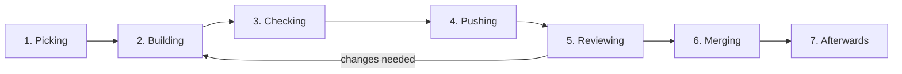
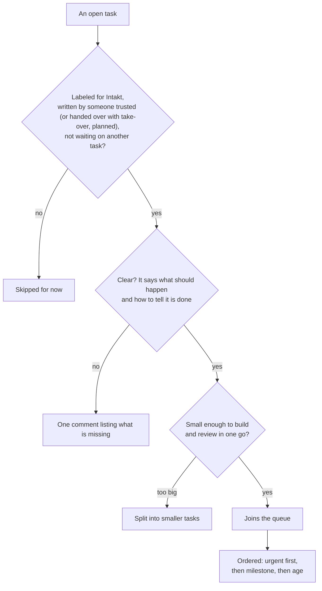
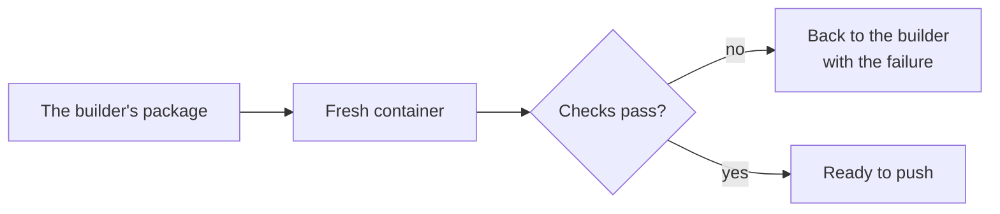
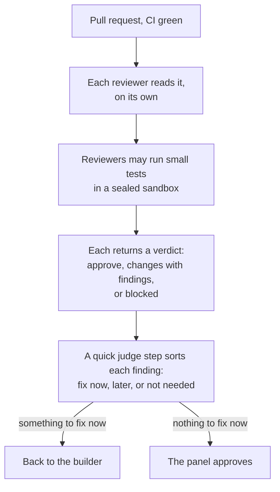
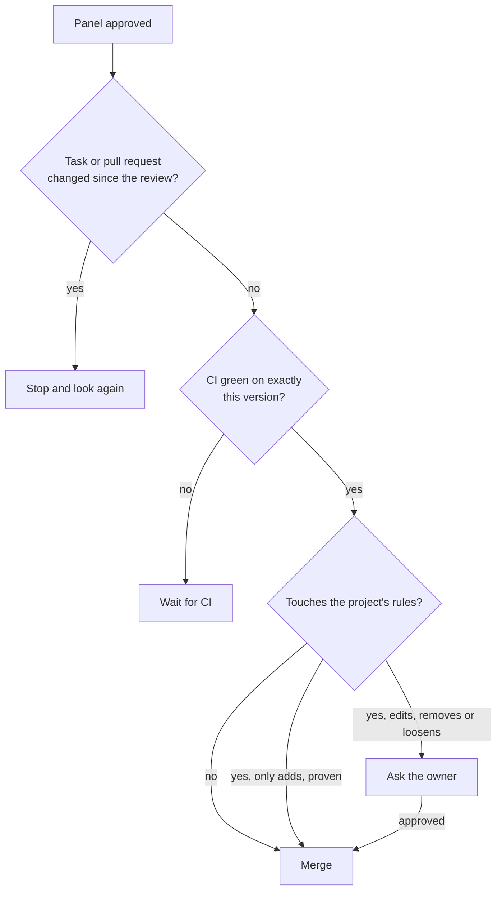

# The journey of a task, step by step

[How Intakt works](how-intakt-works.md) gives the overview. This page follows one task through every step, from the moment Intakt picks it to the moment it is merged, and says what happens at each step and why. No programming knowledge needed. Intakt is still being built, so this describes the decided design ([details](../design/README.md)).

## 1. Picking the next task

Several cheap checks come first, so no money is spent building a task that isn't ready.

One exception: a task whose pull request is already open (it needs a fix or an update) goes before every task not started yet, unless that task is `urgent`, so open work lands first. Each time a task joins the queue, Intakt looks its pull request up on the site where the code is hosted (GitHub or Gitea), so a task that comes back after a decision is still treated as a fix to its open pull request, never started over.

- **Waiting on another task:** a task can say `Waits for #12`. It isn't picked until #12 is done, so nothing gets built on a missing foundation. *(Planned:)* Intakt learns whether #12 is done from the one list of open tasks it reads each round (a list that comes back incomplete releases no wait), never by asking about each waited-for task on its own, and a worker with no room for new work asks the site nothing, so routine checks never use up the site's hourly allowance.
- **Too big:** large tasks are split into parts that each work on their own, with their own tests.
- **Two new tasks touching the same files** are usually built one after the other, so they don't trip over each other; everything else can run in parallel.
- **A task with an open pull request never waits** because another task is changing the same files.
- **A task held back for files only lets a task of the same priority and kind go ahead, and only one that touches none of the files in flight**; if there is none, it is built anyway.
- **Pace:** how many builders run at once depends on how much of the week's AI allowance is left (see [Spending wisely](how-intakt-works.md#spending-wisely)).

## 2. Building

The builder is an AI agent working in a **sealed workspace**: a fresh copy of the project in a container that has no access to your accounts, your keys or your other projects, and can only reach the AI company and the package registries.

It receives:
- the task, with its acceptance criteria and the evidence its change must show;
- a short **briefing**: what the project is, what is in flight, recent decisions, and known pitfalls for the files it will touch;
- on a second attempt, **only the open findings** from the reviewers, not their whole reviews.

It produces two things, and nothing else leaves the workspace:
- **the change itself**, as commits in a sealed package (a git *bundle*);
- **a short description** for the pull request: a summary, the evidence (for example test output), and any new packages it needs.

Before it finishes, it runs a **self-check**: no merge commits, nothing that looks like a password or key, description not too long. Catching those itself is much cheaper than being refused afterwards.

Planned: the self-check also runs the project's quick checks, ticks off every piece of evidence the task asks for, and looks for documentation the change made wrong. Intakt checks before it asks the reviewers because every round of fixes after a review costs about as much as four reviews, and with one account that comes straight out of new work. When the same kind of problem keeps coming back from the reviewers, Intakt suggests a new automatic check as a task; label it to accept it, and the problem is caught before review from then on.

## 3. Checking

Intakt never trusts the builder's word that the work passes. First it looks at the package itself: it must add to the task's own branch only, never change main, never rewrite what was already pushed, hold no merge unless the task asked to merge main in, leave out nothing its commits need, and hold no damaged commit that git itself would never write. A first package may start on any version of main, so main moving on while the builder works is fine. A package that breaks one of these rules is refused with a fixed reason that repeats nothing from the package. Lines that credit a co-author or say a tool generated the change are removed from the commits. (Planned: the search for passwords and keys in the package, and sending a refused package back to the builder once.) Then it unpacks the change in a **fresh, separate container** and runs the project's own checks there:

- **The quality gates** (`bin/check`): tests, static analysis, code style and the project's own rules. The check of the libraries the project uses (`audit`) fails on a library with a known security problem, and also on a library version released less than 3 days ago, so a freshly published (possibly compromised) release waits a few days before it can get in; Composer itself refuses to pick such a version when it updates the libraries. For this, `bin/check` needs Composer 2.11 or later and refuses to start with an older one. Each check runs as a separate program of its own, several at the same time (as many as the machine has processors, fewer when its memory is limited, with the checks that only read the code finished before any check that runs it starts, so a test cannot change what another check is still judging; then the slow test check starts first, and a check that runs beside it runs at the lowest priority, so it only uses processor time the tests leave free; the setting `INTAKT_GATE_SLOTS` changes how many, and `1` runs them one after the other), and the report lists them in the same fixed order every time; a check whose program crashes, gets stuck or answers with something that is not a proper result counts as failed, and the report shows the end of what it printed. Anything a check's program started is stopped together with it, also when you interrupt `bin/check` (which is why `bin/check` refuses to start when PHP lacks the `pcntl` or `posix` extension it needs for this); only a program the check started in a contained run of its own may keep running if the check's program is killed outright. The test check also lists the ten slowest test files, so slow tests are easy to spot. To finish sooner, it hands the test files out to several workers at once (one per processor, up to four), one file at a time, starting with the files that took longest the last time; the rules stay as strict, so a failing, skipped or warning test in any worker, or a worker that crashes or gets stuck, still fails the check and is named. Each group of tests it runs at the same time gets its own database, its own folder for temporary files and caches, and its own network ports, so they cannot get in each other's way. A test that still cannot share the machine (for example because it writes to a place in the project folder that all workers share; a folder of its own for each worker is fine) is marked `serial` and runs by itself after all the others: put `#[Group('serial')]` on its class, with a one-line comment saying why.
- **Dependencies:** a new package from a trusted publisher (such as `symfony/` or `doctrine/`) is routine; anything else, or a change to how packages are installed, waits for the owner.
- **The boot check:** does the changed project still start up?

## 4. Committing and pushing

The builder never pushes anything itself; it has no access to GitHub at all. Intakt does it:

1. It **signs the commits with its own key**, so every commit on the branch is verifiably Intakt's.
2. It **pushes the branch** to GitHub and opens (or updates) the **pull request**, with the builder's description.
3. GitHub's **CI** runs the checks again on GitHub's machines, as a second, independent opinion.

One special case: if the change edits the **CI setup itself** and the new setup could reach more than a throwaway machine with read-only access, Intakt holds the push and asks you first, because GitHub runs a pushed CI setup straight away.

## 5. Reviewing

Once CI is green, the **review panel** reads the change: a fixed core panel for every change, plus specialists the change calls for ([which reviewers](how-intakt-works.md#which-reviewers-look-at-a-change)).

- **Findings have a severity:** P1 (wrong or unsafe: always blocks), P2 (a real defect: blocks), P3 (a nice-to-have: becomes a follow-up task, never blocks). From the second review round on, a new P1 or P2 only keeps its severity when it is something the change broke or it names a rule or task requirement it breaks; otherwise it is lowered to P3, so reviewers cannot keep moving the goalposts.
- **A finding keeps its name:** each finding gets a short id (F1, F2, ...). On the next round, every reviewer is shown the findings still open, says which ones are fixed, and a problem that is still there keeps its id, so one problem can be followed from round to round.
- **All reviewers at once:** the core panel's reviewers read the same version at the same time, and none waits for another to approve first, so the builder gets every finding in one go instead of one extra round per reviewer.
- **Evidence beats opinion:** a reviewer can write a small test, run it against the change, and attach the result to its finding.
- **Second chances, but not endless ones:** if the same serious problem comes back twice, a stronger model builds the fix; a third time, the maintainer agent decides. If a task keeps getting sent back, it is re-planned rather than handed to you: split into smaller tasks, made clearer, or tried once more with a stronger model, and you are asked only in four cases: a product choice is needed, the reviewers disagree about what the task asks for, a serious problem touches security, secrets or data integrity, or the task still fails after its last try with a stronger model and cannot be split (planned).
- **No repeat work:** a review counts only for exactly what it saw: the same code, the same task, the same checks and the same reviewers. Two kinds of new commit keep it: merging main in when git does it by itself with nothing to fix by hand, and a change that only touches the `docs/` folder. The earlier review then still counts for everything else, and only the touched files are looked at again. Intakt can already tell these cases apart, and each review round remembers what it saw so its reviews stop counting once that changes; checking this whenever new commits arrive, and looking again at only the touched files so a review isn't paid for twice, is planned.
- **Grown too big?** Every new version of the change is measured again (planned). One that has grown too big to review in one go, for example after several rounds of fixes, is not reviewed and not sent back to the builder, who cannot split it; the maintainer agent splits it into smaller tasks. In general, the builder only gets back what it can fix on its own branch.
- **Stuck for an outside reason?** The task goes on hold and comes back by itself when the reason is gone ([holds](how-intakt-works.md#when-something-gets-stuck)).

## 6. Merging

Right before merging, Intakt checks once more that nothing changed under its feet:

- **It merges exactly the version that was reviewed.** If anything was pushed in between, the merge refuses and the new version is reviewed. Two pushes keep the reviews for the parts they did not touch, so only the touched parts are reviewed again: a merge of main without conflicts, and a change that touches only documentation.
- **A finished change goes first.** A change that is approved, has green checks and needs nothing else is merged before Intakt starts reviewing anything new, whatever its priority, because waiting only makes more work.
- **Changes to the rules** follow the approval rules in [What needs you](how-intakt-works.md#what-needs-you-and-what-doesnt).
- After merging, it **reads the result back** and only then closes the task.
- **A merged pull request always shows as merged.** Intakt deletes the branch only after the forge says the pull request is merged, so a merged change never shows as closed without a merge.

## 7. Afterwards

- **Follow-ups:** any P3 notes from the reviewers become a follow-up task. The maintainer agent checks each note against the code, drops what's already fixed, and turns the rest into small buildable tasks.
- **Project memory:** what was learned (a fixed finding, a recurring failure and its cause) goes into the project memory, so the next builder and reviewers are briefed.
- **Unblocking:** tasks that said `Waits for` this one become eligible.
- **Tidying up:** the task's branch is cleaned up.

## When things go wrong

| Situation | What Intakt does |
|---|---|
| The checks fail | the builder gets the failure and tries again |
| A reviewer's account is over its limit | the same company's next account takes over; when all of them are out, a reviewer from another company takes its place as a substitute, and a catch-up review by the usual one is noted as owed (running it is planned) |
| GitHub misses an update | Intakt notices that CI never started and nudges GitHub once, then hands it to the maintainer agent |
| CI was cancelled | a newer push stopped the checks of the older version, which is not a failure; Intakt waits for the newer checks, starts them again once if nothing does, and otherwise hands it to the maintainer agent |
| The change conflicts with main | the builder merges main in and resolves it |
| The same problem keeps coming back | a stronger model, then the maintainer agent |
| Something needs a real decision | you get one message with the options and a recommendation |
