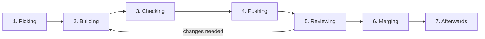
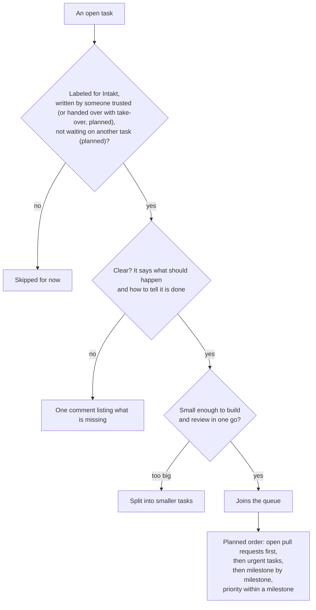
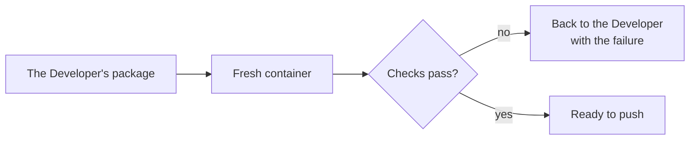
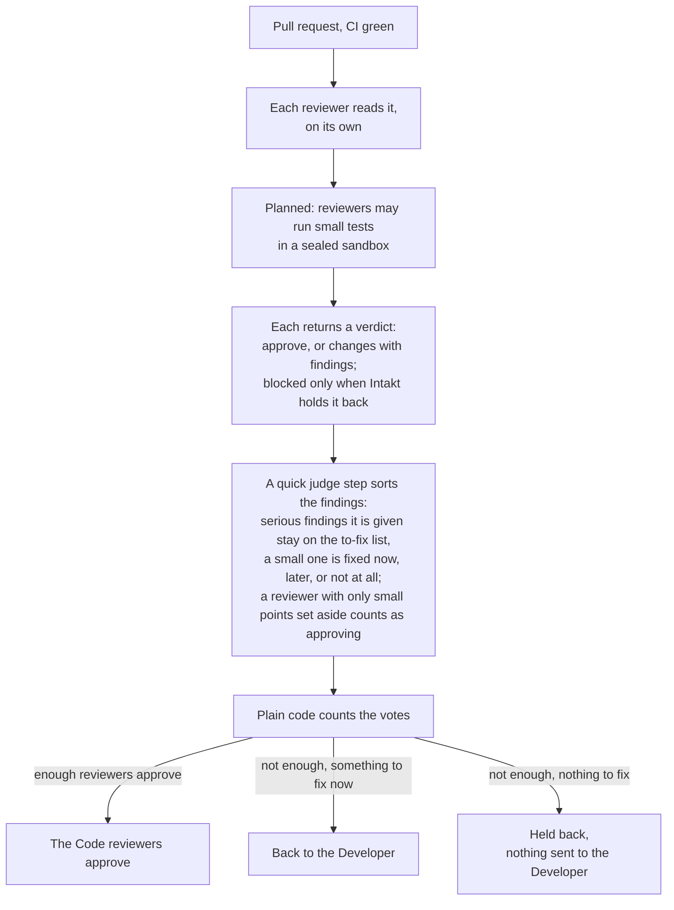
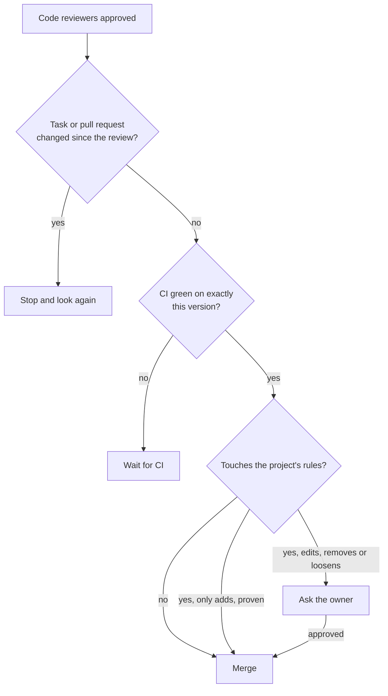

# The journey of a task, step by step

[How Intakt works](how-intakt-works.md) gives the overview. This page follows one task through every step, from the moment Intakt picks it to the moment it is merged, and says what happens at each step and why. No programming knowledge needed. Intakt is still being built, so this describes the decided design ([details](../design/README.md)).

## 1. Picking the next task

Several cheap checks come first, so no money is spent building a task that isn't ready. What *ready* means is stated once, in the [Definition of Ready](writing-a-good-task.md#definition-of-ready); the Tech lead checks it.

Planned: Intakt does not yet take tasks from the queue on its own, so the order in the last box and the rules below are designed, not running. Milestones due on the same day, or with no due date, share one turn, and priority decides between their tasks.

What runs today: you start one task yourself with the console command `intakt:build:task`, naming the project and the issue number. It does steps 2 to 4 below for that one issue, in order: it reads the issue, updates Intakt's copy of the project, makes a fresh copy to build in, runs the Developer there, checks what the Developer handed back, runs the project's checks on it, and then signs and pushes the branch and opens or updates its pull request. It stops at the first step that fails and says why, and the dashboard's task page shows each step. Everything in this first step (picking on its own, the queue and its order) is planned, and so are the parts of the later steps marked planned ([the exact command](../user/README.md#building-one-task)).

Planned: within one priority and milestone, a task that other tasks wait on (directly or further down the chain) goes before an older one, so the work that frees the most tasks starts first. It never jumps ahead of a higher priority or a milestone due earlier.

Planned: before that, within one priority and milestone, the first task of the longest chain of waiting work that still has to finish before the milestone is due goes first, but never ahead of a more important kind of work (core before features, features before tooling). A task the milestone waits on counts on that chain even when it belongs to a later milestone or to none, and it is built with the milestone that needs it.

Planned: waiting work moves up. A task that has waited in the queue for a few days (5 by default; each project can change the number, and 0 turns this off) counts one priority step higher, `low` to `normal` to `high`, and again after each further stretch of the same length, but never up to `urgent` and never into another milestone. The count starts when Intakt first sees the task ready and starts over if the task stops being ready, unless its pull request is already open: then the pull request keeps its count and its place (below). Open pull requests move up the same way, counted from when their latest version joined the queue: each new version (after a fix or an update) starts the count over. Fixes to open pull requests are ordered by priority alone, whatever their milestone. A task an old pull request waits on moves up with it, at most to `high` and only within its own milestone, so the pull request is not held back. The review queue has no milestones, so there an old pull request can be reviewed before newer ones of other milestones, but never before an `urgent` one. Your labels stay as you set them; the dashboard shows the priority Intakt uses for each task and why. A ready task with no milestone is never given one by Intakt: the dashboard lists it for you to place, and until then it comes last, unless a milestone waits on it: then it is built with the earliest milestone that needs it, and moves up there as that milestone's tasks do.

One exception *(planned, with the rest of the order)*: a task whose pull request is already open (it needs a fix or an update) goes before every task not started yet, even an `urgent` one, so open work lands first; an approved pull request goes first of all. If you take `ready` off a task whose pull request is open, the pull request keeps its place and its reviews, and carries on from there when you give `ready` back. Each time a task joins the queue, Intakt looks its pull request up on the site where the code is hosted (GitHub or Gitea), so a task that comes back after a decision is still treated as a fix to its open pull request, never started over.

- **Waiting on another task** *(planned)*: a task can say `Waits for #12`. It isn't picked until #12 is done, so nothing gets built on a missing foundation. Intakt learns whether #12 is done from the one list of open tasks it reads each round (a list that comes back incomplete releases no wait), never by asking about each waited-for task on its own (with one exception: when a task waits for a pull request, Intakt asks the site about that pull request after it has left the list of open ones, to learn whether it was merged or only closed; if the site does not answer, it asks again the next round, and after three rounds without an answer at most once a day, and while a pull request that was closed without being merged still holds a task back, it asks again at most once a day, in case it was reopened and merged), and a worker with no room for new work asks the site nothing, so routine checks never use up the site's hourly allowance.
- **Too big:** large tasks are split into parts that each work on their own, with their own tests.
- **Ran out of steps** *(planned)*: if the Developer runs out of steps (its allowed number of turns, as logs call them) before it finishes, Intakt doesn't just try again at the same size, since that usually stops at the same place. The Tech lead sizes the task again with what that try showed (the files it changed and where it stopped) and splits it, or keeps it whole and says why. If a second try also stops unfinished, the task goes to the Maintainer or to you, even if only one of the two tries ran out of steps. The Tech lead also compares new tasks with recent ones that ran out, so its sizes fit the project better.
- **Evidence the Developer can't produce** *(planned)*: if the task asks for evidence only you could produce (a real AI call, a run on your own install) without marking it `(owner provides)`, it comes back to you with one comment naming those items, before any build. Marked items are yours to check before the merge, and reviewers never send the work back for them.
- *(Planned:)* **Two new tasks touching the same files** are built one after the other: when Intakt is confident which files a task will touch, a free Developer skips a task whose files another change is still working on and takes the next one, unless no task of the same milestone, priority and kind is free, so they don't trip over each other; everything else can run in parallel. A task first in line on the longest chain of waiting work in its milestone keeps its place and is never skipped this way.
- *(Planned:)* **A task with an open pull request never waits** because another task is changing the same files.
- *(Planned:)* **A follow-up waits for the pull request it follows** to be merged, so it is built on top of the finished change instead of beside it. Closing the task is not enough: any task that waits for a pull request starts only once that pull request is really merged.
- *(Planned:)* **A task held back for files only lets a task of the same milestone, priority and kind go ahead, and only one that touches none of the files in flight**; if there is none, it is built anyway, so a later milestone never jumps ahead this way. A task first in line on the longest chain of waiting work in its milestone is never held back for its files. Today no task is held back for its files; the whole rule arrives with the build lane.
- *(Planned:)* **A blocked or waiting task** is passed over, and the next task in line is built instead, even one of a later milestone.
- **Pace:** how many Developers run at once depends on how much of the week's AI allowance is left (see [Spending wisely](how-intakt-works.md#spending-wisely)).

## 2. Building

The Developer is an AI agent working in a **sealed workspace**: a fresh copy of the project in a container that has no access to your accounts, your keys or your other projects, and can only reach the AI company and the package registries.

It receives:
- the task, with its acceptance criteria and the evidence its change must show;
- a short **briefing**: what the project is, what is in flight, recent decisions, and known pitfalls for the files it will touch;
- on a second attempt, **only the open findings** from the reviewers, not their whole reviews.

When it completes a change, it hands back two things, and nothing else leaves the workspace:
- **the change itself**, as commits in a sealed package (a git *bundle*);
- **a short description** for the pull request: a summary, the evidence (for example test output), and any new packages it needs.

If it cannot go on without a decision from you, it hands back **a question** instead: the question, its choices and its recommendation. A question comes first: when it leaves one, no package is sent, almost whatever else it did (a build that runs out of memory or time is handled first). Intakt then parks the task: it stores the question and stops the build there, without checking or pushing anything. (Planned: showing the question on the dashboard and going on once you answer.)

Before it finishes, it runs a **self-check**: no merge commits, nothing that looks like a password or key, description not too long. Catching those itself is much cheaper than being refused afterwards.

Planned: the self-check also checks the change against the [Definition of Done](writing-a-good-task.md#definition-of-done): it runs the project's quick checks, ticks off every piece of evidence the task asks for, and looks for documentation the change made wrong. That last part is a plain report, not an AI's guess: it takes the names, settings and numbers the change removed or changed, lists every place in the project's documentation that still mentions one, and the Developer fixes or confirms each before it hands back. Intakt checks before it asks the reviewers because every round of fixes after a review costs about as much as four reviews, and with one account that comes straight out of new work. When the same kind of problem keeps coming back from the reviewers, Intakt suggests a new automatic check as a task; label it to accept it, and the problem is caught before review from then on.

## 3. Checking

Intakt never trusts the Developer's word that the work passes. First it looks at the package itself: it must add to the task's own branch only, never change main, never rewrite what was already pushed, hold no merge unless the task asked to merge main in, leave out nothing its commits need, and hold no damaged commit that git itself would never write. A first package may start on any version of main, so main moving on while the Developer works is fine. A package that breaks one of these rules is refused with a fixed reason that repeats nothing from the package. Lines that credit a co-author or say a tool generated the change are removed from the commits. (Planned: the search for passwords and keys in the package, and sending a refused package back to the Developer once.) Next it looks for a file that lost most of its content: one that keeps less than a fifth of its size and loses more than 50 lines fails the check, with the file named, unless the task's plan says that file is removed or rewritten, because a Developer once replaced two documentation files with the single line `1`. Then it unpacks the change in a **fresh, separate container**, with a fresh copy of the project and no downloads kept from before (it may start with a saved copy of the libraries for the same lock files, after checking that they fit the machine, and otherwise installs them itself as before), and runs the project's own checks there. GitHub's CI checks the change combined with the latest main, so Intakt fetches main again right before this check, because main may have moved on while the Developer worked. When main moved on since the branch last took it in, the container first combines the change with the latest main the same way GitHub does (the change goes into main) and checks that; the combination stays inside the container, and what gets pushed is the Developer's change as it was handed back. If the change and the latest main clash, no check runs and the build stops with the reason `the branch conflicts with current main, so the check ran no step`; if combining them fails while git reports no clash (git refuses it, cannot record the combination, or leaves it unrecorded), the build stops with `git refused to merge the branch with current main without a conflict, so the check ran no step`. Only the result the container leaves in its output folder counts (for a PHP project, `composer install` and then `bin/check --fast`, or the command the project sets):

- **The quality gates** (`bin/check`): tests, static analysis, code style and the project's own rules. The check of the libraries the project uses (`audit`) fails on a library with a known security problem, and also on a library version released less than 3 days ago, so a freshly published (possibly compromised) release waits a few days before it can get in; Composer itself refuses to pick such a version when it updates the libraries. The one exception, decided once by the owner, is the Symfony packages at `8.2.0-BETA2`; the check names it when it passes, and it goes away once that release is a few days old. For this, `bin/check` needs Composer 2.11 or later and refuses to start with an older one. Each check runs as a separate program of its own, several at the same time (as many as the machine has processors, fewer when its memory is limited, with the checks that only read the code finished before any check that runs it starts, so a test cannot change what another check is still judging; then the slow test check starts first, and a check that runs beside it runs at the lowest priority, so it only uses processor time the tests leave free; the setting `INTAKT_GATE_SLOTS` changes how many, and `1` runs them one after the other), and the report lists them in the same fixed order every time; a check whose program crashes, gets stuck or answers with something that is not a proper result counts as failed, and the report shows the end of what it printed. Anything a check's program started is stopped together with it, also when you interrupt `bin/check` (which is why `bin/check` refuses to start when PHP lacks the `pcntl` or `posix` extension it needs for this); only a program the check started in a contained run of its own may keep running if the check's program is killed outright. The test check also lists the ten slowest test files, so slow tests are easy to spot. To finish sooner, it hands the test files out to several workers at once (one per processor, up to four), one file at a time, starting with the files that took longest the last time; the rules stay as strict, so a failing, skipped or warning test in any worker, or a worker that crashes or gets stuck, still fails the check and is named. Each group of tests it runs at the same time gets its own database, its own folder for temporary files and caches, and its own network ports, so they cannot get in each other's way. A test that still cannot share the machine (for example because it writes to a place in the project folder that all workers share; a folder of its own for each worker is fine) is marked `serial` and runs by itself after all the others: put `#[Group('serial')]` on its class, with a one-line comment saying why.
- **Dependencies:** a new package from a trusted publisher (such as `symfony/` or `doctrine/`) is routine; anything else, or a change to how packages are installed, waits for the owner.
- **The boot check:** does the changed project still start up?

## 4. Committing and pushing

The Developer never pushes anything itself; it has no access to GitHub at all. Intakt does it:

1. It **signs the commits with its own key**, so every commit on the branch is verifiably Intakt's.
2. It **pushes the branch** to GitHub and opens (or updates) the **pull request**, with the Developer's description. First it asks GitHub whether the branch already has an open pull request that someone else opened (a person, another loop or another App). If it does, Intakt stops there and pushes nothing, so it does not take over someone else's pull request. It only ever updates its own pull request to main; one of its own to another branch stays as it is, and Intakt opens a new one to main.
3. GitHub's **CI** runs the checks again on GitHub's machines, as a second, independent opinion.

Git itself can check Intakt's signatures, but GitHub does not show these commits as "Verified": it checks such a signature only against a key on a person's account, and Intakt's GitHub App has none.

If the branch conflicts with main, nothing is pushed. Today the run stops there; when the push step itself finds the conflict, it says how many files conflict (never their names), and a conflict caught earlier by the check before the push stops the run without a count. Sending the branch back to the Developer to merge main first, so that only a branch without conflicts is pushed, is planned.

One special case: if the change edits the **CI setup itself** and the new setup could reach more than a throwaway machine with read-only access, Intakt holds the push and asks you first, because GitHub runs a pushed CI setup straight away.

## 5. Reviewing

Once CI is green, the **Code reviewers** read the change: a fixed core panel for every change, plus specialists the change calls for ([which reviewers](how-intakt-works.md#which-reviewers-look-at-a-change)).

- **Findings have a severity:** P1 (wrong or unsafe: always blocks), P2 (a real defect: blocks), P3 (a nice-to-have: never blocks; a small fix in a file the change already touches is marked "fix now", a bigger one becomes a follow-up task, or is set aside when the judge finds it not needed). A quick plain check first drops a finding that quotes code the change does not contain; the judge step cannot set a P1 or P2 aside that the check kept: when it thinks one is not needed, the finding still goes to the Developer, with the judge's reason written beside it. A change is sent back only with something on the to-fix list: a reviewer that asked for changes only over small points the judge put off or set aside counts as approving, and one whose points never reached the to-fix list for another reason (the plain check dropped them, or the judge's answer could not be read) counts as not approving, so the Developer is never sent back with nothing to fix. From the second review round on, a new P1 or P2 only keeps its severity when it is something the change broke or it names a rule or task requirement it breaks; otherwise it is lowered to P3, so reviewers cannot keep moving the goalposts.
- **A finding keeps its name:** each finding gets a short id (F1, F2, ...). On the next round, every reviewer is shown the findings still open, says which ones are fixed, and a problem that is still there keeps its id, so one problem can be followed from round to round.
- **All reviewers at once:** the core panel's reviewers read the same version at the same time, and none waits for another to approve first, so the Developer gets every finding in one go instead of one extra round per reviewer.
- **Evidence beats opinion:** a reviewer will be able to write a small test, run it against the change, and attach the result to its finding (planned: today reviewers read the change and run nothing).
- **Second chances, but not endless ones:** if the same serious problem comes back twice, a stronger model builds the fix (planned: today a confirmed escalation only changes what `intakt:build:tier` and `intakt:build:model` choose, because no rework build asks them yet); a third time, the Maintainer decides. If a task keeps getting sent back, it is re-planned rather than handed to you: split into smaller tasks, made clearer, or tried once more with a stronger model, and you are asked only in four cases: a product choice is needed, the reviewers disagree about what the task asks for, a serious problem touches security, secrets or data integrity, or the task still fails after its last try with a stronger model and cannot be split (planned). Planned: the third time one task is sent back, it is split into smaller tasks instead of being tried again, or, when it cannot be split, made clearer or tried once more with a stronger model, and this happens only once per task.
- **No repeat work:** a review counts only for exactly what it saw: the same code, the same task, the same checks and the same reviewers. Two kinds of new commit keep it: merging main in when git does it by itself with nothing to fix by hand, and a change that only touches the `docs/` folder. The earlier review then still counts for everything else, and only the touched files are looked at again. One part never carries over: a reviewer's judgement of whether a change to the rules makes them looser, which it gives again on every new version. Intakt can already tell these cases apart, and each review round remembers what it saw so its reviews stop counting once that changes; checking this whenever new commits arrive, and looking again at only the touched files so a review isn't paid for twice, is planned.
- **Grown too big?** Every new version of the change is measured again (planned). One that has grown too big to review in one go, for example after several rounds of fixes, is not reviewed and not sent back to the Developer, who cannot split it; the Maintainer splits it into smaller tasks. Documentation text that only moved to another page will not count toward the size: a check confirms it moved unchanged, and reviewers read only the rest (planned). A too-big pull request that you or the Maintainer opened without a task is split the same way, with no `take-over` needed; the original is closed only once every piece has its own pull request, open or already merged, and a check confirms the pieces together give exactly the original change and each piece still carries exactly its assigned share; a piece closed without merging keeps it open, or reopens it if it was already closed (planned, [details](how-intakt-works.md#when-something-gets-stuck)). In general, the Developer only gets back what it can fix on its own branch.
- **Stuck for an outside reason?** The task goes on hold and comes back by itself when the reason is gone, except when it needs the newest project: that task is never held, it is rebuilt once with the newest project (or goes straight to the Maintainer if it has no try left or the rebuild leaves it stuck) ([holds](how-intakt-works.md#when-something-gets-stuck)).

## 6. Merging

Right before merging, Intakt checks once more that nothing changed under its feet:

- **It merges exactly the version that was reviewed.** If anything was pushed in between, the merge refuses and the new version is reviewed. Two pushes keep the reviews for the parts they did not touch, so only the touched parts are reviewed again: a merge of main without conflicts, and a change that touches only documentation.
- **A finished change goes first.** A change that is approved, has green checks and needs nothing else is merged before Intakt starts reviewing anything new, whatever its priority, because waiting only makes more work.
- **Changes to the rules** follow the approval rules in [What needs you](how-intakt-works.md#what-needs-you-and-what-doesnt).
- After merging, it **reads the result back** and only then closes the task.
- **A merged pull request always shows as merged.** Intakt deletes the branch only after the forge says the pull request is merged, so a merged change never shows as closed without a merge.

## 7. Afterwards

- **Polish round (planned):** when every reviewer approves but small "fix now" notes remain, the Developer gets one short extra pass to fix just those before the merge, and one reviewer checks only that pass. If it fails, the approved change merges without it and the notes become one follow-up task, unless the task is itself a follow-up: then the notes are listed in the merge note and dropped. A project setting turns it off.
- **Follow-ups:** P3 notes that need their own design, tests or files outside the change become a follow-up task. The Maintainer checks each note against the code, drops what's already fixed, and turns the rest into small buildable tasks. Planned: such a follow-up waits for the next stage (milestone) instead of the one being finished, unless it fixes something that blocked the original or no later stage is open; it says which stage it came from, so you can move it back. That is the default: you can list it as a setting the Maintainer's weekly review may try other values for, within limits you set. Planned: a task that is itself a follow-up files no further follow-ups for its own nice-to-have notes. They are listed in the merge note and dropped, so follow-ups stop breeding follow-ups. A real problem a reviewer itself noted for later (not a nice-to-have) is still filed; one the judge would put off is not filed, it stays on the Developer's to-fix list.
- **Project memory:** what was learned (a fixed finding, a recurring failure and its cause) goes into the project memory, so the next Developer and reviewers are briefed.
- **Unblocking:** tasks that said `Waits for` this one become eligible.
- **Tidying up:** the task's branch is cleaned up.

## When things go wrong

| Situation | What Intakt does |
|---|---|
| The checks fail | the Developer gets the failure and tries again. Once automatic CI retry ships (T57), Intakt retries a failure that shows no result from the code (a lost runner, a registry that could not be reached) once, and sends a failure that names a step or test of the project straight back to the Developer, unless the test is already recorded as flaky, which then uses that same single retry (a head never gets a second one) |
| A reviewer's account is over its limit | the same company's next account takes over; when none of them can serve the model right now (each one either over its own limit or with the router provider the model names paused on it), a reviewer from another company takes its place as a substitute, and a catch-up review by the usual one is noted as owed (running it is planned) |
| GitHub misses an update | Intakt notices that CI never started and nudges GitHub once, then hands it to the Maintainer. Planned: it first checks whether the change clashes with main, and a clash takes the row on conflicts with main below instead of the nudge |
| CI was cancelled | a newer push stopped the checks of the older version, which is not a failure; Intakt waits for the newer checks, starts them again once if nothing does, and otherwise hands it to the Maintainer. Planned: before starting them again it checks whether the change clashes with main, and a clash takes the row on conflicts with main below instead |
| The change conflicts with main | the Developer merges main in and resolves it, or the Maintainer takes it over when the task has no build tries left. Planned: when the clash is only in shared lists that many changes each add a line to (you name them in your settings, for example the file that pins package versions or the guide's index), Intakt combines them itself and runs the checks, and the change goes back the same way (to the Developer, or to the Maintainer when no build tries are left) when Intakt can't combine them without choosing a side (for example both sides changed the same line), can't rebuild the file that pins package versions, or the checks fail. A dependency bot's change that clashes with main is never joined or sent to a Developer: it waits for the bot's next version |
| The same problem keeps coming back | a stronger model, then the Maintainer |
| Something needs a real decision | you get one message with the options and a recommendation |
