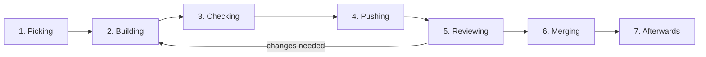
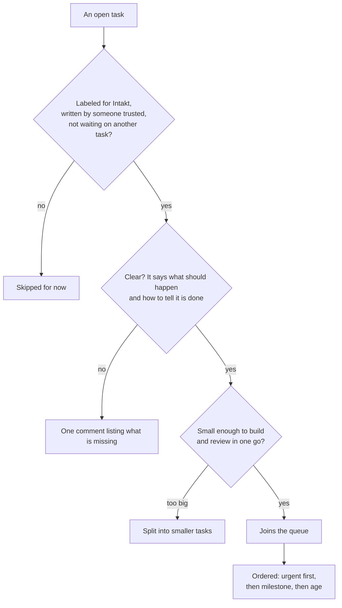
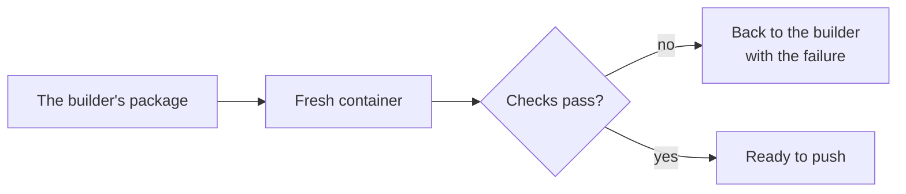
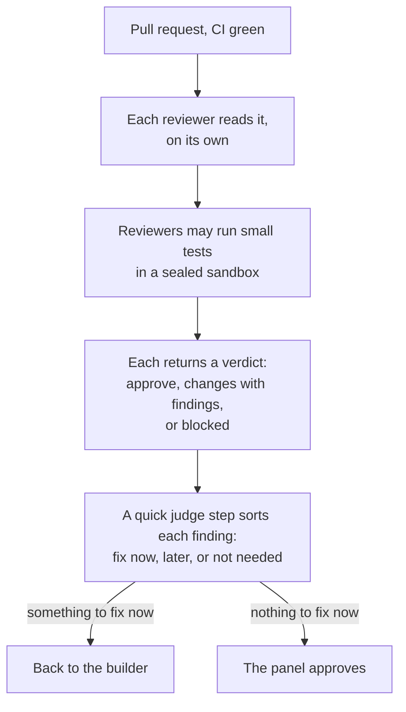
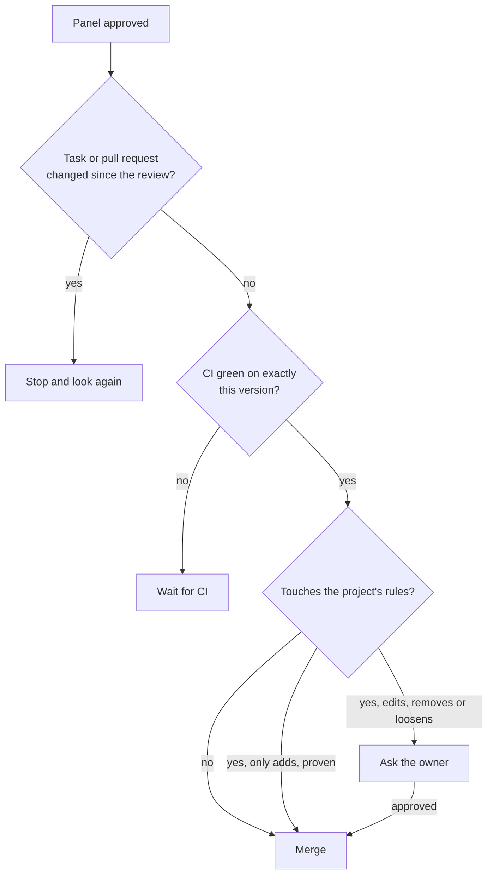

# The journey of a task, step by step

[How Intakt works](how-intakt-works.md) gives the overview. This page follows one task through every step, from the moment Intakt picks it to the moment it is merged, and says what happens at each step and why. No programming knowledge needed. Intakt is still being built, so this describes the decided design ([details](../design/README.md)).

## 1. Picking the next task

Several cheap checks come first, so no money is spent building a task that isn't ready.

One exception: a task whose pull request is already open (it needs a fix or an update) goes before every task not started yet, unless that task is `urgent`, so open work lands first.

- **Waiting on another task:** a task can say `Waits for #12`. It isn't picked until #12 is done, so nothing gets built on a missing foundation.
- **Too big:** large tasks are split into parts that each work on their own, with their own tests.
- **Two tasks touching the same files** are built one after the other, so they don't trip over each other; everything else can run in parallel.
- **Pace:** how many builders run at once depends on how much of the week's AI allowance is left (see [Spending wisely](how-intakt-works.md#spending-wisely)).

## 2. Building

The builder is an AI agent working in a **sealed workspace**: a fresh copy of the project in a container that has no access to your accounts, your keys or your other projects, and can only reach the AI company and the package registries.

It receives:
- the task, with its acceptance criteria and the evidence its change must show;
- a short **briefing**: what the project is, what is in flight, recent decisions, and known pitfalls for the files it will touch;
- on a second attempt, **only the open findings** from the reviewers, not their whole reviews.

It produces two things, and nothing else leaves the workspace:
- **the change itself**, as commits in a sealed package (a git *bundle*);
- **a short description** for the pull request: a summary, the evidence (for example test output), and any new packages it needs.

Before it finishes, it runs a **self-check**: no merge commits, nothing that looks like a password or key, description not too long. Catching those itself is much cheaper than being refused afterwards.

## 3. Checking

Intakt never trusts the builder's word that the work passes. It unpacks the change in a **fresh, separate container** and runs the project's own checks there:

- **The quality gates** (`bin/check`): tests, static analysis, code style and the project's own rules.
- **Dependencies:** a new package from a trusted publisher (such as `symfony/` or `doctrine/`) is routine; anything else, or a change to how packages are installed, waits for the owner.
- **The boot check:** does the changed project still start up?

## 4. Committing and pushing

The builder never pushes anything itself; it has no access to GitHub at all. Intakt does it:

1. It **signs the commits with its own key**, so every commit on the branch is verifiably Intakt's.
2. It **pushes the branch** to GitHub and opens (or updates) the **pull request**, with the builder's description.
3. GitHub's **CI** runs the checks again on GitHub's machines, as a second, independent opinion.

One special case: if the change edits the **CI setup itself** and the new setup could reach more than a throwaway machine with read-only access, Intakt holds the push and asks you first, because GitHub runs a pushed CI setup straight away.

## 5. Reviewing

Once CI is green, the **review panel** reads the change: a fixed core panel for every change, plus specialists the change calls for ([which reviewers](how-intakt-works.md#which-reviewers-look-at-a-change)).

- **Findings have a severity:** P1 (wrong or unsafe: always blocks), P2 (a real defect: blocks), P3 (a nice-to-have: becomes a follow-up task, never blocks).
- **Evidence beats opinion:** a reviewer can write a small test, run it against the change, and attach the result to its finding.
- **Second chances, but not endless ones:** if the same serious problem comes back twice, a stronger model builds the fix; a third time, the maintainer agent decides. If a task keeps getting sent back, it is re-planned rather than handed to you: split into smaller tasks, made clearer, or tried once more with a stronger model, and you are asked only when a product choice is needed (planned).
- **No repeat work:** a review counts only for exactly what it saw. But if main moves on and merging it in leaves the change itself identical, the earlier review still counts and isn't paid for twice.
- **Stuck for an outside reason?** The task goes on hold and comes back by itself when the reason is gone ([holds](how-intakt-works.md#when-something-gets-stuck)).

## 6. Merging

Right before merging, Intakt checks once more that nothing changed under its feet:

- **It merges exactly the version that was reviewed.** If anything was pushed in between, the merge refuses and the new version is reviewed. Two pushes keep the reviews for the parts they did not touch, so only the touched parts are reviewed again: a merge of main without conflicts, and a change that touches only documentation.
- **Changes to the rules** follow the approval rules in [What needs you](how-intakt-works.md#what-needs-you-and-what-doesnt).
- After merging, it **reads the result back** and only then closes the task.

## 7. Afterwards

- **Follow-ups:** any P3 notes from the reviewers become a follow-up task. The maintainer agent checks each note against the code, drops what's already fixed, and turns the rest into small buildable tasks.
- **Project memory:** what was learned (a fixed finding, a recurring failure and its cause) goes into the project memory, so the next builder and reviewers are briefed.
- **Unblocking:** tasks that said `Waits for` this one become eligible.
- **Tidying up:** the task's branch is cleaned up.

## When things go wrong

| Situation | What Intakt does |
|---|---|
| The checks fail | the builder gets the failure and tries again |
| A reviewer's account is over its limit | the same company's next account takes over; when all of them are out, a reviewer from another company takes its place as a substitute, and the usual one catches up later |
| GitHub misses an update | Intakt notices that CI never started and nudges GitHub once, then alerts |
| The change conflicts with main | the builder merges main in and resolves it |
| The same problem keeps coming back | a stronger model, then the maintainer agent |
| Something needs a real decision | you get one message with the options and a recommendation |
