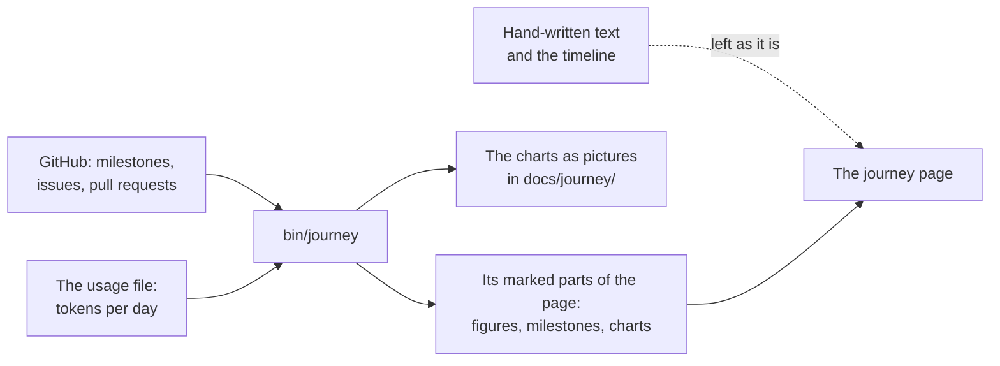

# The journey page

The [journey page](../journey.md) tells how Intakt was built: from an empty repository to a review panel that builds itself, milestone by milestone. It is not the same as the [journey checks](checking-the-whole-product.md), which test the product. This guide explains in plain words how the page stays up to date. The technical details are in [the journey page's architecture](../architecture/journey-page.md).

## Two kinds of text on one page

Most of the page is written by hand: what was planned, what happened, what was learned, and the timeline of key days. The figures at a glance, the milestone table and the picture charts are not typed by hand: a small program, `bin/journey`, works them out again from two sources:

- **GitHub**: the milestones, issues and pull requests of the project, read when the program runs;
- **the usage file** `docs/journey/usage.jsonl`: how many tokens the AI accounts used each day, as the AI companies reported them.

Each generated part sits between two hidden markers in the page. The program rewrites only what is between them and leaves every other line exactly as it was, so a hand-written sentence is never overwritten. When nothing changed, it writes nothing.

## The charts

The picture charts show tokens per day by kind of work and by account, tokens per merged pull request, issues opened and closed per day, and how many issues were open each day. Each picture chart comes with a short line saying where its numbers come from, and under it a table with the same numbers, so you can read them without seeing the colors. Each figure carries a word saying how it came to be: **counted** (Intakt counted it from GitHub), **measured** (the AI companies reported it) or **estimated** (worked out, such as tokens reserved for steps that were stopped before they reported their use).

## The kept merge count

Tokens per merged pull request divides each day's tokens by the pull requests merged that day. Merges keep coming in after a day is over, so counting them again every time would change old figures. So the first time the program counts the merges for a given usage file, it writes the counts into a hidden line at the end of that chart's part. While the usage file stays the same, later runs reuse those counts, and the token charts stay exactly as they were. Once the usage file changes, the merges are counted again and the line is written anew.

## A journey page for every project (planned)

Today only Intakt has a journey page. The plan is to give every project one on the dashboard, with the same kinds of figures worked out from what Intakt records. When a milestone closes, the Maintainer will draft a short dated entry from the issues' decisions, the stalls and the send-backs, each claim linking its issue or pull request.

You approve that entry, and a pull request adds it to the project's `docs/journey.md`. How close you are to your subscription limits shows only in the dashboard's admin area, never in the repository. A project can turn the page off. The design is in [the dashboard design](../design/05-architecture/13-dashboard.md#journey-page).

## Where you can read it

On GitHub the page shows as it is. The project's published site carries a copy beside the highlights page, with the timeline drawn as a picture, because the site cannot draw the timeline itself.
