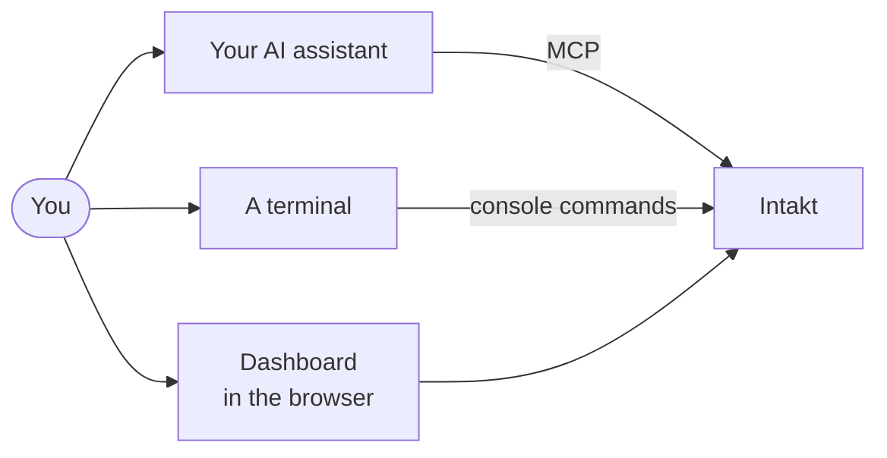

# Using Intakt from your AI assistant or the command line

Besides the dashboard, you can talk to Intakt from your own AI assistant (such as Claude Code or another agent) or from a terminal. The review command for the terminal is built. The MCP server exists in part (task T15 in [the plan](../plan.md)): today it can only list your projects, so the rest of its part below describes the planned design.



## From your AI assistant (MCP, planned)

**MCP** (Model Context Protocol) is a standard way for AI assistants to use tools. Intakt runs an MCP server, so you can ask your assistant things like "start a review of my branch" or "what did the reviewers say about PR 88?", and it calls Intakt's tools to do it.

| Tool | What it does | Changes anything? |
|---|---|---|
| start a review | reviews a branch or pull request end to end | yes |
| review status | where a review stands | no, read only |
| read verdicts | each reviewer's verdict and findings | no, read only |
| read the act list | what the builder must fix, after the judge step | no, read only |
| list projects | the projects this install runs | no, read only |

How it stays safe:
- **Every tool is labeled** with what it does ("only reads", "changes something"), so your assistant knows before it calls.
- **Starting a review needs a token** you set in Intakt's config.
- **Intakt decides, not the model:** whether a tool may write is decided by Intakt's own rules, never by what the assistant asks for.
- **Approvals are not tools:** no MCP tool can approve a merge or a protected change. That stays your click or comment on the forge.

## From a terminal

The review command runs one review and prints the outcome:

```
bin/console intakt:review <branch> --project=intakt --task="<what the branch builds>" --format=json
```

- It prints the verdict, the list of things to fix, and the tokens used (not yet a price), or JSON for scripts. It needs the review workers running on the same machine. The reviewers read a copy of the branch's last commit that Intakt makes for the round and removes afterwards, not the files you have checked out, so you can keep working while they read; reviewing a pull request instead of a branch is planned.
- Its exit code says the outcome: 0 approved, 10 changes needed, 11 blocked (and 1 when you gave it something wrong), so a script or CI job can act on it.
- Stopping it with Ctrl-C removes its copy first. Only a hard kill can leave the copy behind: `git worktree list` shows it as `intakt-review-...`, and `git worktree remove --force <path>` removes it.

Other commands come with the parts they belong to, for example re-running the Symfony AI bug reproductions (`intakt:upstream:run`) or summarizing a branch's change.

## From your own programs

The same events that update the dashboard are available as a small local API with JSON, for your own tools and scripts. Like the dashboard, it reads through Intakt and never changes Intakt's state behind its back.
