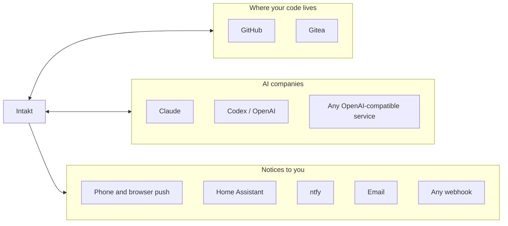

# What Intakt connects to

Intakt talks to three kinds of outside service: where your code lives, the AI companies that do the work, and the places it sends you notices. Each connection is a **plugin**: a small, swappable piece, so adding a new service doesn't change the rest of Intakt. Intakt is still being built, so this describes the decided design ([details](../design/05-architecture/02-plugins.md)).

## Where your code lives (forges)

| Forge | What Intakt needs |
|---|---|
| **GitHub** | its own GitHub App, created by the setup wizard with one confirmation, installed only on the repositories you choose |
| **Gitea** | a bot user of its own |

Intakt always acts as **itself**, never as you, so its comments and your approvals can always be told apart. It reads the tasks, opens and updates pull requests, reads CI results, comments and merges. It learns about changes from the forge's notifications (webhooks) the moment they happen.

## AI companies (vendors)

| Vendor | How you connect it |
|---|---|
| **Claude** (Claude Code) | a subscription login, or an API key |
| **Codex** (OpenAI) | a subscription login, or an API key |
| **Any OpenAI-compatible service** | an API key and its address |

Each vendor tells Intakt which models it has, what they cost and what they are good at (building, reviewing, quick triage), so Intakt can pick a model without special code per company. See [accounts and costs](accounts-and-costs.md) for how spending works.

## Notices to you (notifiers)

| Notifier | Good for |
|---|---|
| **Browser and phone push** | the dashboard installed as an app on your phone |
| **Home Assistant** | your phone through the Home Assistant app, or a light on the wall |
| **ntfy** | simple push to any device |
| **Email** | a daily digest |
| **Webhook** | anything else: chat tools, your own scripts |

You choose which kind of notice goes where: approvals and urgent problems to your phone, digests by email, quiet hours at night, and a fallback if the first one fails. Each notice is sent **once** per item and change, with a link to it on the dashboard. Notices never carry secrets and never approve anything: approving is always a click or a comment by you, on the forge.

## The project's checks (gates)

The fourth kind of plugin is your project's **check command**, the one that runs all its tests and rules (`bin/check`, `make check`, `npm test`, ...). Intakt runs it in a fresh container before anything is pushed. Its files are protected, so no change can quietly weaken it ([why](why-the-ai-cant-wreck-your-project.md)).
