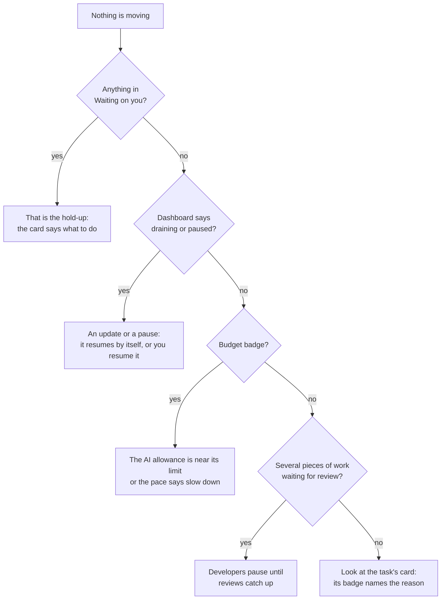

# Why isn't anything happening?

Sometimes the dashboard looks quiet: nothing building, a task that hasn't moved. Usually Intakt is waiting on purpose, and the reason is written on the card. This page lists the common reasons and what, if anything, to do. Intakt is still being built, so this describes the decided design.

## Start here

## Common reasons

| What you see | What it means | What to do |
|---|---|---|
| A card in **Waiting on you** | only a person can move it on | do what the card says |
| **Draining** on one build slot | Intakt is updating itself: that slot lets its job finish, then moves to the new version, while the other slots and the reviews go on; after that first slot the remaining build slots drain together, so several slots can show draining while the reviews go on (planned) | nothing: it resumes in minutes, and a job that runs too long is saved and continues on the new version |
| **Draining** everywhere | an update that changes stored data, which the old version could not read, pauses all work while it switches (planned) | nothing: it resumes in minutes; only if such an update fails after work has resumed does work stay paused until a newer version is installed, and Intakt tells you |
| **Paused** | someone paused the project or the install | resume it from the dashboard |
| **budget** badge | the AI allowance is near its limit, or this week is spending fast | wait for the refill, or add an account ([costs](accounts-and-costs.md)) |
| **Only one Developer** is running | the week's pace says slow down | normal; it speeds up when there is room |
| Developers paused, reviews waiting | finished work is piling up for review, so building more would only go stale | nothing: building resumes as reviews finish. An `urgent` task can still start |
| Developers paused, **waiting for CI** | finished work is waiting for its checks and the CI runners are busy | nothing: building resumes as CI catches up. If it happens often, add a runner |
| **CI** badge for a long time | GitHub hasn't finished, or never started, the checks | Intakt nudges GitHub after a few minutes and, if that didn't help, hands it to the Maintainer. Planned: if the change clashes with the newest main, it is not nudged but joined with main first (by Intakt itself when the clash is only in the shared lists, otherwise by a Developer, or by the Maintainer when the task has no build tries left); a dependency bot's change that clashes waits for the bot's next version instead |
| A task went **back in line** after waiting too long | it waited past the time limit for its checks, a reviewer or the latest changes from main, so Intakt freed the place for other work and kept the task's spot | nothing: it is picked up again in turn. You hear about it only if it happens three times in a row |
| **CI was cancelled** | a newer push stopped the checks of the older version; that is not a failure | nothing: Intakt waits for the newer checks, starts them again once if nothing does, and otherwise hands it to the Maintainer. Planned: a change that clashes with the newest main is joined with main first instead, as in the row on the **CI** badge |
| A banner **Main of <project> does not boot** | main's latest commit failed its boot check, so pull requests are reviewed without that check until main boots again | fix main so `bin/instance` boots; the banner goes away once a new main commit boots, or main or Intakt's tools go back to a commit and tool version that booted before (and comes back if they go back to one that failed) |
| **on hold** | the task needs something outside it (another task, a change to Intakt) | nothing: it comes back by itself when the reason is gone |
| **dependency** badge | it `Waits for` another task | finish or unblock that task |
| An item labelled **hands-off** (planned) | a person is driving it, so Intakt neither builds nor reworks it ([details](../design/05-architecture/08-merge.md#hands-off-and-take-over)) | remove `hands-off` to hand it back |
| A task stays in **Backlog** | it isn't ready: unclear, too big, or missing the `intakt` label | read Intakt's comment on the issue and add what it asks ([writing a good task](writing-a-good-task.md)) |
| A task never appears | no `intakt` label, or written by someone without write access | add the label yourself; for an issue by someone without write access the `intakt` label is not enough, a person with write access must set `take-over` (planned) |
| A project gets nothing built or reviewed | its share is 0, which pauses it, open pull requests included | raise its share above 0 |
| A project gets no new builds, but its reviews go on | another project has `urgent` work, which takes the next free build slot | nothing: it continues once the urgent task has its slot |
| One pull request is skipped for a while | something went wrong with that one only, so Intakt tries it again after a short wait that grows each time; one broken item never stops the rest | nothing: the Reviews page shows a card with the reason; it is tried again at least every half hour, and after four failures in a row it goes to the Maintainer (planned) |
| The log has an error saying the failure back-off started | something no single pull request causes went wrong: GitHub refused Intakt's credentials, the disk is full, the lock store failed while a pull request was being locked or unlocked, two different pull requests failed with the same error within an hour, or a hand-over could not be recorded; Intakt records a 15-minute hold, but today nothing checks it before a job, so work goes on (only the `intakt:budget:replay` command reads it; stopping new work and merges while it lasts is planned) | nothing: it ends by itself; if the cause stays, it starts again, and the log names the cause |
| A red item on the board | a part of Intakt itself is failing (a sandbox, a package install, the boot gate); the Maintainer tries to fix it first | nothing, unless it also turns up in Waiting on you |
| A red card in Waiting on you | a broken part only you can fix (an expired login, a credential, the host), or one the Maintainer could not fix | follow the card: it names the step and the cause |

## When work stops moving (planned)

None of this is built yet. Each rule in one sentence:

- **Every stall gets a reason and a next step:** when a task or the chain of tasks behind it has not moved for a while, Intakt names one reason and acts on it: the Developer fixes its own work, the Maintainer prepares a fix to protected files or to the shared toolbox as its own pull request, you decide, or the task waits for another one. A new version that fails on a problem Intakt has already seen on that task does not count as moving, and neither does going back and forth between problems already seen (failing one check, then another, then the first again), so a task stuck on the same failures still shows as stalled. One reviewer approving each new version does not count either while another keeps sending it back for the same problems, and neither does a new version that passes every check, unless it fixes a check that had failed and was not fixed before: a check that breaks again after it was fixed counts neither when it breaks nor when it is fixed again. Fewer problems than in any earlier round does count; a number that only goes up and down does not.
- **Tasks that wait on each other are caught:** when two or more tasks each wait for the other, Intakt notices the loop instead of passing the problem around. The Maintainer loosens or removes one of the waits, or splits out the part both need; if it cannot, you are asked to choose. The milestone shows "cannot finish" instead of a date while the loop lasts, and once a loop is gone (a wait changed or one of the tasks closed), its question is withdrawn. A task in two loops keeps the other loop's question until that one is gone too.
- **You are asked early:** a decision only you can make (a new package from an outside company, a change to protected files) is asked as soon as it shows up, while other fixes go on, and your answer holds for later versions that leave that part unchanged. A change to where a package comes from, which exact download is locked, or the package manager's own settings or install scripts is asked again, even when the list of packages stays the same. A reviewer that finds a change loosens the rules asks you as soon as it reports that, about that version only. A dependency bot's pull request (Dependabot, Renovate) is the exception: you are asked to approve it only at the end, once its checks pass, the reviewers approve and it merges cleanly with main.
- **The nearest milestone goes first:** after `urgent` work and work on open pull requests, which always go first, the Developers start with the nearest milestone (milestones due on the same day share one turn, and priority decides between their tasks); within one milestone, priority and kind of work, the tasks on the longest chain that still has to finish before the milestone is due go first, and that chain never puts a lower priority or kind ahead. A task the milestone waits on counts on that chain even when it belongs to a later milestone or to none, and it is built with the milestone that needs it.
- **The task others wait on goes next:** among tasks of the same priority and milestone, the one that frees the most waiting tasks is built first, then the oldest (finished changes waiting for review follow the same rule within one priority, whatever their milestone); the board shows how long build slots sat empty because the ready work was waiting on other tasks.
- **Follow-ups wait for the next stage:** a follow-up from a reviewer's nice-to-have note joins the next milestone, so the stage being finished does not keep refilling; one that fixes something blocking stays, and so does one when no later milestone is open, and the board counts the follow-ups in each milestone. That is the default: you can put it on the list of settings the Maintainer may try out within limits you set ([a weekly look at speed and quality](how-intakt-works.md#a-weekly-look-at-speed-and-quality-planned)).
- **The Developer has the same tools as CI:** a tool a test needs is listed in the requirements, and a missing one stops the Developer's own check before the push, never first in CI ([Definition of Done](writing-a-good-task.md#definition-of-done)).
- **A task waits only for what it needs:** a `Waits for` line names the one part it builds on, never a whole bigger task split into parts.
- **The board shows a milestone at risk:** it names the stalled task, its reason and who is fixing it (for example "M5 at risk: #N stalled 3 h, needs the environment, fix in review"), and you get a message only when you must act.

## Is the server itself busy?

If the dashboard is slow or does not answer, ask the web server how it is doing. Inside the container, run `php bin/console intakt:server:status`. It shows how many of the server's workers are busy and how many are free, how many requests are waiting, how often a worker was restarted, and whether the live-update service (the Mercure hub) is healthy. A line that says `down` names what could not be read and why. Planned: the same numbers in a row on the dashboard, and a container health check built on them.

## What is Intakt doing right now?

Run `php bin/console intakt:status --format=json`. It prints one line of JSON: for each project, the reviews in progress, the tasks `intakt:build:task` worked on with the last step each reached (and why it failed, if it did; a step recorded as `asked` is left out, so a task parked on a question shows the step before it), the pull requests the watcher holds back and why, the ones handed over to you and the last results, plus any pause or drain in effect and how many messages wait in each background queue. It reads only Intakt's database, so it answers even when no background worker runs; a growing count in the `async` queue then tells you the workers are stopped. It never shows a secret. The dashboard gives the same JSON at `http://localhost:7780/status`, for a script or another dashboard on the same computer. The fields are described in the [user documentation](../reference/user-manual.md#the-status-document).

## Reading Intakt's log

This is the service log, not the live job log on a task's card (described under "Still stuck?" below); they are two different things.

Intakt writes its warnings and errors to the service output: the journal when it runs as a service, or `docker logs` when it runs in a container. Each line is one record in JSON. It holds the time, the level (such as warning or error), the message, and the item it belongs to, such as the reviewer, the round or the account. For a failure it also holds the kind of error and the place in the code where it happened.

Intakt hides the secrets it knows about. The credentials Intakt holds, the user and password in a web address, the values of authorization and cookie headers, and anything shaped like a secret all appear as `[redacted]`. The [technical description of the log](../reference/user-manual.md#the-log) lists the fields and the credentials by name.

## Still stuck?

Open the task's card: its timeline shows every step with its reason, and the live log shows what the current job is doing right now. If a card has been somewhere much longer than usual with no reason given, that is a bug in Intakt: the trends on the dashboard and the record behind every card make it easy to report.
