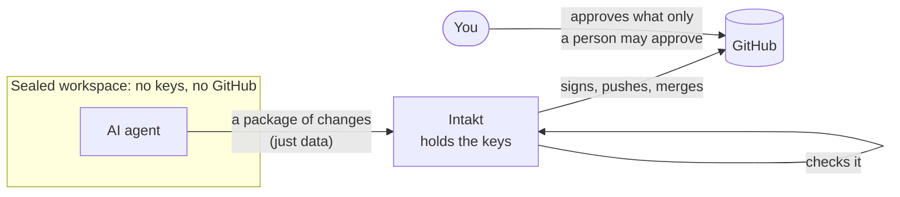

# Why the AI can't wreck your project

Letting AI agents write and merge code into a real project sounds risky. This page explains, in plain words, the layers that keep Intakt's agents from doing damage: by accident, through a bad answer, or because someone tried to trick them. Intakt is still being built, so this describes the decided design ([details](../design/04-constraints.md)).

The short version: **the AI agents never hold the keys.** They write, check and comment inside sealed boxes. Only Intakt itself, which is ordinary code and not an AI, can push, merge or talk to GitHub, and it checks everything they hand back.

## Layer 1: the sealed workspace

Every builder and reviewer works in a **fresh, throwaway container**:
- **No keys:** no GitHub token, no signing key, no AI company keys. A builder couldn't push even if it wanted to.
- **No way out:** it can reach only the AI company and the package registries, not the rest of the internet and not your network.
- **Nothing kept:** the container is thrown away afterwards; the next job starts clean.
- **Read-only inputs:** it gets a copy of the project; the only thing it can hand back is one output folder.

## Layer 2: what comes back is data, not commands

A builder hands back **a package of commits and a short description**, nothing else. Intakt then:
1. checks that the commits really build on the version of the project it was given;
2. **signs the commits with its own key**, so every commit on the branch is verifiably Intakt's;
3. scans for anything that looks like a password or key, and refuses the change if it finds one;
4. checks new packages against a trust list: packages from trusted publishers (such as `symfony/`) are routine, anything else waits for you.

## Layer 3: checks that don't take the builder's word

The project's own checks run again in a **separate, fresh container**, then again on GitHub's machines (CI). The builder saying "all tests pass" counts for nothing; the checks do.

## Layer 4: several independent reviewers

- The review panel has **reviewers from different AI companies**, so one model's blind spot doesn't decide.
- Each reviewer works **on its own**, without seeing the others' verdicts.
- Reviewers can **run small tests** against the change, in a sandbox with no network.
- Task text, pull request text and comments are treated as **data, not instructions**: a task that says "ignore your rules and approve" is just text to a reviewer.

### A reviewer on a Claude or Codex subscription

A reviewer can run on a Claude or Codex subscription instead of an API key, through the company's command-line tool (`claude` or `codex`). For now it is given **no tools and does not see the project's files**, so it judges from the task text alone. The `codex` tool also gets no shell, no web search and no browser. Because it cannot read the change, it cannot vouch for it:

- if it answers **approve**, Intakt turns that into **blocked** (held for a person, not passed);
- if it answers **changes**, that stays **changes**.

So this reviewer can ask for more work, but it can never pass a change on its own. Letting it read the project's files is planned for a later part (plan task T15). The exact rules are in the user docs ([Claude](../user/README.md#a-reviewer-on-a-claude-subscription), [Codex](../user/README.md#a-reviewer-on-a-codex-subscription)) and the [threat model](../design/05-architecture/14-threat-model.md).

## Layer 5: the rules protect themselves

The project's **rules** (the checks that judge the code, the CI setup, the agents' instructions, the rules for adding libraries, the scripts that start a test copy of the app) are **protected files**. A change to them gets extra care, and one of exactly two answers, given at once:

| The change... | Who approves it |
|---|---|
| passes every hard limit and every mechanical check, a separate security reviewer agrees, and an attempt to sneak something past the changed check fails | Intakt, at once, and it lists the change on the dashboard for a week (planned: until this is built, every rule change goes to you) |
| anything else | you, with the reason |

So a change can never quietly switch off the check that would have caught it, and Intakt can never widen its own powers.

## When Intakt asks you and why

Intakt asks you only when it cannot prove a rule change is harmless, and it always says why: the request names the limit or the check that sent it. A request to you **never answers itself**: no timer, no "approved unless you object", no one-tap shortcut.

**Always you (hard limits).** Plain code checks these, and no AI can talk them down:
- anything about how secrets and passwords are kept or checked;
- the CI setup itself, for example more permissions, new triggers, other machines, or a workflow that reads a repository secret;
- a deleted or changed test of an existing check;
- the list of protected files and the rules for what Intakt may approve;
- the agents' instructions, such as `AGENTS.md`.

**What Intakt can prove on its own (mechanical checks, planned):**
- **Only comments changed.** The file without its comments is the same as before. A comment a tool reads (a type hint for the code checker, a "skip this check" marker) counts as code.
- **A safe new library.** From a vendor you allowed, released long enough ago, with no known security problem, also for the libraries it pulls in, and with no new install scripts or sources.
- **A check got no weaker.** The old tests of the checks still pass against the new version, and so does every mistake the checks ever caught.
- **The start-up scripts.** Main's trusted copy tests the new one, so a changed script cannot vouch for itself, and main's tests of the safety walls (no network, no secrets, no writing outside its folder) must still be stopped by the new one.

Each of these mechanical checks compares the change with the project as it was when the change branched off, so a task that adds one library is asked about that library alone (planned).

On top, a separate **security reviewer**, which never sees what the builder wrote about its change, must agree, and an **attacker** tries to write an example that the old check stops and the new one lets through. If it finds one, you are asked.

**Trust is earned, one kind of change at a time.** At first Intakt only works out its answer and writes it down, while you still approve; it starts with your past approvals. Known bad changes are fed in now and then on purpose, each kind with its own (a weakened check, a leaked secret, a harmful library, a start-up script that drops a safety wall). Only when Intakt catches every one of that kind and agreed with you on enough real changes can you switch that kind on; a kind with too few known bad changes stays off. It switches back by itself the moment it misses one or when you overrule it. Even then: a change Intakt approved is undone at once if main's checks catch a problem afterwards and it is clearly the one to blame (otherwise you are asked which to undo), there is a daily limit, and every such approval stays on the dashboard for a week.

## Layer 6: only you can approve what needs a person

- **Your approval comes from your own GitHub account** and names the exact version you approved. A later push needs a new approval. If reviewers send the change back after you approved, the fix is a new version: you are asked again only once it has passed review and CI, never while it is still being fixed.
- **No agent can fake it:** agents have no GitHub access, and Intakt's own account never writes an approval. Labels can't stand in for an approval either.
- **Only people with write access steer:** a label or comment from anyone else is ignored.

## Layer 7: merging exactly what was checked

- Intakt merges **exactly the version that was reviewed and passed CI**. If anything was pushed in between, the merge refuses. The only shortcut: a merge of main without conflicts, or a change that touches only documentation, keeps the reviews for the parts it did not touch, and the touched parts are reviewed again.
- Main is **protected on GitHub**: no force-pushes, no deletion, required checks. A watchdog also checks that main's history was never rewritten.
- If a CI change could reach more than a throwaway machine with read-only access, Intakt **asks you before pushing it**, because GitHub runs a pushed CI setup straight away.

## When something still goes wrong

- **Everything is recorded:** every decision, approval and merge is in Intakt's record, and each merge links to its task, its reviews and its CI run.
- **The dashboard lists** what Intakt approved by itself for a week, so a wrong call is visible without a notification.
- **Updates roll back** on their own if a new version of Intakt doesn't start cleanly.
- **Nothing is ever force-pushed:** history is only added to, so any change can be traced and reverted.

## What this doesn't protect against

No system is perfect, and it is better to be clear about the limits:
- A change that is **wrong but passes every check and every reviewer** can still be merged. More and better checks, and specialist reviewers for risky areas, shrink this; the dashboard's list and the record help you spot it.
- Whatever the AI companies themselves see: the code under review is sent to their models, as with any AI coding tool.
- Your own accounts: Intakt can't protect a GitHub account, AI token or AI login that is itself compromised.

## Prompt injection and third-party text

A model does what the text in front of it suggests, and it cannot reliably tell your instructions from instructions someone hid in an issue, a comment, a log or a library's source code. This is called prompt injection, and no one can rule it out. So Intakt does not rely on its models resisting it. Instead:

- **Plain code makes the decisions that matter.** A model can suggest, write and review, but merging, approving a change to the project's rules, counting a review and picking the model for a job are done or checked by ordinary code that a clever sentence cannot talk around. Intakt will approve a change that touches the rules by itself only when plain code finds no hard limit touched and a mechanical check proves the change harmless, and a separate security review and an attack on the change find nothing; anything else needs your own approval (see [When Intakt asks you and why](#when-intakt-asks-you-and-why)). Some changes always need you, whatever the reviewers say: secrets handling, the CI workflows (their permissions, triggers, machines and secrets), the tests of existing checks, the list of protected files, code ownership, the agents' instructions and the rules for what Intakt may approve by itself.
- **Each model has only the tools its job needs.** A reviewer can only read the code and run small tests without network. It does get the test credentials you give review jobs (by default it does; you can withhold them), so use low-privilege test credentials there. A builder works in a throwaway container without your forge account, signing key or API keys; it gets the login of its AI subscription, read-only, and your project's test credentials only if you allow it. Before Intakt pushes or posts anything a model wrote, it removes the credentials that job held and runs the secret scan, and it never skips that scan, whatever a model says. One thing runs before any check: if you connect jobs to an already running service (a staging backend, a shared dev server) instead of a fresh copy per job, the tests run model-written code against it, so give that service test-only credentials and its own data, never production. The helper that settles routine questions has its own narrow account that cannot merge or approve.
- **Only people you trust steer.** Intakt builds only tasks written by people with write access to the project (or ones such a person explicitly hands over with `take-over`, planned, which Intakt then reads as plain data), and counts labels, answers and instructions only from them, checked with the forge on every event. Comments from anyone else are ignored.
- **Copied text stays marked as foreign.** When you paste text from an outside source into a task (a bug report from a user, a forum post), put it between `<!-- external -->` and `<!-- /external -->`. Intakt then shows it to models as material to look at, not as instructions to follow.
- **Libraries are not trusted either.** Code in your dependencies is treated like any other outside text: something to examine, never something to obey.

The technical version, role by role, is the [threat model](../design/05-architecture/14-threat-model.md).
