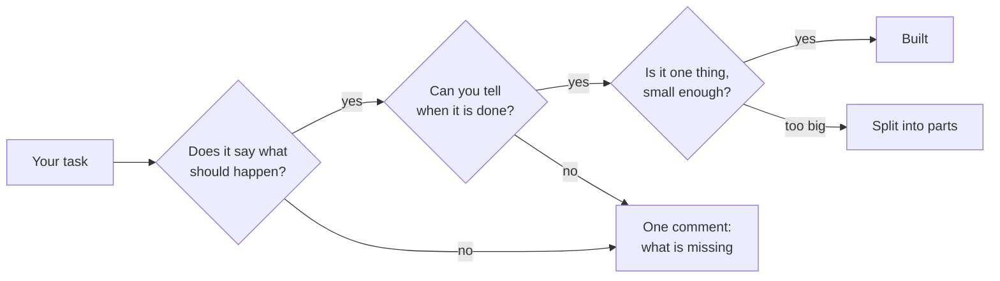

# Writing a good task

Intakt builds exactly what a task says, so the task is the most important thing you write. A clear task is built and merged in one go; an unclear one costs extra rounds, and every round costs money. This page shows what Intakt looks for and gives you a template to copy. Intakt is still being built, so this describes the decided design ([details](../design/05-architecture/03-choosing-work.md)).

## Definition of Ready

This is the one place the guide states it; every other page that says when a task may be built points here. The Tech lead checks it ([the design's statement](../design/01-intent.md#definition-of-ready)). A task is *Ready* to build when:

1. It says one outcome, what you will be able to see, and acceptance points anyone can check.
2. It is small enough to build and review in one go, or it has been split into parts that are.
3. It has a plan: the files, the approach and the risks. For a project with screens, when the task touches them, the plan also covers what the Designer adds: the flows, every state (empty, loading, error, success), the wording, the phone, tablet and desktop widths, and accessibility (planned). Before the first build the plan also carries a short brief (the change, the files it touches, the command that verifies it and what done looks like) that passes its check (planned).
4. Every evidence item can be produced inside the Developer's sandbox, or is marked `(owner provides)` ([below](#evidence-the-developer-can-produce)).
5. It names the docs the change will touch.
6. It names what it waits for (`Waits for #n`) and, for a part of a split task, the task it came from.
7. It still makes sense on today's main: not done already, not replaced by another task, and not contradicted by a later decision.

For a new project, the spec is ready to plan when the Tech lead can break it into tasks that each meet these seven points.

## Definition of Done

This is the one place the guide states it; every other page that says what the Developer checks before handing work back points here. The Developer owns it, together with the checks ([the design's statement](../design/01-intent.md#definition-of-done)). A change is *Done* when the Developer hands it back with:

1. Every acceptance point met, and every evidence item it can produce shown from a running copy of the project in the pull request; items marked `(owner provides)` are yours or Intakt's to provide.
2. Its own run of the project's fast checks passing.
3. The docs it touches saying what the code now does: every name and behavior it changed was searched for in the docs and corrected.
4. The mistakes reviewers often found before, listed in its briefing, checked against the change.

Done is the Developer's word, not the last one: the checks then run again in a clean place, CI runs, the Code reviewers judge the change, and only a merge ends the task.

## What Intakt checks before it starts

Before any money is spent, the Tech lead reads the task and asks three questions from the [Definition of Ready](#definition-of-ready):



A task that fails one of them is not built. Intakt leaves one comment listing what is missing, and picks the task up again once you have added it.

## Writing a bug task

Give a bug the `bug` label and describe it in four parts, each under its own heading or in bold:

- **When:** the steps or the input that show the bug.
- **Today:** what happens now.
- **Expected:** what should happen.
- **Must keep working:** what the fix must not change.

Start each part with a heading that is just its name (`## Today`) or with its name in bold (`**Today:** the page stays blank`). Parts written inside a code block or a comment do not count.

If a part is missing or empty, Intakt builds nothing. It parks the task with a question that names the missing part; add it, or remove the `bug` label. For now the question is only stored: Intakt does not post it on the issue yet. A complete bug task goes on to the build. A bug no test can show (a vendor outage, a device only you have) keeps the usual evidence rules.

## The template

Copy this into a new issue and fill it in:

```markdown
One or two sentences: what should be different when this is done, and why.

## Acceptance
- An observable result: "running `intakt:review 12` prints the verdict as JSON"
- Another one, if needed: "a review with no findings exits with code 0"

## Evidence
- E1: the test run
- E2: the command's output on a local install
- E3: a CI run link (owner provides)

Waits for #12
```

What each part is for:

| Part | What to write | Why it matters |
|---|---|---|
| **The first lines** | the outcome and the reason, in plain words | the Developer and the Code reviewers both judge against it |
| **Acceptance** | results anyone can check: a command's output, a page that shows something, a test that passes | "it works" can't be checked; "prints the verdict as JSON" can |
| **Evidence** | what the finished change must show, numbered E1, E2, ... | reviewers check each item one by one; missing evidence sends the work back, except an item marked `(owner provides)`, which you deliver yourself (see [Evidence the Developer can produce](#evidence-the-developer-can-produce)) |
| **Waits for #n** | another task this one needs first, or the pull request it needs (optional); name only the part you build on, never a whole bigger task split into parts | the task isn't started until that task is done, or until that pull request is merged into main (a pull request closed without merging keeps it waiting), so nothing is built on a missing base, and naming more than you need makes tasks wait in single file; write it outside any `<!-- external -->` block (planned, see below) |

Planned: a `Waits for #n`, `Waits for release:` or `Replaces #n` line only counts in your own words: inside text you copied between `<!-- external -->` and `<!-- /external -->`, such a line records no wait and has no effect, so write it outside that block.

Planned: when a task needs a change in another repository that Intakt doesn't build (a fix in a library, a release of a tool), write `Waits for release: <owner>/<repo>#<n>` instead, with one or more issues after the colon. Use the same line for a repository Intakt does build when your task needs that change released or deployed, not only merged. The line is all you write: Intakt shows the task as blocked by itself, so don't set a label for it. Intakt starts the task once each of those issues is closed and the change that closed it is in what your project runs: released and in your lock file for a library, deployed for a tool. If it can't tell, it asks rather than guessing. Don't describe such a wait only in a sentence: nothing would start the task again. A `Waits for release:` line inside an `<!-- external -->` block records no wait, so write it in your own text outside that block.

## How Intakt counts your Evidence items

Intakt can check a build's pull request text against your task's Evidence list with `intakt:check:pull-request-text`, and every build runs the same check before its push. It counts the items of the list under your first Evidence heading (`## Evidence`, a heading with more words such as `## Evidence (for this part)`, or a line `Evidence:`) as E1, E2, and so on, in order. An introduction line under the heading is fine. Indented lines under an item belong to that item. A list inside a code block or an HTML comment is not counted, and a mention of `E2` only inside an HTML comment, or on a code block's opening line after its backticks, in the pull request text does not count either, because nobody sees it. Under a line `Evidence:` the list ends at the next heading, at a new label such as `Acceptance:`, or at a paragraph after a blank line; under a heading it runs to the next heading. So under `## Evidence`, a list after a label such as `Acceptance:` still counts as Evidence items: put acceptance lines under their own heading. A heading you indent below an item, in line with the item's text, is part of that item and ends nothing; a heading with less indent ends the list. A code block you open below an item ends with that item, even if you forget its closing line. The pull request text must name each item and stay at or under 4000 characters. A first miss stops the build before its push, with nothing pushed and the work kept in the build folder; a second miss in a row goes on to the reviewers, who see the gap themselves. Planned: the build lane hands a first miss back to the builder to redo only the text.

## Evidence the Developer can produce

Every evidence item must be something the Developer can produce inside its sandbox (point 4 of the [Definition of Ready](#definition-of-ready)). The sandbox has no network beyond the AI company and the package registries, no access to GitHub, and no real credentials.

Evidence only you or Intakt itself can produce is marked `(owner provides)`. It is not the Developer's to deliver. Without the mark, reviewers ask for the item round after round and the Developer cannot deliver it.

| The Developer can produce | Only you or Intakt can produce (mark it `(owner provides)`) |
|---|---|
| a test run listing the cases, or one named test | a CI run link (the Developer has no GitHub access) |
| the output of a console command on a local install (`bin/console doctrine:migrations:migrate` on SQLite) | a call to a real AI company with a real key |
| `bin/instance` and `bin/probe` runs, which work offline (the Developer's sandbox refuses new user namespaces, so it runs `bin/probe` with `PROBE_ISOLATED=1`, which does not open the network: `bin/probe` first checks that only `lo` is visible and up, and refuses with exit code 2 if not; that output is valid evidence) | a webhook delivered by GitHub, or a comment posted there |
| a call against `MockPlatformFactory` with a `ScriptedResponse`, or a recorded `HttpCassette` | a run on your own install |
| the diff, for a change to documentation only | |

An item marked `(owner provides)` still belongs in the list: it tells reviewers what you check before the merge.

Planned: when the Tech lead sizes a task, it also checks each evidence item against the [Definition of Ready](#definition-of-ready). If one is something the Developer can't produce and it isn't marked `(owner provides)`, the task comes back to you with one comment naming those items, before any build starts. Fix the item or add the mark, and the task goes on. A marked item is listed for you, and Intakt's reviewers never send the work back for it.

## Good and not so good

| Not so good | Better |
|---|---|
| "Improve the review output." | "The review command prints its verdict as JSON, so scripts can read it." |
| "Make it faster." | "A review of a 200-line change finishes in under two minutes; the timing is in the evidence." |
| "Fix the bug." | "A verdict with an empty findings list is accepted instead of refused (`tests/...` shows it)." |
| "Add login, the dashboard and notifications." | Three tasks: one each, the later ones `Waits for` the first. |

## Size

Small tasks are cheaper and safer: they are reviewed more thoroughly and go wrong less often.
- **One outcome per task.** If you write "and" between two features, it is probably two tasks.
- **Too big is not a problem you have to solve alone:** Intakt splits a large task into parts that each work on their own, and each part keeps the decisions that apply to it. Planned: if the Developer runs out of steps before it finishes a task, the Tech lead sizes it again with what that try showed, instead of trying again at the same size; if a second try also stops unfinished, the task comes to you or the Maintainer.
- **Very small tasks** in the same area may be built together, to save a review.

## Steering with labels

Labels on the issue tell Intakt how to treat the task. Only people with write access to the repository can steer; a label set by anyone else is ignored.

| Label | Effect |
|---|---|
| the project's eligibility label (`intakt` by default) | Intakt may build this task |
| `idea` | for discussion only: Intakt never builds or plans it, even if the eligibility label is also set |
| `priority:urgent`, `high`, `normal`, `low` | the order in the queue (no label means `normal`) |
| `class:core`, `feature`, `tooling`, `process` | what kind of work it is |
| `model:strong`, `standard`, `light` | start with a stronger or cheaper AI model |
| `plan:required`, `plan:skip` | the Tech lead writes a plan for your approval first, or not |
| `review:full`, `review:<role>` | all the Code reviewers every round, or a specialist reviewer (for example `review:security`) |

To park an idea, label the issue `idea`; to turn it into work, remove `idea` and add the project's eligibility label (`intakt` unless the project names another).

## Asking and answering

- **When Intakt has a question** it can't answer from the task, it asks on the issue with the choices and its recommendation, and moves on to other work meanwhile. Your answer is written into the task, and the task starts again from there.
- **When you want to change course** on a task in flight, comment on the issue. A change of mind restarts the task, so it is cheaper to get the task right before it starts.

## A quick checklist

The short form of the [Definition of Ready](#definition-of-ready) for you as the writer:

- [ ] It says what should be different, and why.
- [ ] Every acceptance point can be checked by someone who didn't write it.
- [ ] The evidence says what the change must show, and anything the Developer can't produce is marked `(owner provides)`.
- [ ] It is one outcome.
- [ ] Anything it depends on is named with `Waits for #n`, naming only the part it needs, not a whole bigger task. A change in a repository Intakt does not build, or one that must be released or deployed and not only merged, is named with `Waits for release: <owner>/<repo>#<n>` (planned, see above). These lines are in your own text, outside any `<!-- external -->` block.
