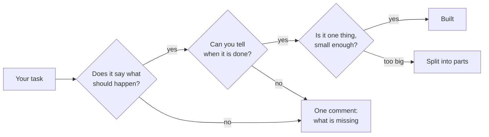

# Writing a good task

Intakt builds exactly what a task says, so the task is the most important thing you write. A clear task is built and merged in one go; an unclear one costs extra rounds, and every round costs money. This page shows what Intakt looks for and gives you a template to copy. Intakt is still being built, so this describes the decided design ([details](../design/05-architecture/03-choosing-work.md)).

## What Intakt checks before it starts

Before any money is spent, a quick check reads the task and asks three questions:



A task that fails one of them is not built. Intakt leaves one comment listing what is missing, and picks the task up again once you have added it.

## The template

Copy this into a new issue and fill it in:

```markdown
One or two sentences: what should be different when this is done, and why.

## Acceptance
- An observable result: "running `intakt:review 12` prints the verdict as JSON"
- Another one, if needed: "a review with no findings exits with code 0"

## Evidence
- E1: the test run
- E2: the command's output on a local install
- E3: a CI run link (owner provides)

Waits for #12
```

What each part is for:

| Part | What to write | Why it matters |
|---|---|---|
| **The first lines** | the outcome and the reason, in plain words | the builder and the reviewers both judge against it |
| **Acceptance** | results anyone can check: a command's output, a page that shows something, a test that passes | "it works" can't be checked; "prints the verdict as JSON" can |
| **Evidence** | what the finished change must show, numbered E1, E2, ... | reviewers check each item one by one; missing evidence sends the work back |
| **Waits for #n** | another task this one needs first (optional) | the task isn't started until that one is done, so nothing is built on a missing base |

## Evidence the builder can produce

Every evidence item must be something the builder can produce inside its sandbox. The sandbox has no network beyond the AI company and the package registries, no access to GitHub, and no real credentials.

Evidence only you or Intakt itself can produce is marked `(owner provides)`. It is not the builder's to deliver. Without the mark, reviewers ask for the item round after round and the builder cannot deliver it.

| The builder can produce | Only you or Intakt can produce (mark it `(owner provides)`) |
|---|---|
| a test run listing the cases, or one named test | a CI run link (the builder has no GitHub access) |
| the output of a console command on a local install (`bin/console doctrine:migrations:migrate` on SQLite) | a call to a real AI company with a real key |
| `bin/instance` and `bin/probe` runs, which work offline | a webhook delivered by GitHub, or a comment posted there |
| a call against `MockPlatformFactory` with a `ScriptedResponse`, or a recorded `HttpCassette` | a run on your own install |
| the diff, for a change to documentation only | |

An item marked `(owner provides)` still belongs in the list: it tells reviewers what you check before the merge.

## Good and not so good

| Not so good | Better |
|---|---|
| "Improve the review output." | "The review command prints its verdict as JSON, so scripts can read it." |
| "Make it faster." | "A review of a 200-line change finishes in under two minutes; the timing is in the evidence." |
| "Fix the bug." | "A verdict with an empty findings list is accepted instead of refused (`tests/...` shows it)." |
| "Add login, the dashboard and notifications." | Three tasks: one each, the later ones `Waits for` the first. |

## Size

Small tasks are cheaper and safer: they are reviewed more thoroughly and go wrong less often.
- **One outcome per task.** If you write "and" between two features, it is probably two tasks.
- **Too big is not a problem you have to solve alone:** Intakt splits a large task into parts that each work on their own, and each part keeps the decisions that apply to it.
- **Very small tasks** in the same area may be built together, to save a review.

## Steering with labels

Labels on the issue tell Intakt how to treat the task. Only people with write access to the repository can steer; a label set by anyone else is ignored.

| Label | Effect |
|---|---|
| `intakt` | Intakt may build this task |
| `priority:urgent`, `high`, `normal`, `low` | the order in the queue (no label means `normal`) |
| `class:core`, `feature`, `tooling`, `process` | what kind of work it is |
| `model:strong`, `standard`, `light` | start with a stronger or cheaper AI model |
| `plan:required`, `plan:skip` | the builder writes a plan for your approval first, or not |
| `review:full`, `review:<role>` | the full review panel every round, or a specialist reviewer (for example `review:security`) |

## Asking and answering

- **When Intakt has a question** it can't answer from the task, it asks on the issue with the choices and its recommendation, and moves on to other work meanwhile. Your answer is written into the task, and the task starts again from there.
- **When you want to change course** on a task in flight, comment on the issue. A change of mind restarts the task, so it is cheaper to get the task right before it starts.

## A quick checklist

- [ ] It says what should be different, and why.
- [ ] Every acceptance point can be checked by someone who didn't write it.
- [ ] The evidence says what the change must show, and anything the builder can't produce is marked `(owner provides)`.
- [ ] It is one outcome.
- [ ] Anything it depends on is named with `Waits for #n`.
