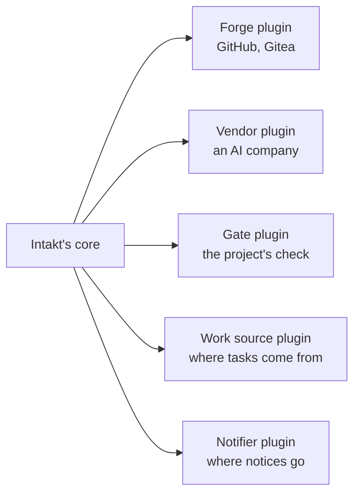
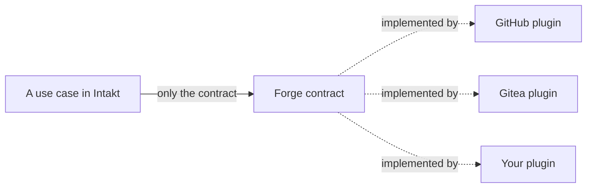

# Writing a plugin

Intakt connects to the outside world through **plugins**: small classes behind small interfaces. To add a forge, an AI company or a notifier, you write one plugin; nothing else in Intakt changes. Intakt is still being built, so the interfaces below are sketches from the design ([details](../design/05-architecture/02-plugins.md)); they become real with the tasks that need them.

## The kinds of plugin

| Kind | What it must do | Built in for v1 |
|---|---|---|
| **Forge** | list work, read an issue, open or update a pull request, read CI status, merge, comment | GitHub, Gitea |
| **Vendor** | run a build, run a review, report usage, report prices and limits | Claude Code, Codex, an OpenAI-compatible API |
| **Gate** | name the steps of the check and the hosts its downloads come from (built); name the files a dependency install depends on, and how to install from them cleanly apart from the files made from the project's own code (built, and used by checks to share one install between heads with the same lock files); name the files it protects (planned) | PHP: `composer install` and `bin/check --fast`, or the project's own command (`make check`, ...) |
| **Work source** | say which tasks are eligible, and in what order | forge issues with a label, with `Waits for #n` |
| **Notifier** | deliver a notice, report whether it arrived, send a test | browser push, Home Assistant, ntfy, webhook, email |

## How a plugin fits in

A plugin is its own module in `src/Plugin/<Kind>/`, listed in `config/modules.php`. The rest of Intakt only ever sees the plugin's kind's **contract** (its interface and the typed objects it passes), never the plugin's own classes, and the `architecture` gate enforces that.

## Steps

1. **Pick the kind** and read its contract under `src/Plugin/<Kind>/Contract/`.
2. **Create the module** `src/Plugin/<YourName>/`, with the implementation in `Infrastructure/`, and register it in `config/modules.php`.
3. **Implement the contract** following [`AGENTS.md`](../../AGENTS.md): final classes, typed objects across the boundary (never arrays), time only through the clock, no state kept between requests.
4. **Make it selectable in config**, so an owner can choose it per project.
5. **Test it offline:** a plugin's tests never call the real service. Use recorded responses, or a scripted stand-in for an AI model (see the vendor tests), and test the failure paths: a rate limit, a timeout, a bad answer.
6. **Document it:** a section in `docs/user/` (how to set it up), and a line in [what Intakt connects to](what-intakt-connects-to.md).

## Rules every plugin keeps

- **It never decides what may be approved or merged.** That stays in Intakt's core, behind the protected rules.
- **Secrets stay in the orchestrator.** A plugin reads its credentials from Intakt's configuration; jobs never see them.
- **It fails clearly.** An error the service reports becomes a typed error Intakt can act on (for example "rate limited, retry after 40 seconds"), never a silent empty result.
- **Vendor plugins describe their models** (cost class, and what each is good at: building, reviewing, quick triage), so Intakt can choose without code specific to that company.
- **Notifiers never carry secrets and never approve anything.**
