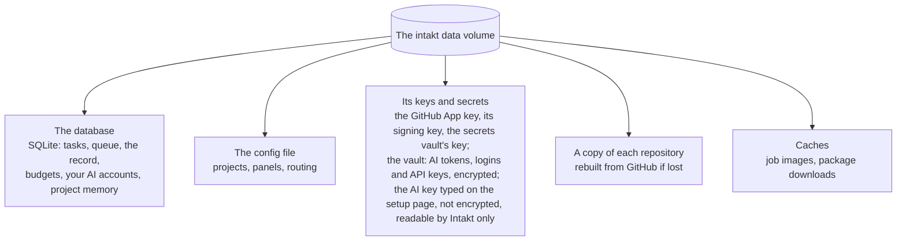

# Your data: backups, upgrading, moving and uninstalling

Everything Intakt knows lives in one place, so it is easy to back up, move or remove. Intakt is still being built, so this describes the decided design ([overview](../design/05-architecture/01-overview.md), [setup](../design/05-architecture/11-setup.md)); the exact commands arrive with the container image (plan task T22).

## What Intakt keeps, and where

| Part | What's in it | If you lose it |
|---|---|---|
| **The database** | every task's state, the record of every decision, budgets, the AI accounts and controls you set in the admin area, project memory | Intakt forgets its history and you add your accounts again; your code and pull requests on GitHub are untouched |
| **The config file** | your settings: projects, panels, routing | you redo the setup wizard |
| **Its keys and secrets** | the App's private key, the signing key and the key of the secrets vault; the vault itself with the AI tokens, logins and API keys you saved, encrypted; the AI key you typed on the setup page, in a file of its own that is not encrypted but that only Intakt's own user can read | you reconnect the App and paste new tokens or log in again in the admin area |
| **The repository copies** | a mirror of each project | nothing: rebuilt from GitHub |
| **Caches** | images and downloads | nothing: rebuilt, just slower once |

**What is not in Intakt:** your code, issues, pull requests, reviews and approvals all live on GitHub (or Gitea). Intakt never holds the only copy of anything of yours.

## What Intakt keeps and for how long

Say a pull request went red last week and you wonder what Intakt still remembers about it. It remembers that the head went red. It does not remember the CI output. Here is what stays, and for how long.

| What | How long | Good to know |
|---|---|---|
| **The ledger** | kept, and only ever added to | The record of what Intakt did. You cannot edit it. Removing the demo project also removes the events it replayed. |
| **Conversations** | 30 days after the last message, unless you change it | What a model was shown and said, so it holds your code. Set `retention.conversation_days` (1 to 36500, or `forever`) in the config file. Only reviewer conversations are stored today; builder conversations will follow the same setting once they are. |
| **The log** | written to the service output (the journal, or `docker logs`), warnings and errors only unless you raise the level; how long it lasts is up to the journal or Docker, not Intakt | Set with `INTAKT_LOG_LEVEL`. Secrets Intakt knows about are written as `[redacted]`. |
| **CI logs** | on GitHub, 90 days by default | Intakt stores none. Change the time in the repository's Actions settings on GitHub, not in Intakt. |

Deleting a conversation never touches the ledger. For a red head, the ledger holds the head and when Intakt looks again, but no CI log text. A CI excerpt that a builder receives lives only in that builder's conversation, so the 30 days apply to it too.

In the container image, all of this lives in `/app/var/data`, which you must mount as a volume: the image declares none, so without one your data is lost with the container (see [Running the container image](../reference/user-manual.md#running-the-container-image)).

## Backing up

Back up the data volume. Two ways:
- **Quick and safe:** pause Intakt from the dashboard and wait until nothing is running, then stop the container (`docker stop intakt`), copy the volume and start it again (`docker start intakt`). A pause alone is not enough: approved work still merges during a pause, which writes to the volume, and a pause ends by itself at the time you chose.
- **Without pausing:** take a consistent copy of the database with SQLite's own backup command, and copy the config file, the keys and the secrets vault next to it.

Treat the backup like a password manager's file: it holds keys. Store it encrypted.

## Upgrading

A new version of Intakt may change how its database is laid out. It does that by itself when it starts, and it only goes forward: an older version cannot read data a newer one has changed. So keep a copy from before the update.

1. Pause Intakt and wait until nothing is running.
2. Stop the container (`docker stop intakt`) and copy the data volume, as in [Backing up](#backing-up).
3. Update to the new version and start it on the volume. It updates the data on its first start.
4. Keep the copy until the new version has run a normal day.

**If something is wrong:** stop the new version and go back to the previous version on the copy you made in step 2. Never start the previous version on the data the new version has already updated.

The steps above are how you upgrade today. Planned: Intakt updates itself, with the old and the new version running side by side on the same data for a while, and running jobs finish on the version they started on ([draining and updates](the-engine-room.md#draining-and-updates)). A new version then only adds data the old one ignores, so going back to the old version needs no copy and loses nothing recorded since. Each version says which older versions it can be installed from directly; that range is its rollback window, and every version in it is tested on the data the new one writes before the new one is published. An install older than that takes the versions in between first, one full update at a time, so it never goes back to a version that was not tested.

Planned: a version that changes stored data so the old version could not read it says so, and only that kind of update pauses all work while it switches. Such an update first copies the data, and if it fails before work resumes, Intakt goes back to the old version on that copy. So its rollback window is empty, but it still says which older versions it can be installed from: an install older than that takes the versions in between first, then this one.

Intakt's own changes are checked this way: the version before it writes data, the new version starts on a copy of that data and must read the same, and the version before it starts again on the untouched original. A change is checked before it is merged when it touches the database migrations (`migrations/`), a stored class, the image's own build files (the `Dockerfile` at the top of the repository and anything under `docker/`) or the locked dependencies (`composer.lock`). An ordinary change to the application also rebuilds the image, but that alone does not run the check before merge. Every change, including that one, is checked on the main branch right after it is merged.

## Moving to another machine

1. Pause Intakt and wait until nothing is running.
2. Stop the old container (`docker stop intakt`), so nothing writes to the volume while you copy it and the pause can't run out and start new work.
3. Copy the data volume to the new machine.
4. Start Intakt there with the same volume; it picks up where it stopped.
5. Remove the old container, so two copies never run against the same repositories.

## Uninstalling

1. Pause Intakt; let running jobs finish.
2. Stop and remove the container, and delete the data volume (and its backups, if you no longer want them).
3. On GitHub, uninstall and delete Intakt's App, so nothing holds access to your repositories any more.
4. Log out the AI subscriptions or revoke the API keys you gave it.

Branches Intakt created and pull requests it opened stay on GitHub until you delete them; its comments stay too, signed by its App.
