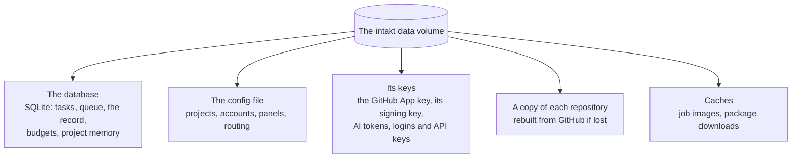

# Your data: backups, moving and uninstalling

Everything Intakt knows lives in one place, so it is easy to back up, move or remove. Intakt is still being built, so this describes the decided design ([overview](../design/05-architecture/01-overview.md), [setup](../design/05-architecture/11-setup.md)); the exact commands arrive with the container image (plan task T22).

## What Intakt keeps, and where

| Part | What's in it | If you lose it |
|---|---|---|
| **The database** | every task's state, the record of every decision, budgets, project memory | Intakt forgets its history; your code and pull requests on GitHub are untouched |
| **The config file** | your settings | you redo the setup wizard |
| **Its keys** | the App's private key, the signing key, AI tokens and logins | you reconnect the App and paste new tokens or log in again |
| **The repository copies** | a mirror of each project | nothing: rebuilt from GitHub |
| **Caches** | images and downloads | nothing: rebuilt, just slower once |

**What is not in Intakt:** your code, issues, pull requests, reviews and approvals all live on GitHub (or Gitea). Intakt never holds the only copy of anything of yours.

## Backing up

Back up the data volume. Two ways:
- **Quick and safe:** pause Intakt from the dashboard (running jobs finish, nothing new starts), copy the volume, resume.
- **Without pausing:** take a consistent copy of the database with SQLite's own backup command, and copy the config file and keys next to it.

Treat the backup like a password manager's file: it holds keys. Store it encrypted.

## Moving to another machine

1. Pause Intakt and wait until nothing is running.
2. Copy the data volume to the new machine.
3. Start Intakt there with the same volume; it picks up where it stopped.
4. Remove the old container, so two copies never run against the same repositories.

## Uninstalling

1. Pause Intakt; let running jobs finish.
2. Stop and remove the container, and delete the data volume (and its backups, if you no longer want them).
3. On GitHub, uninstall and delete Intakt's App, so nothing holds access to your repositories any more.
4. Log out the AI subscriptions or revoke the API keys you gave it.

Branches Intakt created and pull requests it opened stay on GitHub until you delete them; its comments stay too, signed by its App.
