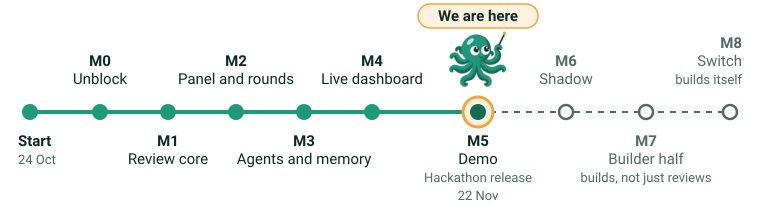

# Intakt at the Symfony AI & MCP Hackathon

Intakt was built for the Symfony AI & MCP Hackathon, from 2026-10-26 to 2026-11-22. This page says what was planned,
what was achieved inside that window, and what comes next. Development continues after the hackathon.

  <picture>
    <source media="(prefers-color-scheme: dark)" srcset="assets/roadmap-dark.svg" width="600" height="350">
    
  </picture>

The 90-second demo video: [on YouTube](https://youtu.be/-8v0nflAQBk).

## The plan

The first release is the review loop ([spec](spec.md), [plan](plan.md)): a panel of reviewers on models from different
AI labs reviews a change, a judge marks every finding against the task and tells the builder what to act on, finding
ids survive from round to round, your own agent runs the loop over MCP until the verdict is clean, a live dashboard
shows each round as it streams, and `docker compose up` with a sample repository gets a juror to the first verdict in
five minutes: a live review with one provider key or Hugging Face token, or, with none, a recorded real review played
back. The larger aim comes after it: you give Intakt a spec, and Intakt turns it into small tasks, builds each
one and merges what passes review.

## The first release: the review loop

What the first release does, as built for the hackathon (deadline 2026-11-22, [spec](spec.md)):

- Point Intakt at a change, a branch of a local repository. A configurable panel of reviewers, each a provider, a model tier and a prompt through Symfony AI's Platform, returns structured JSON verdicts.
- Findings keep their ids across rounds, enforced in code, so reviewers cannot move the goalposts. A judge step tells the builder what to act on, and only a P3 finding can be deferred or rejected. The outcome and the act list agree: a round sent back as `changes` always names a finding to act on, and a reviewer whose findings are all P3s the judge deferred or rejected counts as approving, with follow-ups.
- Agents start reviews and read findings through an MCP server.
- A small live dashboard shows each round as it streams.
- Every figure says what kind it is: token counts the provider reported are `measured`, rounds and findings from the ledger are `counted`, and a cost from your price list is `estimated`, with the date of the prices. Figures of different kinds are never added into one total.
- `docker compose up` with a sample repository and your API keys (or a Hugging Face token) runs it in five minutes.

## The timeline

The repository's first commit with content is from 2026-10-26, the first day of the hackathon; the commit of
2026-10-24 is GitHub's empty initial commit. Everything else was built inside the window. The milestones reached, with
the dates from [the journey's milestones](journey.md#milestones) and, for 2026-10-27, its [timeline](journey.md#timeline):

- **2026-10-26:** the design is written and the first pull requests are merged.
- **2026-10-27:** 31 plan tasks with acceptance criteria, in the milestones M1 to M5.
- **2026-11-03:** M3 Agents and memory: the MCP server and client, the Store briefing, GitHub.
- **2026-11-06:** M1 Review core (one reviewer, a schema-valid verdict in the ledger) and M4 Live dashboard.
- **2026-11-11:** the first release, v0.1.0, then a release train twice a day.
- **2026-11-12:** M2 Panel and rounds: a configured panel, quorum, finding ids that persist, the judge.
- **2026-11-21:** M5 Demo (`docker compose up`, the sample repository, the five-minute path) was due. On GitHub it is
  still open, with 657 issues closed and 26 open.
- **2026-11-22:** the redesigned dashboard parts merged: the first-run page, the board with Needs you and Working now,
  the review path, and the owl's verdict card with To fix cards and the Full record view. The repository went public,
  and the user guide became a story told in nine chapters.

## What was achieved

- **The five-minute start and the keyless demo:** clone, `docker compose up`, and a live review of the sample change,
  which needs one provider key or Hugging Face token; without one, the demo plays a recorded real review of the sample
  change instead, calling no model ([five-minute start](../README.md#five-minute-start),
  [timed run](bench.md#timed-run)).
- **The review page:** the owl's verdict card first, with how many findings are left to fix, then the findings in three urgency groups, one row per
  finding with its first sentence, file and line. **Full record** holds the timeline, each round's reviewers, the judge's
  call on every finding, the tokens and the cost ([reading the verdict](user/04-reading-the-verdict.md),
  [a tour of the dashboard](guide/a-tour-of-the-dashboard.md)).
- **Trends:** figures about the reviews of every project as tiles ([the Trends page](reference/user-manual.md#the-trends-page)).
- **The review bench:** a panel on Claude and GPT caught all 5 planted defects in each of 3 runs (15 of 15, measured 2026-11-21, 3 false alarms); on open models the panel caught 11 of 15 (2026-11-16) with 2 false alarms
  ([review bench](bench.md#review-bench)).
- **MCP tools and the agent skill:** your agent starts reviews, reads the findings and loops until the verdict is clean
  ([MCP](reference/mcp.md), [the skill](../skills/intakt-review/README.md)).
- **The quality gates:** CI runs `bin/check`, and the journeys separately with `bin/check --journeys`, on pull requests
  from this repository and on pushes to main. A pull request from a fork runs no CI job, so its code never reaches a
  CI runner ([quality gates](architecture/quality-gates.md)).
- **Upstream reports:** likely bugs in Symfony, Symfony AI and other libraries, each with a minimal reproduction, and
  fixes that are in Symfony 8.2.0-BETA2 ([found and fixed upstream](../upstream/README.md#found-and-fixed-upstream),
  [upstream reproductions](../upstream/README.md), "Found in the beta" on
  [Highlights](https://shinyredapples.github.io/intakt/highlights/)).
- **Built by an AI loop:** the repository itself, in figures and examples ([showcase](showcase/README.md)).

Counted on 2026-11-22 from the repository: 8,501 commits on main (counted), 30 upstream reproductions in `upstream/`
and 12 fixes (11 pull requests) merged upstream (counted, [upstream reproductions](../upstream/README.md)). Counted on
2026-11-22 from the GitHub API: 1,211 merged pull requests (counted). Counted from the GitHub API
to 2026-11-13, as listed in [the journey](journey.md): 773 closed issues (counted, 761 done and 12 dropped).

## AI use

- AI agents in a build loop wrote the code, the docs and the tests.
- Every change went through a pull request with reviews by models from two AI labs, CI with the repository's quality
  gates, and, for a change to protected paths (the checks, CI, the agent rules), the `owner-approval` label: such a
  change waits for the owner's approval of its head. In the [showcase](showcase/README.md), 23 of the 25 merges with that
  label have an owner approval on record; #162 was approved by the loop itself, by class (both reviewers classified its
  `AGENTS.md` change as tightening the rules), and #74's final diff touched no protected path.
- The owner set the plan, the decisions and the priorities.
- The repository as an example of this way of working, in figures and examples: [the showcase](showcase/README.md).

## After the hackathon

Development continues. The next milestones, from [the plan](plan.md) and the
[GitHub milestones](https://github.com/shinyredapples/intakt/milestones):

- **M6 Runs alongside (the shadow phase):** Intakt runs beside the build loop that developed it, takes the place of
  one of its reviewers on pull requests on GitHub, and its verdict counts.
- **M7 Builder half:** Intakt builds a task from an issue to a pull request.
- **M8 Switch:** Intakt runs its own loop.

How Intakt got here, milestone by milestone: [the journey](journey.md).
