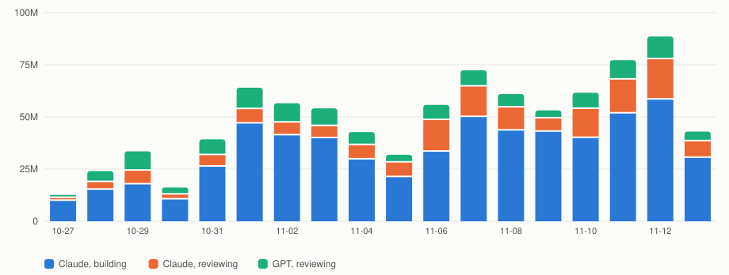
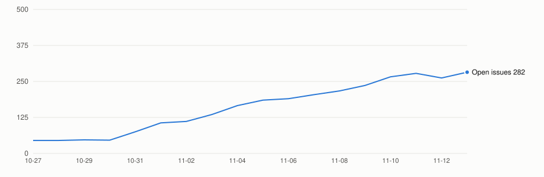
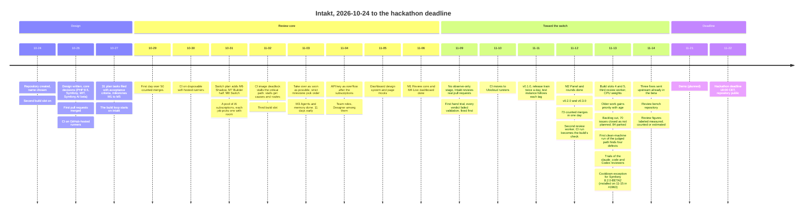

# Journey: from an empty repository to a review panel that builds itself

Intakt was started on 2026-10-24 for the Symfony AI & MCP Hackathon (deadline 2026-11-22). Most of it was built by the
build loop that developed Intakt, an AI runner Intakt is designed to replace: sessions wrote the design and the plan, the loop built the
issues, and a panel of AI reviewers approved or sent back every pull request. This page follows that path milestone by
milestone: what was planned, what happened, what changed, and what we learned. The Symfony and Symfony AI features
behind it are on [Highlights](https://shinyredapples.github.io/intakt/).

## At a glance

<!-- journey:begin glance -->
| | |
|---|---|
| First merged pull request | 2026-10-26 |
| Pull requests merged | 1163 counted (to 2026-11-22) |
| Issues closed | 1622 counted (1509 done, 113 dropped) |
| Busiest day | 81 counted merges (2026-11-21) |
| Tokens per merged pull request | 2.07M measured (2412M measured tokens over 1163 counted merges; not included: 25.61M estimated tokens reserved for killed steps) |

Counted: from the pull requests and issues the GitHub API lists. Measured: the providers' usage answers, summed per day from the `tokens` field of `docs/journey/usage.jsonl`. Estimated: the reservations of steps that were killed before they reported usage, from the `reserved` field of `docs/journey/usage.jsonl` and never added to the measured tokens.
<!-- journey:end glance -->

The token figures run to 2026-11-21, the last full day of the usage export; the merge counts run to the recording of 2026-11-22, so the figure per merge is slightly low.


Merged pull requests per day, counted from the GitHub API:

<!-- journey:begin merges-per-day -->
```
10-26  ▏ 2
10-27  ████ 16
10-28  ██████ 23
10-29  █████████████ 52
10-30  ██████ 22
10-31  █████████████ 51
11-01  ████████████ 48
11-02  ███████████ 42
11-03  ████████████ 49
11-04  █████████ 34
11-05  █████ 18
11-06  ████████ 32
11-07  ████████ 30
11-08  ██████ 23
11-09  ████ 17
11-10  ████████ 30
11-11  █████████ 34
11-12  ██████████████████ 73
11-13  █████ 18 (to 07:30)
```
<!-- journey:end merges-per-day -->

## Token usage

Tokens per day the loop spent on Intakt across every account: 2412M measured from 10-27 to 11-21, 2068M measured on Claude and 345M measured
on GPT. Building took 66% measured, reviewing 34% measured (Claude 19.7%, GPT 14.3%). Tokens are counted the same way for both vendors: input
and output in full, cached input at a tenth. Beside them, 25.61M estimated tokens were reserved for Claude steps that were
killed before they reported usage; the charts leave them out.

<!-- journey:begin tokens-by-lane -->


Measured: the providers' usage answers, summed per day from the `tokens` field of `docs/journey/usage.jsonl`.

<details markdown="1"><summary>Tokens per day by lane (measured), as a table</summary>

| Day | Claude, building (measured) | Claude, reviewing (measured) | GPT, reviewing (measured) |
|---|---|---|---|
| 10-27 | 9,743,937 | 1,414,394 | 1,475,652 |
| 10-28 | 15,080,151 | 3,670,947 | 5,320,086 |
| 10-29 | 17,634,626 | 6,574,144 | 9,313,894 |
| 10-30 | 10,410,087 | 2,367,409 | 3,389,857 |
| 10-31 | 26,116,605 | 5,239,242 | 7,602,051 |
| 11-01 | 46,799,005 | 6,924,580 | 10,302,741 |
| 11-02 | 41,154,441 | 6,110,315 | 9,295,766 |
| 11-03 | 39,788,254 | 5,790,708 | 8,540,343 |
| 11-04 | 29,590,671 | 6,868,585 | 6,306,327 |
| 11-05 | 21,101,440 | 7,015,509 | 3,739,786 |
| 11-06 | 33,312,742 | 15,162,642 | 7,309,720 |
| 11-07 | 49,929,733 | 14,623,577 | 7,827,106 |
| 11-08 | 43,452,349 | 11,062,758 | 6,456,744 |
| 11-09 | 42,880,259 | 6,395,410 | 3,873,823 |
| 11-10 | 39,897,375 | 13,950,428 | 7,782,678 |
| 11-11 | 51,627,169 | 16,252,098 | 9,348,347 |
| 11-12 | 58,288,733 | 19,354,173 | 10,917,017 |
| 11-13 | 101,198,931 | 24,223,152 | 14,192,612 |
| 11-14 | 71,332,146 | 18,493,242 | 10,300,181 |
| 11-15 | 64,468,859 | 15,113,163 | 8,565,064 |
| 11-16 | 105,518,060 | 24,083,406 | 14,752,328 |
| 11-17 | 109,156,502 | 21,669,591 | 13,735,417 |
| 11-18 | 181,425,471 | 66,745,561 | 43,561,360 |
| 11-19 | 125,886,392 | 53,179,319 | 36,857,642 |
| 11-20 | 120,385,619 | 56,747,813 | 44,719,942 |
| 11-21 | 137,390,140 | 45,077,106 | 39,147,860 |

</details>
<!-- journey:end tokens-by-lane -->

By account. Until 10-31 the loop ran on Claude account 1 alone; from 10-31 each job picks the account with the most
room that would otherwise go unused, and from 11-04 an API key takes over only when the
subscriptions are spent (120M measured tokens to 11-21: 30M measured on 11-06 to 11-08, 24M measured on 11-13 and 11-14, 65M measured on 11-18 and 11-19). GPT reviews every head from its own subscription.

<!-- journey:begin tokens-by-account -->


Measured: the providers' usage answers, summed per day from the `tokens` field of `docs/journey/usage.jsonl`.

<details markdown="1"><summary>Tokens per day by account (measured), as a table</summary>

| Day | Claude account 1 (measured) | Claude account 2 (measured) | Claude API key (measured) | GPT subscription (measured) |
|---|---|---|---|---|
| 10-27 | 11,158,331 | 0 | 0 | 1,475,652 |
| 10-28 | 18,751,098 | 0 | 0 | 5,320,086 |
| 10-29 | 24,208,770 | 0 | 0 | 9,313,894 |
| 10-30 | 12,777,496 | 0 | 0 | 3,389,857 |
| 10-31 | 10,486,257 | 20,869,590 | 0 | 7,602,051 |
| 11-01 | 45,679,626 | 8,043,959 | 0 | 10,302,741 |
| 11-02 | 47,264,756 | 0 | 0 | 9,295,766 |
| 11-03 | 32,292,324 | 13,286,638 | 0 | 8,540,343 |
| 11-04 | 17,987,592 | 18,471,664 | 0 | 6,306,327 |
| 11-05 | 9,566,052 | 18,550,897 | 0 | 3,739,786 |
| 11-06 | 25,735,436 | 7,398,215 | 15,341,733 | 7,309,720 |
| 11-07 | 0 | 50,675,989 | 13,877,321 | 7,827,106 |
| 11-08 | 47,143,797 | 6,193,793 | 1,177,517 | 6,456,744 |
| 11-09 | 49,275,669 | 0 | 0 | 3,873,823 |
| 11-10 | 53,847,803 | 0 | 0 | 7,782,678 |
| 11-11 | 58,871,551 | 9,007,716 | 0 | 9,348,347 |
| 11-12 | 64,662,528 | 12,980,378 | 0 | 10,917,017 |
| 11-13 | 65,234,089 | 38,711,912 | 21,476,082 | 14,192,612 |
| 11-14 | 56,025,456 | 30,870,357 | 2,929,575 | 10,300,181 |
| 11-15 | 71,000,467 | 8,581,555 | 0 | 8,565,064 |
| 11-16 | 104,167,553 | 25,433,913 | 0 | 14,752,328 |
| 11-17 | 118,887,991 | 11,938,102 | 0 | 13,735,417 |
| 11-18 | 120,550,555 | 74,684,921 | 52,935,556 | 43,561,360 |
| 11-19 | 11,833,521 | 154,973,623 | 12,258,567 | 36,857,642 |
| 11-20 | 56,734,639 | 120,398,793 | 0 | 44,719,942 |
| 11-21 | 182,467,246 | 0 | 0 | 39,147,860 |

</details>
<!-- journey:end tokens-by-account -->

Tokens per merged pull request, per day:

<!-- journey:begin tokens-per-merge -->


Measured: the day's tokens from the providers' usage answers, summed per day from the `tokens` field of `docs/journey/usage.jsonl`, divided by the pull requests merged that day, counted from the GitHub API.

<details markdown="1"><summary>Tokens per merged pull request (measured), as a table</summary>

| Day | Tokens per merge (measured) |
|---|---|
| 10-27 | 789,623 |
| 10-28 | 1,046,573 |
| 10-29 | 644,666 |
| 10-30 | 734,879 |
| 10-31 | 763,880 |
| 11-01 | 1,333,881 |
| 11-02 | 1,346,679 |
| 11-03 | 1,104,475 |
| 11-04 | 1,257,811 |
| 11-05 | 1,769,818 |
| 11-06 | 1,743,284 |
| 11-07 | 2,412,680 |
| 11-08 | 2,650,950 |
| 11-09 | 3,126,440 |
| 11-10 | 2,054,349 |
| 11-11 | 2,271,400 |
| 11-12 | 1,213,149 |
| 11-13 | 2,737,543 |
| 11-14 | 1,925,491 |
| 11-15 | 1,958,824 |
| 11-16 | 2,328,287 |
| 11-17 | 2,258,773 |
| 11-18 | 3,646,654 |
| 11-19 | 4,233,791 |
| 11-20 | 2,919,123 |
| 11-21 | 2,735,988 |

</details>
<!-- merges counted for usage sha256:ef57a76a775d044dffebc04990d58e8f7914e9bcad594559704e7157b2d1c827: 2026-10-27=16 2026-10-28=23 2026-10-29=52 2026-10-30=22 2026-10-31=51 2026-11-01=48 2026-11-02=42 2026-11-03=49 2026-11-04=34 2026-11-05=18 2026-11-06=32 2026-11-07=30 2026-11-08=23 2026-11-09=17 2026-11-10=30 2026-11-11=34 2026-11-12=73 2026-11-13=51 2026-11-14=52 2026-11-15=45 2026-11-16=62 2026-11-17=64 2026-11-18=80 2026-11-19=51 2026-11-20=76 2026-11-21=81 -->
<!-- journey:end tokens-per-merge -->


## Issues created and closed

In the snapshot of 2026-11-13, 1,055 counted issues were filed from 10-27 to 11-13 and 773 counted were closed (761
done, 12 dropped); the table below is read from the GitHub API when the page is built, so its counts for the same days
differ. Most new issues come from the work itself: plan tasks split into parts, review follow-ups and design findings.
Closing kept pace in the first days; from 10-31, when the switch plan added M6 to M8, more were filed than closed almost
every day, and 11-12 was the first day since 10-30 that closed more than it filed.

<!-- journey:begin issues-per-day -->


Counted: from the issues the GitHub API lists.

<details markdown="1"><summary>Issues created and closed per day (counted), as a table</summary>

| Day | Created (counted) | Closed (counted) |
|---|---|---|
| 10-27 | 49 | 4 |
| 10-28 | 27 | 27 |
| 10-29 | 55 | 53 |
| 10-30 | 25 | 26 |
| 10-31 | 86 | 57 |
| 11-01 | 89 | 58 |
| 11-02 | 54 | 49 |
| 11-03 | 81 | 57 |
| 11-04 | 70 | 39 |
| 11-05 | 42 | 23 |
| 11-06 | 45 | 40 |
| 11-07 | 56 | 42 |
| 11-08 | 52 | 39 |
| 11-09 | 50 | 31 |
| 11-10 | 77 | 47 |
| 11-11 | 56 | 44 |
| 11-12 | 92 | 108 |
| 11-13 | 182 | 158 |
| 11-14 | 85 | 76 |
| 11-15 | 76 | 62 |
| 11-16 | 127 | 91 |
| 11-17 | 46 | 91 |
| 11-18 | 198 | 116 |
| 11-19 | 74 | 71 |
| 11-20 | 81 | 109 |
| 11-21 | 88 | 99 |
| 11-22 | 7 | 5 |

</details>
<!-- journey:end issues-per-day -->

Open issues at the end of each day (11-22: at the time of the recording, not the end of the day):

<!-- journey:begin open-issues -->


Counted: from the issues the GitHub API lists.

<details markdown="1"><summary>Open issues per day (counted), as a table</summary>

| Day | Open issues (counted) |
|---|---|
| 10-27 | 45 |
| 10-28 | 45 |
| 10-29 | 47 |
| 10-30 | 46 |
| 10-31 | 75 |
| 11-01 | 106 |
| 11-02 | 111 |
| 11-03 | 135 |
| 11-04 | 166 |
| 11-05 | 185 |
| 11-06 | 190 |
| 11-07 | 204 |
| 11-08 | 217 |
| 11-09 | 236 |
| 11-10 | 266 |
| 11-11 | 278 |
| 11-12 | 262 |
| 11-13 | 286 |
| 11-14 | 295 |
| 11-15 | 309 |
| 11-16 | 345 |
| 11-17 | 300 |
| 11-18 | 382 |
| 11-19 | 385 |
| 11-20 | 357 |
| 11-21 | 346 |
| 11-22 | 348 |

</details>
<!-- journey:end open-issues -->

## Timeline



## Milestones

<!-- journey:begin milestones -->
| Milestone | Goal | Due | Last issue closed | Done / open (counted) |
|---|---|---|---|---|
| M0 Unblock | Fixes the build loop needs before anything else | 10-27 | 11-05 | 7 / 0 |
| M1 Review core | One reviewer returns a schema\-valid verdict for a local branch, recorded in the ledger; Intakt boots and runs probes offline | 11-02 | 11-06 | 58 / 0 |
| M2 Panel and rounds | A configured panel, quorum, persistent finding ids, the judge, a console command | 11-09 | 11-12 | 53 / 0 |
| M3 Agents and memory | MCP server and client, the Store briefing, labels, GitHub, branch cleanup | 11-14 | 11-03 | 31 / 0 |
| M4 Live dashboard | Rounds, streaming progress, verdicts and cost, live | 11-17 | 11-06 | 25 / 0 |
| M5 Demo | Image in worker mode with no state leaks, docker compose up, sample repository, the five\-minute path, hardening | 11-21 | open | 618 / 33 |
| M6 Shadow | Plan T37 to T43 \(\#319 to \#325\) and their parts; readied early by the owner on 2026\-11\-01\. | 11-24 | open | 213 / 4 |
| M7 Builder half | Plan T44 to T69 \(\#326 to \#351\)\. | 12-14 | open | 324 / 147 |
| M8 Switch | Plan T70 to T74 \(\#352 to \#356\)\. | 2027-01-07 | open | 21 / 34 |
| After the hackathon | Planned, but not part of the hackathon release \(2026\-11\-22\)\. | none | open | 28 / 98 |

Counted: from the issues the GitHub API lists, by each issue's milestone.
<!-- journey:end milestones -->

M3 and M4 finished eleven days early. M5 grew from 8 planned tasks to 292 counted issues: on 2026-11-03 every quality and
robustness issue a demo visitor could hit moved into it.

### M0 to M2: the review core (10-24 to 11-12)

**Planned:** one reviewer, then a panel with quorum and a judge.
**Happened:** the design was written in two days and split into 31 plan tasks with acceptance criteria
([#5](https://github.com/shinyredapples/intakt/issues/5) to [#35](https://github.com/shinyredapples/intakt/issues/35)). From there the loop built and reviewed each task.
**Decided on the way (10-26):** PHP 8.5 and Symfony, MIT license, several projects per install, vendor accounts as
a prioritized list, and Symfony AI 1.0 beta used to its limits, with bugs reported upstream.

### M3 and M4: agents and a live dashboard (to 11-06)

**Happened:** MCP server and client, the Store briefing, GitHub integration and the live dashboard landed ahead of
schedule.
**Learned:** a stall needs a named cause. On 11-02 one pull request blocked the whole critical path for hours: the CI
image lacked FrankenPHP, and the owner's approval for a new package was only asked after CI went green, which it could
not. Since then every stall gets a cause and a route, and owner decisions are asked on first sight ([#595](https://github.com/shinyredapples/intakt/issues/595)).

### The plan changes (10-31 to 11-09)

- **10-31, switch plan.** The hackathon release covers reviews. Three milestones were added after it: M6 Shadow,
  M7 Builder half, M8 Switch, built from Intakt's design with the earlier loop as reference only ([#318](https://github.com/shinyredapples/intakt/issues/318)).
- **11-03, take over as soon as possible.** The loop starts M7 before the deadline, protected by a strict pick order:
  urgent first, then milestone by milestone ([#742](https://github.com/shinyredapples/intakt/issues/742)).
- **11-09, no observe-only stage.** Intakt's review replaces one of the loop's reviewers on real pull requests at once
  ([#1251](https://github.com/shinyredapples/intakt/issues/1251)). The first hand trial matched the loop's verdicts on three pull requests, but every recorded verdict failed
  validation ([#1253](https://github.com/shinyredapples/intakt/issues/1253)): fixed before anything else.

### M5: the demo (to 11-21)

**Planned:** container image, `docker compose up`, a sample repository, the five-minute path.
**Happened:** the timed run from `git clone` to the first verdict is recorded at the deadline.
**Releases:** v0.1.0 on 11-11, then a release train twice a day (13:00 and 21:00); a test instance follows each tag.

The week before the deadline:

- **11-13, the backlog cut.** After an audit of every ticket, pull request and CI run, 70 issues were closed as not
  planned and 84 were parked under the `parked` label. What is left open is what the deadline needs.
- **11-13, the judged path on a clean machine.** The first run the way a juror will do it: clone,
  `docker compose up`, then the review command the install prints. The install was running after 202 s and printed
  the command at 210 s, but the Hugging Face path failed in 2 of 3 runs. The run produced four issues
  ([#1801](https://github.com/shinyredapples/intakt/issues/1801), [#1802](https://github.com/shinyredapples/intakt/issues/1802),
  [#1803](https://github.com/shinyredapples/intakt/issues/1803), [#1804](https://github.com/shinyredapples/intakt/issues/1804)).
- **11-13, the subscription reviewers.** Trials of `claude_code` and Codex as reviewers that run on a subscription
  instead of an API key showed where they differ from the API path
  ([#1822](https://github.com/shinyredapples/intakt/issues/1822), [#1823](https://github.com/shinyredapples/intakt/issues/1823),
  [#1824](https://github.com/shinyredapples/intakt/issues/1824), [#1835](https://github.com/shinyredapples/intakt/issues/1835),
  [#1836](https://github.com/shinyredapples/intakt/issues/1836)): since 11-14 an approval from either counts only when
  the reviewer has read the change through the review server.
- **11-13, Symfony 8.2.0-BETA2.** The beta came out that day, and the owner allowed a one-time exception to the
  3-day release cooldown for `symfony/*` at 8.2.0-BETA2 ([#1842](https://github.com/shinyredapples/intakt/issues/1842),
  [#1900](https://github.com/shinyredapples/intakt/issues/1900)). The move itself was installed on 11-15, in
  [#1960](https://github.com/shinyredapples/intakt/issues/1960): since then the lock file holds Symfony 8.2.0-BETA2.
  Three fixes Intakt sent upstream are in the beta, so Intakt now runs them
  (Config: a NaN value skips validation, [symfony/symfony#67911](https://github.com/symfony/symfony/pull/67911);
  Messenger: an early SIGTERM is ignored, [symfony/symfony#67912](https://github.com/symfony/symfony/pull/67912);
  Serializer: a list of objects accepts any object, [symfony/symfony#67913](https://github.com/symfony/symfony/pull/67913)).
  On 11-14 two more Symfony AI reports were filed ([symfony/ai#2944](https://github.com/symfony/ai/issues/2944),
  [symfony/ai#2945](https://github.com/symfony/ai/issues/2945)) and a comment on
  [symfony/ai#2617](https://github.com/symfony/ai/pull/2617); the full list is in "Found in the beta" on Highlights.
- **11-14, measuring the reviews.** The review bench ([#1938](https://github.com/shinyredapples/intakt/issues/1938))
  got its repository: eight changes with the findings a review should report; the command that runs it comes later.
  The review report labels every figure as measured, counted or estimated
  ([#1939](https://github.com/shinyredapples/intakt/issues/1939)); the dashboard follows.

### M6 to M8: Intakt builds itself

M7 started before the deadline: 29 of its issues were done by 11-13. Its status at the deadline follows here.

## Capacity: accounts, builders, reviewers and CI

The loop grew from one builder and one reviewer to five builders and three review workers in three weeks, each step
measured first.

| Date | Change | Why |
|---|---|---|
| 10-24 | Second build slot | two issues build at once |
| 10-31 | A pool of AI subscriptions; each job picks the account with the most room that would otherwise go unused | one account capped the whole loop |
| 10-31 | GPT reviews in Claude's place while every Claude account is out, with a catch-up review later | a review never waits for one vendor |
| 11-02 | Third build slot, first only on room that would expire at the weekly reset, always on from 11-03 | about half an account-week went unused |
| 11-03 | GPT reviews every head, next to Claude | every head gets a second vendor's review, low-risk ones included |
| 11-04 | An API key as overflow after the subscriptions | paid capacity only when the subscriptions are spent |
| 11-12 | Second review worker | builders stood idle 158 times in one day waiting for review |
| 11-13 | Build slots 4 and 5 (subscriptions first, the API key as backup), a third review worker | the API key had spent nothing in the week to 11-12 while 118 ready issues waited |
| 11-13 | CPU weights: reviews 400, slots 1 to 3 100, slots 4 and 5 25 | extra builders use only idle CPU, reviews never wait behind tests |

### CI

| Date | Change | Why |
|---|---|---|
| 10-26 | GitHub-hosted runners, pinned actions, Dependabot | a gate on every pull request from day two |
| 10-28 | Persistence tests on MySQL, MariaDB and PostgreSQL | the ledger must work on all three |
| 10-29 | CI code runs as an unprivileged user in a built image, without a Docker socket; database engines only when persistence changes | untrusted pull request code, faster runs |
| 10-30 | Disposable self-hosted runners, the runner chosen by a repository variable | Docker job containers that are thrown away after each job, and more minutes than a private repository's free tier |
| 11-02 | FrankenPHP in the CI image | the live dashboard's tests could not run, which stalled the critical path |
| 11-10 | Ubicloud runners (4 vCPU) | hosted machines, so the home server's CPU stays with the build loop |
| 11-12 | Composer cache restored from the Actions cache | 25 "withheld log" failures were empty-cache downloads, not tests |
| 11-12 | The head's CI run is the build's check | three local check runs pushed the build container to load 27 |

### Dashboard design

The dashboard was designed before most of it was built. 10-27: lessons from running several projects on shared
accounts went into the design. 11-04: a Designer joined the team roles (UI only: checks, a scored rubric and a blind
pairwise taste ladder calibrated by the owner's votes). 11-05 and 11-06: a design system, a logo and mocks for every
page. The board and the task detail page are built against the mocks for the demo; the remaining pages (projects,
team, history, settings, setup) follow after the hackathon.

## What we learned

- **Fix small findings before the merge, not after.** A polish round inside the pull request cost about 74k measured tokens;
  the same items as a follow-up issue cost about 490k measured. Polish-before-merge became the default (89 counted polish rounds,
  77 counted merged in one week).
- **Rules belong in gates, not in prompts.** Coding rules the reviewers kept repeating (final classes, no magic
  strings, typed module contracts) became static gates ([#604](https://github.com/shinyredapples/intakt/issues/604), [#841](https://github.com/shinyredapples/intakt/issues/841) to [#845](https://github.com/shinyredapples/intakt/issues/845)); `AGENTS.md` keeps judgement only.
- **Prove races by construction.** A flaky test is reproduced with a forced order, never by running it a hundred times.
- **CI and the local check must match.** Failures that only appeared in CI came from a ZTS build of PHP in CI against
  NTS locally; the check now runs in the CI image itself.
- **Hosted runners need a dependency cache.** Withheld CI logs ([#897](https://github.com/shinyredapples/intakt/issues/897)) were Composer downloads failing on an empty
  cache, not test failures.
- **New work starves old work.** With 30 to 70 new issues a day, tasks from the original plan sat behind fresh
  high-priority ones. Ready issues and open pull requests now gain priority with age ([#1733](https://github.com/shinyredapples/intakt/issues/1733)).
- **A test audit pays for itself.** A dedicated test engineer role reviewed coverage and filed 15 tasks ([#1297](https://github.com/shinyredapples/intakt/issues/1297) to
  [#1312](https://github.com/shinyredapples/intakt/issues/1312)).
- **Rework, not capacity, was the drag.** From 11-05 to 11-13, 57% measured of the tokens on merged issues were spent after
  the first build and first review; 47% counted of merged issues passed the first review; 349 of 1,091 counted issues were follow-ups.
- **Run the judged path the way a juror will.** The first clean-machine run happened on 11-13 and found four defects
  no test had ([#1801](https://github.com/shinyredapples/intakt/issues/1801) to [#1804](https://github.com/shinyredapples/intakt/issues/1804)).
- **More builders do not by themselves mean more merges.** 11-12: 73 counted merges for 89M measured tokens with three
  builders. Builders 4 and 5 started on 11-13, the last day of the hand-written snapshot, whose merges it counts only to 07:30 (18).
  From 11-14 to 11-21 the five builders merged 45 to 81 counted pull requests a day at 1.9M to 4.2M measured tokens each, against 1.2M on 11-12;
  the tickets got harder and builders waited for the two check slots, so the limit is tokens per week, not builders.
- **Cut the backlog on purpose.** More issues were opened than closed on almost every day; the cut of 11-13 (70
  closed as not planned, 84 parked) made the deadline's work visible again.

## How this page is made

[#1740](https://github.com/shinyredapples/intakt/issues/1740): `bin/journey` writes the regions between `journey:begin` and `journey:end` markers: the At a glance table, the milestone table and the charts with a table of their numbers, from the GitHub API (milestones, issues and pull requests, read when the page is built) and token use from `docs/journey/usage.jsonl`. It draws the charts and the timeline above as SVG files in `docs/journey/`. The numbers written by hand in the text are a snapshot of 2026-11-13, except the token figures, which follow `docs/journey/usage.jsonl` to 2026-11-21. `docs/journey/usage.jsonl`
holds tokens per day, vendor, account and lane, nothing about limits; Claude and GPT are counted the same way (input and
output in full, cached input at a tenth). A step that was killed (out of memory, a host restart) reports no usage and
counts at its reservation: 25.61M tokens, about 1.1% beside the measured ones, are such reservations. The file keeps them in
a `reserved` field apart from the measured `tokens`, the charts and the measured figures leave them out, and the At a
glance table shows their total beside the measured one. The milestone stories and lessons are written by hand and link
to the issue or pull request behind a claim where there is one.

Each figure is followed by its kind, as in Intakt's review report: `measured` for tokens the providers' usage answers
reported, `counted` for merges, issues and rounds counted from the GitHub API or the build loop's records, `estimated`
for the tokens reserved for killed steps. The page shows no cost. Each table and chart names its kind in its column or
title and says under it where its figures come from; a figure that divides measured tokens by counted merges shows both
parts beside it, each with its own kind, and no total adds measured and estimated tokens.
