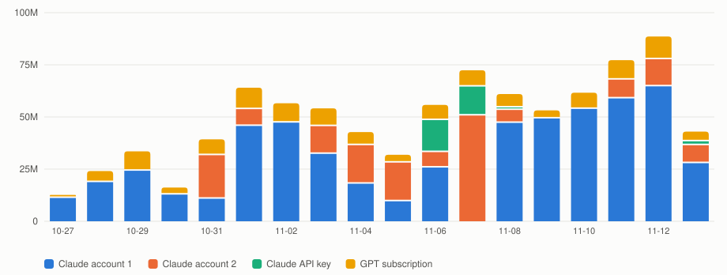
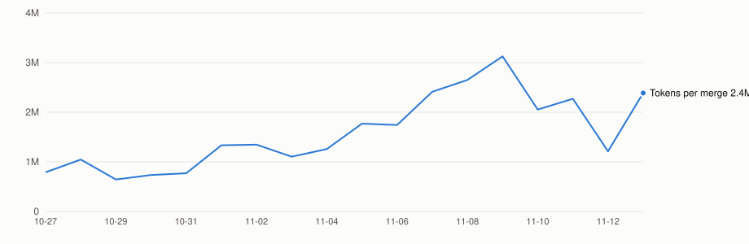
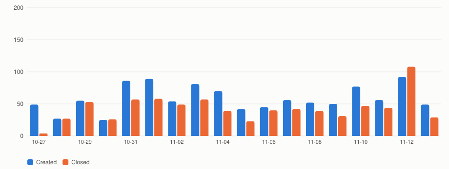
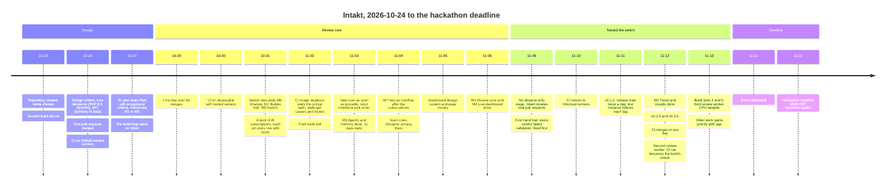

# Journey: from an empty repository to a review panel that builds itself

Intakt was started on 2026-10-24 for the Symfony AI & MCP Hackathon (deadline 2026-11-22). Most of it was built by an AI
build loop, the runner Intakt is designed to replace: sessions wrote the design and the plan, the loop built the
issues, and a panel of AI reviewers approved or sent back every pull request. This page follows that path milestone by
milestone: what was planned, what happened, what changed, and what we learned. The Symfony and Symfony AI features
behind it are on [Highlights](highlights.md).

## At a glance

<!-- journey:begin glance -->
| | |
|---|---|
| First commit | 2026-10-24 |
| First merged pull request | 2026-10-26 |
| Pull requests merged | 614 (to 2026-11-13) |
| Issues closed as done | 772 |
| Busiest day | 73 merges (2026-11-12) |
| First release | v0.1.0, 2026-11-11; v0.3.0 on 2026-11-12 |
| First-pass approvals | 53% of builds approved without a send-back (94 of 177), up from 38% |
| Tokens per merge | 1.78M, down 38% against the same baseline |
<!-- journey:end glance -->


Merged pull requests per day:

<!-- journey:begin merges-per-day -->
```
10-26  ▏ 2
10-27  ████ 16
10-28  ██████ 23
10-29  █████████████ 52
10-30  ██████ 22
10-31  █████████████ 51
11-01  ████████████ 48
11-02  ███████████ 42
11-03  ████████████ 49
11-04  █████████ 34
11-05  █████ 18
11-06  ████████ 32
11-07  ████████ 30
11-08  ██████ 23
11-09  ████ 17
11-10  ████████ 30
11-11  █████████ 34
11-12  ██████████████████ 73
11-13  █████ 18 (to 07:30)
```
<!-- journey:end merges-per-day -->

## Token usage

Tokens per day the loop spent on Intakt across every account: 903M from 10-27 to 11-13, 780M on Claude and 123M on
GPT. Building took 69%, reviewing 31% (Claude 17%, GPT 14%). Tokens are counted the same way for both vendors: input
and output in full, cached input at a tenth.

<!-- journey:begin tokens-by-lane -->

<!-- journey:end tokens-by-lane -->

By account. Until 10-31 the loop ran on one Claude subscription and did not record which; from 10-31 each job picks the
account with the most room that would otherwise go unused, and from 11-04 an API key takes over only when the
subscriptions are spent (30M tokens so far, on 11-06 to 11-08). GPT reviews every head from its own subscription.

<!-- journey:begin tokens-by-account -->

<!-- journey:end tokens-by-account -->

Tokens per merged pull request, per day:

<!-- journey:begin tokens-per-merge -->

<!-- journey:end tokens-per-merge -->


## Issues created and closed

1,055 issues were filed from 10-27 to 11-13 and 773 closed (761 done, 12 dropped). Most new issues come from the work
itself: plan tasks split into parts, review follow-ups and design findings. Closing kept pace in the first days; from
10-31, when the switch plan added M6 to M8, more were filed than closed almost every day, and 11-12 was the first day
since 10-30 that closed more than it filed.

<!-- journey:begin issues-per-day -->

<!-- journey:end issues-per-day -->

Open issues at the end of each day:

<!-- journey:begin open-issues -->

<!-- journey:end open-issues -->

## Timeline



## Milestones

<!-- journey:begin milestones -->
| Milestone | Goal | Due | Last issue closed | Done / open |
|---|---|---|---|---|
| M0 Unblock | fixes the build loop needed first | 10-27 | 11-05 | 7 / 0 |
| M1 Review core | one reviewer returns a schema-valid verdict, recorded in the ledger | 11-02 | 11-06 | 58 / 0 |
| M2 Panel and rounds | a configured panel, quorum, persistent finding ids, the judge | 11-09 | 11-12 | 53 / 0 |
| M3 Agents and memory | MCP server and client, the Store briefing, GitHub | 11-14 | 11-03 | 31 / 0 |
| M4 Live dashboard | rounds, streaming progress, verdicts and cost, live | 11-17 | 11-06 | 25 / 0 |
| M5 Demo | `docker compose up`, sample repository, the five-minute path | 11-21 | open | 279 / 13 |
| M6 Shadow | Intakt reviews the loop's own pull requests | 11-24 | open | 171 / 2 |
| M7 Builder half | Intakt builds, not only reviews | 12-14 | open | 29 / 154 |
| M8 Switch | Intakt replaces the loop | 2027-01-07 | open | 2 / 8 |
<!-- journey:end milestones -->

M3 and M4 finished eleven days early. M5 grew from 8 planned tasks to 292 issues: on 2026-11-03 every quality and
robustness issue a demo visitor could hit moved into it.

### M0 to M2: the review core (10-24 to 11-12)

**Planned:** one reviewer, then a panel with quorum and a judge.
**Happened:** the design was written in two days and split into 31 plan tasks with acceptance criteria
(#5 to #35). From there the loop built and reviewed each task.
**Decided on the way (10-26):** PHP 8.5 and Symfony, MIT license, several projects per install, vendor accounts as
a prioritized list, and Symfony AI 1.0 beta used to its limits, with bugs reported upstream.

### M3 and M4: agents and a live dashboard (to 11-06)

**Happened:** MCP server and client, the Store briefing, GitHub integration and the live dashboard landed ahead of
schedule.
**Learned:** a stall needs a named cause. On 11-02 one pull request blocked the whole critical path for hours: the CI
image lacked FrankenPHP, and the owner's approval for a new package was only asked after CI went green, which it could
not. Since then every stall gets a cause and a route, and owner decisions are asked on first sight (#595).

### The plan changes (10-31 to 11-09)

- **10-31, switch plan.** The hackathon release covers reviews. Three milestones were added after it: M6 Shadow,
  M7 Builder half, M8 Switch, built from Intakt's design with the old loop as reference only (#318).
- **11-03, take over as soon as possible.** The loop starts M7 before the deadline, protected by a strict pick order:
  urgent first, then milestone by milestone (#742).
- **11-09, no observe-only stage.** Intakt's review replaces one of the loop's reviewers on real pull requests at once
  (#1251). The first hand trial matched the loop's verdicts on three pull requests, but every recorded verdict failed
  validation (#1253): fixed before anything else.

### M5: the demo (to 11-21)

**Planned:** container image, `docker compose up`, a sample repository, the five-minute path.
**Happened:** the timed run from `git clone` to the first verdict is recorded at the deadline.
**Releases:** v0.1.0 on 11-11, then a release train twice a day (13:00 and 21:00); a test instance follows each tag.

### M6 to M8: Intakt builds itself

M7 started before the deadline: 29 of its issues were done by 11-13. Its status at the deadline follows here.

## Capacity: accounts, builders, reviewers and CI

The loop grew from one builder and one reviewer to five builders and three review workers in three weeks, each step
measured first.

| Date | Change | Why |
|---|---|---|
| 10-24 | Second build slot | two issues build at once |
| 10-31 | A pool of AI subscriptions; each job picks the account with the most room that would otherwise go unused | one account capped the whole loop |
| 10-31 | GPT reviews in Claude's place while every Claude account is out, with a catch-up review later | a review never waits for one vendor |
| 11-02 | Third build slot, first only on room that would expire at the weekly reset, always on from 11-03 | about half an account-week went unused |
| 11-03 | GPT reviews every head, next to Claude | every head gets a second vendor's review, low-risk ones included |
| 11-04 | An API key as overflow after the subscriptions | paid capacity only when the subscriptions are spent |
| 11-12 | Second review worker | builders stood idle 158 times in one day waiting for review |
| 11-13 | Build slots 4 and 5 (subscriptions first, the API key as backup), a third review worker | the API key had spent nothing while 118 ready issues waited |
| 11-13 | CPU weights: reviews 400, slots 1 to 3 100, slots 4 and 5 25 | extra builders use only idle CPU, reviews never wait behind tests |

### CI

| Date | Change | Why |
|---|---|---|
| 10-26 | GitHub-hosted runners, pinned actions, Dependabot | a gate on every pull request from day two |
| 10-28 | Persistence tests on MySQL, MariaDB and PostgreSQL | the ledger must work on all three |
| 10-29 | CI code runs as an unprivileged user in a built image, without a Docker socket; database engines only when persistence changes | untrusted pull request code, faster runs |
| 10-30 | Disposable self-hosted runners, the runner chosen by a repository variable | Docker job containers that are thrown away after each job, and more minutes than a private repository's free tier |
| 11-02 | FrankenPHP in the CI image | the live dashboard's tests could not run, which stalled the critical path |
| 11-10 | Ubicloud runners (4 vCPU) | hosted machines, so the home server's CPU stays with the build loop |
| 11-12 | Composer cache restored from the Actions cache | 25 "withheld log" failures were empty-cache downloads, not tests |
| 11-12 | The head's CI run is the build's check | three local check runs pushed the build container to load 27 |

### Dashboard design

The dashboard was designed before most of it was built. 10-27: lessons from running several projects on shared
accounts went into the design. 11-04: a Designer joined the team roles (UI only: checks, a scored rubric and a blind
pairwise taste ladder calibrated by the owner's votes). 11-05 and 11-06: a design system, a logo and mocks for every
page. The board and the task detail page are built against the mocks for the demo; the remaining pages (projects,
team, history, settings, setup) follow after the hackathon.

## What we learned

- **Fix small findings before the merge, not after.** A polish round inside the pull request cost about 74k tokens;
  the same items as a follow-up issue cost about 490k. Polish-before-merge became the default (89 polish rounds,
  77 merged in one week).
- **Rules belong in gates, not in prompts.** Coding rules the reviewers kept repeating (final classes, no magic
  strings, typed module contracts) became static gates (#604, #841 to #845); `AGENTS.md` keeps judgement only.
- **Prove races by construction.** A flaky test is reproduced with a forced order, never by running it a hundred times.
- **CI and the local check must match.** Failures that only appeared in CI came from a ZTS build of PHP in CI against
  NTS locally; the check now runs in the CI image itself.
- **Hosted runners need a dependency cache.** Withheld CI logs (#897) were Composer downloads failing on an empty
  cache, not test failures.
- **New work starves old work.** With 30 to 70 new issues a day, tasks from the original plan sat behind fresh
  high-priority ones. Ready issues and open pull requests now gain priority with age (#1733).
- **A test audit pays for itself.** A dedicated test engineer role reviewed coverage and filed 15 tasks (#1297 to
  #1312).

## How this page is made

`bin/journey` (#1740) writes the regions between `journey:begin` and `journey:end` markers and the charts in
`docs/journey/`: GitHub numbers from the API when the page is built, token use from `docs/journey/usage.jsonl`. That file
holds tokens per day, vendor, account and lane, nothing about limits; Claude and GPT are counted the same way (input and
output in full, cached input at a tenth). The milestone stories and lessons are written by hand and link to the issue or
pull request behind each claim.
