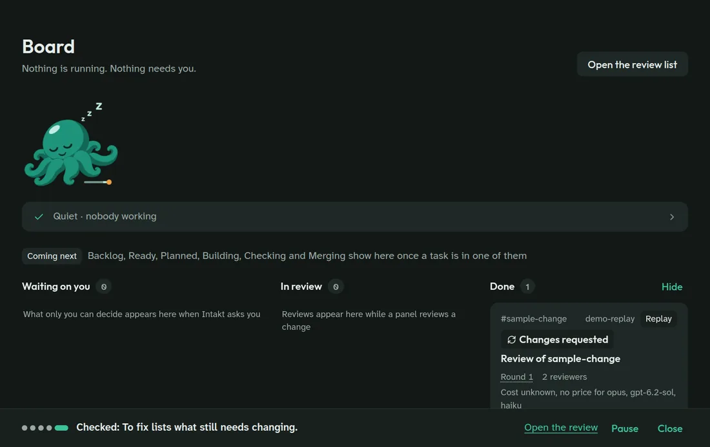

# 6. Trends and Status

*Chapter 6 of 9 in [the Intakt user guide](README.md).*

## A week later

Intakt has reviewed a dozen of your changes. A colleague asks whether the second reviewer earns its keep, and how long a review really takes. You could scroll through every review page. Or you open **Trends** in the menu, and Intakt has already counted.

## What Trends shows

**The headline** at the top is the review bench result, such as "The review panel found 15 of 15 planted defects", with the date of the run. It tells you how good the panel was on a test with known answers.

**The tiles** each give one figure:

- **Passes:** review rounds started so far.
- **To fix:** P1 and P2 findings the owl kept.
- **One reviewer only:** the share of kept findings that no other reviewer of the same pass raised.
- **Time to verdict:** the median time from the start of a round to the owl's call.
- **Cost per pass:** the mean estimated cost of the rounds with a known price.

A tile appears only when there is a figure for it, never as a made-up 0. Point at a label, or reach it with the Tab key, to read more.

## The charts answer three questions

1. **Which reviewer finds what?** *Catches by reviewer* has one small chart per reviewer role, with a bar per urgency. The number in brackets counts the findings only that reviewer reported. This is the answer to your colleague.
2. **What does the owl keep?** *Checked findings* counts the findings kept to fix, merged as duplicates, deferred and rejected.
3. **How busy were you?** *Passes and cost per day* appears once reviews ran on 3 or more days.

Each chart carries a chip that says whether its figures are counted or estimated.

## Leave the demo out

When you have played the demo run, a **Demo review** toggle sits at the top. Press it to count your own reviews only; press it again to bring the demo back.

## Now: what is running right now

Trends looks back. For the present moment, open **Now** in the menu. The board's status line sums it up in one phrase, such as "Running smoothly · 1 reviewer working" or "Quiet · nobody working".

1. Click the status line.
2. The **Status** page lists every reviewer still at work, with its role, its change, its project and its round.
3. Click a lane to open the review it is working on.

When nobody works, the page says so: "No reviewer is working right now: reviewers appear here while they review a change".

## Status for scripts

Your own scripts can ask the same question. The dashboard serves one JSON document at `/status`, for example <http://localhost:7781/status> on the demo. Inside the container, `php bin/console intakt:status --format=json` prints it too.

It lists the reviews in progress, the last outcome of each change and how many background jobs wait in each queue. It reads only Intakt's database, so it answers even when no worker runs. It never holds a secret. The fields are described in [status.schema.json](status.schema.json).

Next: [Keys, providers and costs](07-keys-providers-and-costs.md)
