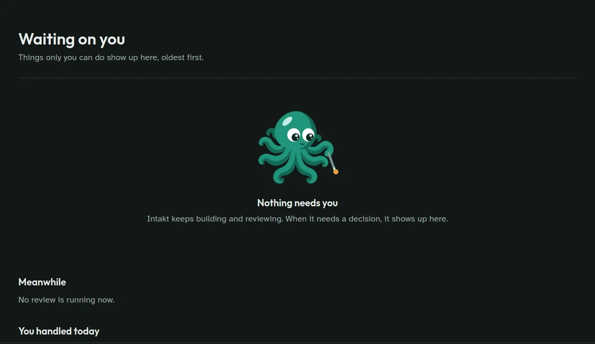

# 8. When something goes wrong

*Chapter 8 of 9 in [the Intakt user guide](README.md).*

## A review that will not finish

It is Friday afternoon. You started a review half an hour ago, and the page still says one reviewer is running. Nothing looks broken, but nothing moves either. Most surprises in Intakt have a reason written on the screen. This chapter lists the common ones: what you see, why, and what to do.

## First, look at Waiting on you

Open **You** in the menu. Anything only you can decide shows up there, oldest first. When the page says **Nothing needs you**, the hold-up is somewhere else, and the cases below will find it.

## The setup page says a step is Missing

- **What you see:** **1. Add a key here** is not Done, and lines such as Provider "openai" is disabled: set OPENAI_API_KEY to enable it.
- **Why:** no provider has a key, so no reviewer can run.
- **What to do:** add a key as in [chapter 3](03-your-first-real-review.md), then restart Intakt.

## The setup page refuses your key

- **What you see:** "The provider refused the key", or "The key has the form of no listed provider".
- **Why:** the provider said no, or the text is not a whole key of a provider Intakt knows.
- **What to do:** copy the whole key again from the provider's page, and check that it is still valid.

## A reviewer reads Blocked

- **What you see:** **Blocked** beside a reviewer, with a reason such as "Every provider of the tier is out: anthropic for 300 s."
- **Why:** every account of that provider is cooling down after a rate limit, and the tier has no substitute.
- **What to do:** wait for the time it names, or add a second account or a substitute ([chapter 7](07-keys-providers-and-costs.md)).

## A reviewer reads Failed

- **What you see:** **Failed** with a reason in plain words, such as "stopped at its output limit" or "the model endpoint could not be reached".
- **Why:** the reviewer could not give a usable verdict, even after Intakt asked it once more. A failed reviewer never counts as an approval.
- **What to do:** for the output limit, raise the tier's `max_output`; for the endpoint, check your network and the provider's status. Then start the next round.

## The round ends with "no outcome in time"

- **What you see:** the review ends blocked with the reason "no outcome in time".
- **Why:** the round did not end within its upper wait. Most often no background worker was running to do the work.
- **What to do:** the container runs its workers for you. Outside it, start one with `php bin/console messenger:consume async`, then review again.

## The cost reads "unknown"

- **What you see:** "Cost: unknown, no price for" and a model name.
- **Why:** you set no price for that model.
- **What to do:** add it under `budget.prices` ([chapter 7](07-keys-providers-and-costs.md#reading-the-cost)).

## A finding you expected is not on the list

- **What you see:** a reviewer mentioned a problem, but it is not under To fix.
- **Why:** the finding quoted code that is not in the change, so it was dropped, or the owl deferred or rejected a P3.
- **What to do:** look for its card marked **Quote not found in the code** or **Dropped**, and open **Quoted code**.

## Your agent cannot start a review

- **What you see:** an MCP error when your agent calls `start_review`.
- **Why:** the token is missing or wrong, or writes are off.
- **What to do:** on the demo, export `INTAKT_MCP_TOKEN` again ([chapter 5](05-let-your-agent-drive.md)). On your own install, set `MCP_OWNER_ACCESS=mcp_tool_write` and `MCP_OWNER_TOKEN` in `.env.local`.

## The dashboard is slow or answers 400

- **What you see:** pages load slowly, or show `400 Bad Request`.
- **Why:** the server is busy, or you opened it under a name other than `localhost`, `127.0.0.1` or `[::1]`. The dashboard answers only those.
- **What to do:** inside the container, `php bin/console intakt:server:status` shows how busy the server is. Open the dashboard on `localhost`.

More cases, and the exact wording of every reason, are in the [complete reference](../reference/user-manual.md).

Next: [Running it for a team](09-running-it-for-a-team.md)
