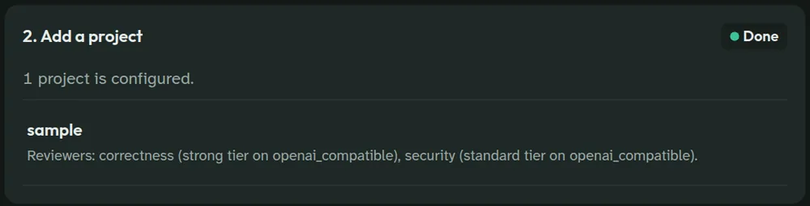

# 9. Running it for a team

*Chapter 9 of 9 in [the Intakt user guide](README.md).*

## From your laptop to your team

Your team saw the Trends page and wants Intakt on its own repository, with its own panel. This last chapter shows the pieces you set once: the project, its panel, the keys of a team, and where the team-scale runbooks live.

## Your project and its panel

The demo's sample project was set up for you. Your own project lives in the project file: the file `INTAKT_CONFIG` names, or `config/intakt.yaml` when that variable is not set. Under `docker compose`, `INTAKT_CONFIG` names `/app/var/data/intakt.yaml` on the data volume, so editing `config/intakt.yaml` in your clone changes nothing there.

This chapter's commands run on an install started from a clone with PHP, not in the demo container: the container sees only its data volume, never a repository on your machine, and Intakt must be able to read the repository it reviews.

1. Copy `config/intakt.example.yaml` to `config/intakt.yaml`, or to the file `INTAKT_CONFIG` names.
2. Under `projects:`, give your project a name and map its three tiers to models ([chapter 7](07-keys-providers-and-costs.md#tiers-how-a-project-picks-its-models)).
3. In its `review:` section, list the reviewers: each has a role, a tier, a provider, a prompt and a budget.
4. Choose the panel's rule with `quorum`:
   - `all`: every reviewer approves,
   - `majority`: more than half approve,
   - `one-strong-plus-one`: at least two approve, one of them a strong reviewer.
5. Run `php bin/console cache:clear`.

Optional `rules` add reviewers to a bigger change or to sensitive paths, for example a security reviewer for anything under `config/`.

Step 4 of the setup wizard, **Check the project** (<http://localhost:7781/setup?step=4>), shows each project Intakt has read with its reviewers, and whether its main branch failed to boot.

Reviewer conversations hold your code and diffs. Intakt keeps each one for 30 days after its last message, and longer while its review round is still open (at most an hour per reviewer plus one for the judge). A scheduled run every ten minutes deletes the conversations past that point, so one goes at the next run, not at the exact moment.

The number of days is `retention.conversation_days` in Intakt's installation-wide config file, `config/intakt.yaml` (or the file `INTAKT_CONFIG` names; see `config/intakt.example.yaml`). It applies to every project; set it to `forever` to keep them all ([the reference](../reference/user-manual.md#how-long-conversations-are-kept)). On an install from a clone, the cleanup runs only while a scheduler worker runs: keep `php bin/console messenger:consume scheduler_retention` running beside the `async` worker.



## Check the panel, then review

Before you spend a token, see which panel a change would get:

```
php bin/console intakt:review:panel <project>
```

Then review a branch of your local repository:

```
php bin/console intakt:review <branch> --project=<project> --task="..."
```

The task is one sentence saying what the branch should do. The reviewers read a snapshot of the branch's head, so you can keep working in your checkout meanwhile. The command needs running workers (`php bin/console messenger:consume async`).

## Use it in scripts

`intakt:review` ends with an exit code a script can test: `0` approve, `10` changes, `11` blocked, `1` wrong input or configuration. Add `--format=json` for one JSON document, described in [review-output.schema.json](review-output.schema.json).

## Several keys of one provider

A team often has more than one key per provider, say a personal and a team key. List them under `accounts:` in the order Intakt tries them:

```yaml
accounts:
    anthropic: [default, team]
```

The `team` account reads `ANTHROPIC_API_KEY_TEAM`. When one account hits a rate limit, the reviewer moves to the next.

Open **Team** in the dashboard's menu (in the bottom bar on a phone) to see each account once with its state and the roles it serves, as Developer or reviewer. `php bin/console intakt:team` prints the same list.

## Who can open the dashboard

The dashboard has no login. It answers only on `localhost`, and `compose.yaml` publishes its port on the loopback address only. If you publish it on another address, anyone who reaches it can use it. Keep it on your machine, or behind your own access control.

## Running Intakt's own CI on your machines

If you maintain a copy of the Intakt repository, its CI can run on your own runner. Set the repository variable `CI_RUNS_ON` to your runner's labels. The runner must be ephemeral: one job per clean machine, with no network path to your other machines. The steps are in [Running Intakt's CI on your own runner](../reference/self-hosted-ci.md).

## Moving a project over from another build loop

A runbook moves a project from an earlier build loop to Intakt, and back. It needs Intakt to build tasks on its own, which is planned, so it cannot be run on the current code yet. Read it in [the takeover runbook](../reference/takeover.md).

## What comes next

Reviewing pull requests on GitHub and posting the result there are planned, and so is Intakt building tasks itself. [The plan](../plan.md) shows the order.

## The end of the day

You started the morning with an agent that said "done". You end it with a panel from two labs, an owl that keeps the list short, and an agent that runs the loop for you and stops by clear rules. Every detail you skipped today waits in the [complete reference](../reference/user-manual.md).

Next: back to [the user guide](README.md)
