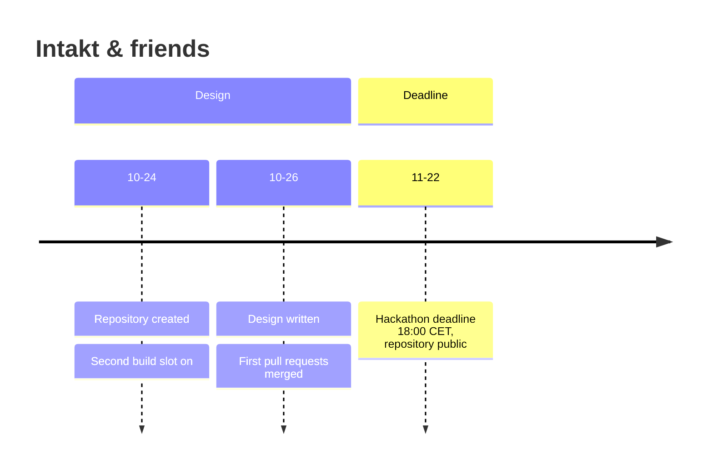

# Journey

Hand-written intro.

<!-- journey:begin glance -->
old glance
<!-- journey:end glance -->

Story between.

<!-- journey:begin merges-per-day -->
```
untouched chart
```
<!-- journey:end merges-per-day -->

Tokens by lane:

<!-- journey:begin tokens-by-lane -->

<!-- journey:end tokens-by-lane -->

<!-- journey:begin tokens-by-account -->
<!-- journey:end tokens-by-account -->

<!-- journey:begin tokens-per-merge -->
<!-- journey:end tokens-per-merge -->

<!-- journey:begin issues-per-day -->
<!-- journey:end issues-per-day -->

<!-- journey:begin open-issues -->
<!-- journey:end open-issues -->



<!-- journey:begin milestones -->
old milestones
<!-- journey:end milestones -->

Lessons at the end.
